# Yomi: Player's Manual

The blight is spreading out of the east. Its corruption creeps over the land a hex at a time, and monsters breed wherever it runs deep. You lead a small company of heroes from your encampment, the last settlement standing, which you name when the game begins (Oakvale, unless you choose otherwise). Nobody knows what drives it. Your job is to hold the land, break the monster nests and beat back the encroachment, and, as you push further out, to find where the blight comes from and end it.

Yomi is a turn-based tactics game. You walk a world map of hexes from place to place, and battles are fought on a small hex board with action points, flanking, facing and zones of control.

---

## 1. Starting a game

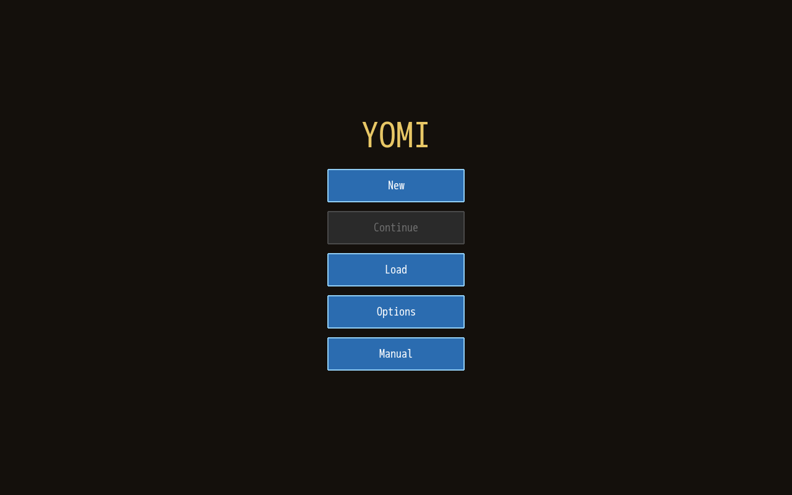

The main menu offers:

- **New**: start a new game.
- **Continue**: return to the game paused under the menu or, if none is paused, load the game saved most recently.
- **Load**: choose one of the three save slots.
- **Options**: set the volume of the master channel, sound effects, music and voice. Opened during a game, it also turns that game's tutorial on or off.
- **Manual**: read this manual. **Back to game** at its top, or **Esc**, returns to the menu, and the game paused under it is just as you left it.

Press **Esc** on the world map or in battle to open this menu over the game. Press it again to return.

### Choosing your party

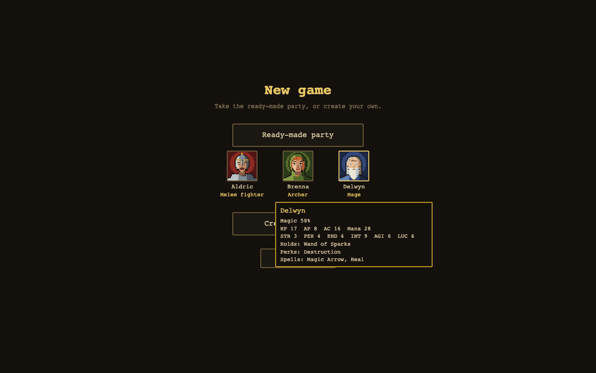

A new game first asks how you want to start:

- **Ready-made party**: three heroes built to work together. **Aldric** is a melee fighter with a longsword and shield, **Brenna** is an archer, and **Delwyn** is a mage who casts Magic Arrow and Heal. Hover over a portrait to see what that hero can do.
- **Create your own**: start with empty places and fill them yourself.

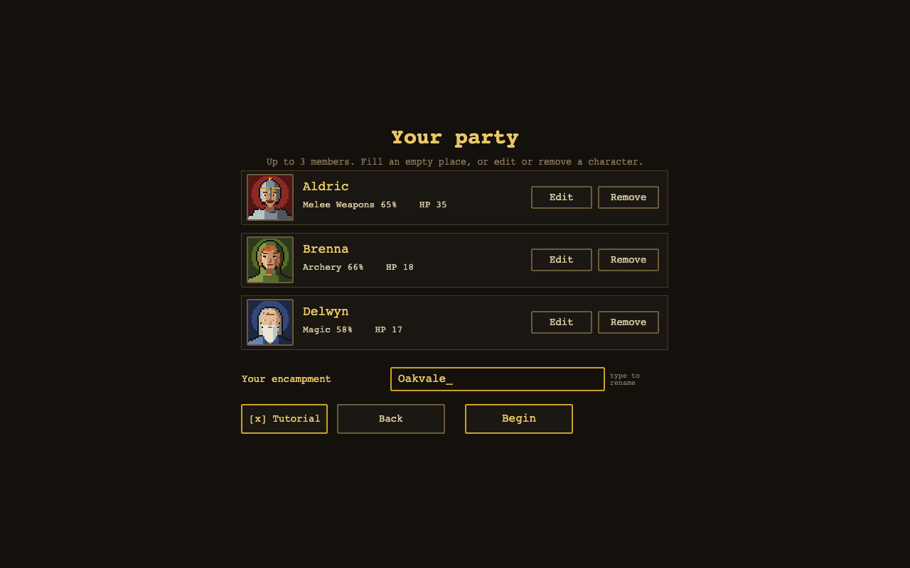

Either choice takes you to the roster, which has one row for each place in the party. You start with three places. Members can be **edited** or **removed**. An empty place can be filled in two ways: **Create character** opens character creation, and **Choose pre-rolled** offers a ready-built hero.

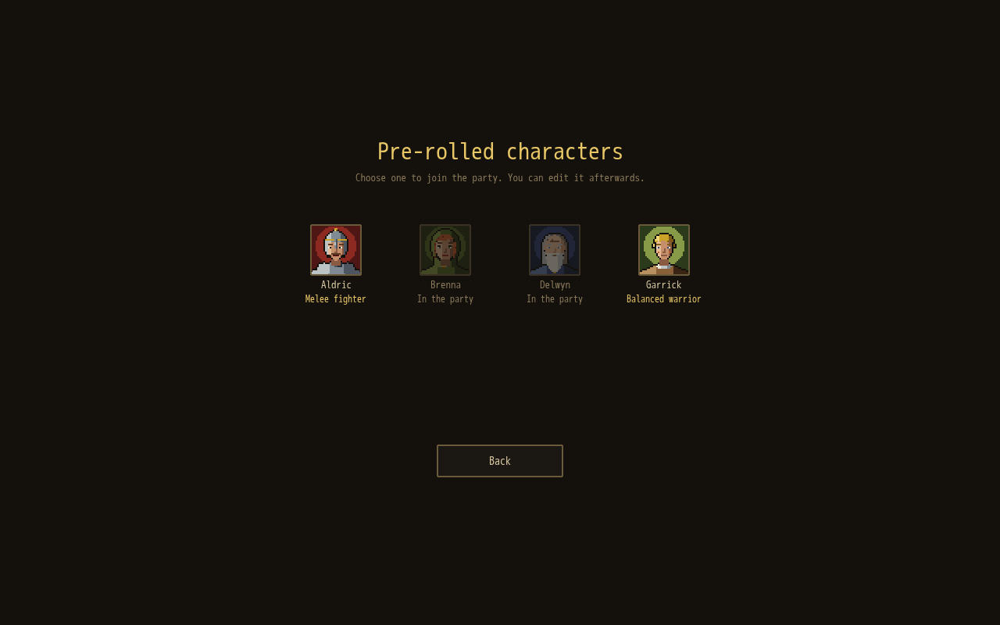

A pre-rolled hero who is already in the party is greyed out, because every name in the party must be unique. Under the rows is the name of your encampment: type to change it (Backspace removes letters). The **Tutorial** box, ticked to begin with, shows tips as you meet each part of the game: each tip shows once, **Got it** (or Enter) moves on, and **Turn tutorial off** stops them; the menu's Options turn them back on, going on from where they stopped. When the party is ready, press **Begin**.

Now and then the story is told in a scene over the game. Click, or press Space or Enter, to read on, and Esc to skip the rest of it. The game takes the first empty save slot, or asks which slot to overwrite if all three are full.

---

## 2. Creating a character

Creation has four steps. You can move through them with **Next** and **Back**, or jump to any step with the tabs along the top. The column on the right always shows what the character will be: hit points, action points, armour class, critical chance, mana, and each skill.

### Attributes

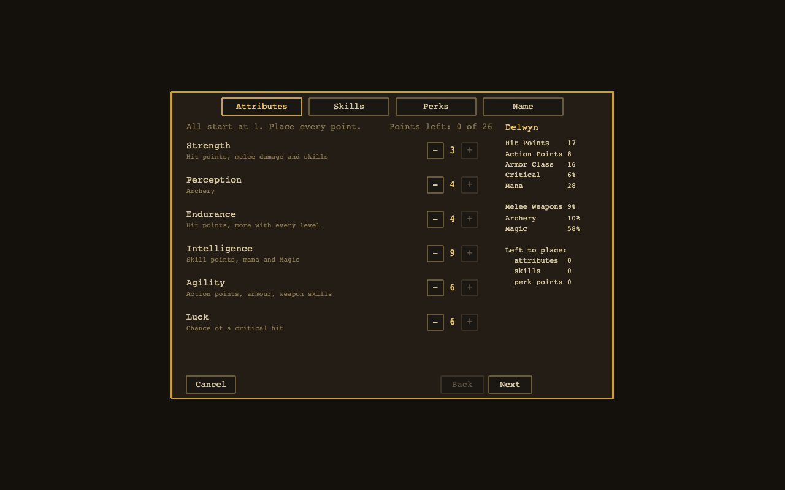

Every attribute starts at 1, and you have **26 points** to place. You must place all of them, and no attribute can go above 10. Hold **+** or **−** to repeat.

| Attribute | What it gives |
| --- | --- |
| Strength | Hit points, melee damage, Melee Weapons skill |
| Perception | Archery skill |
| Endurance | Hit points, and more hit points with every level |
| Intelligence | Skill points each level, mana, Magic skill |
| Agility | Action points, armour class, the weapon skills |
| Luck | Chance of a critical hit |

The budget is tight. Raising one attribute to 10 leaves room for two at about 7 and the rest low. Nodes of the skill trees can raise attributes later: Toughness, open at level 1, adds 1 to Endurance, and Gain Strength, from level 2, adds 2 to Strength.

### Skills

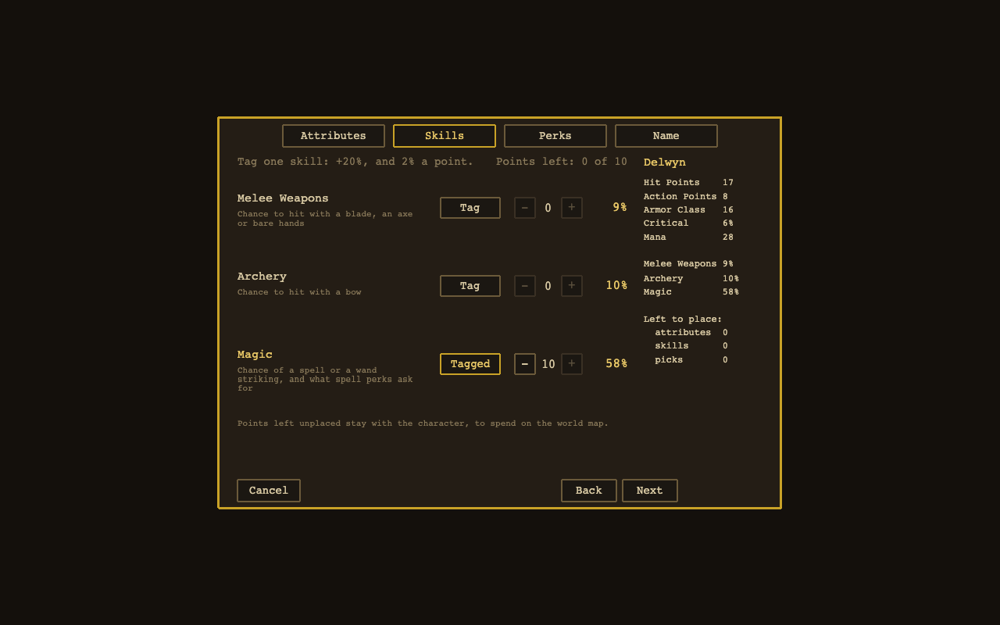

There are three skills, each a percentage:

- **Melee Weapons**: your chance to hit with a blade, an axe or bare hands.
- **Archery**: your chance to hit with a bow.
- **Magic**: your chance of landing a spell or a wand shot. Spell nodes also require a minimum Magic.

Skills start low and are set by attributes alone. **Tag** one skill: tagging adds 20% to it and makes each skill point raise it by 2% instead of 1%. You then have **10 skill points** to place. From 80% a raise costs 2 points, and from 90% it costs 3. Skill points raise no skill past **100%**.

An untrained skill sits near 10%, and against an armoured foe that becomes the minimum 5% chance to hit. A hero who specialises (tags a skill, puts all 10 points into it and takes its skill perk) starts at around 60%.

### Perk points, perks and spells

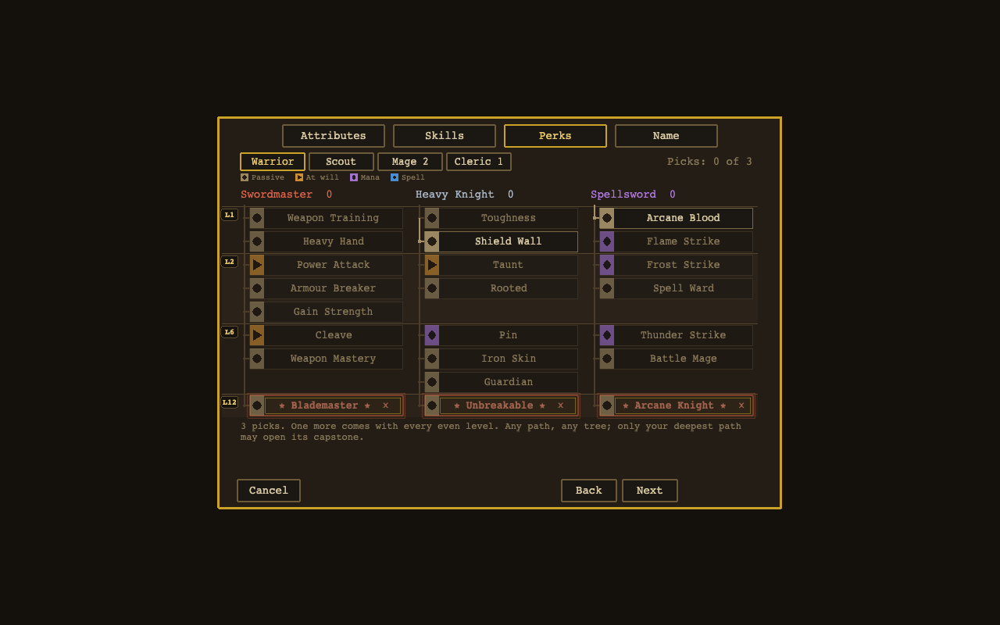

The screen's rule line reads "3 perk points. One more comes with every level. A node costs 1 to 4 by its tier. Any path, any tree; only your deepest path may open its capstone." You have **3 perk points**, and one more comes with every level. A node costs its tier's points (1, 2, 3, and 4 for a capstone), and points you do not spend are kept. There are no separate spell points and no Spellcasting perk. There are four skill trees, **Warrior**, **Scout**, **Mage** and **Cleric**, each with a tab at the top left (or press 1 to 4), and each tree has three paths, one to a column. Any hero may take nodes from any path of any tree. A spell is a node like any other, bought with perk points like any other node.

At creation only the first tier (marked **L1** in the left margin) can be taken: click an open node to take it and click it again to give it back. The tiers below ask a higher level (L2, L6, L12) and nodes already held in the same path; the number beside each path's name is how many of its nodes the hero holds, in gold for the deepest. The bottom of the tree is a **capstone** (★, haloed in a double gold frame): only the hero's deepest path may open its capstone, and a hero may hold only one. A line runs down each path's left side through its nodes, top to bottom, and a bracket on a node's right side, ending in an arrowhead, means the node at the bracket's other end, which may be several rows up, must be taken first. Lines are gold into nodes taken, pale into nodes you can take now and dark into nodes still closed; a stretch of a path's left-hand line is gold only when the nodes at both its ends are taken.

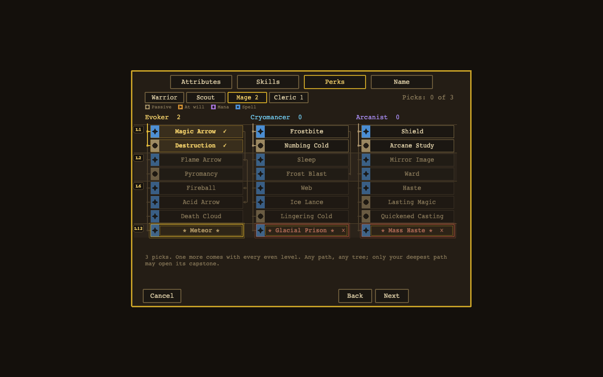

The coloured tab on a node's left edge says what it is, as the legend under the tree tabs shows: a dim gold disc for a passive, an amber blade for an ability used at will, a violet diamond for an ability that costs mana, and a blue star for a spell. Point at a node to read, under the tree, what it does (with a spell's mana and action points), what it asks, and why it is closed.

If a change you make (an attribute lowered, a skill point taken back) leaves a perk you already took without its requirements, that perk is dropped and its perk points returned, and the screen says so.

### Name and face

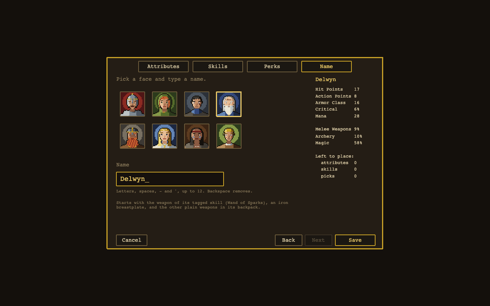

Pick a portrait and type a name of up to 12 letters. Gear is not chosen: every hero starts holding the weapon of their tagged skill (a melee hero also holds an oak shield), wears an Iron Breastplate, and carries the other plain weapons in their backpack, and the oak shield too, unless they hold it.

Any skill points or perk points you leave unspent stay with the character, and you can spend them later on the world map.

---

## 3. The world map

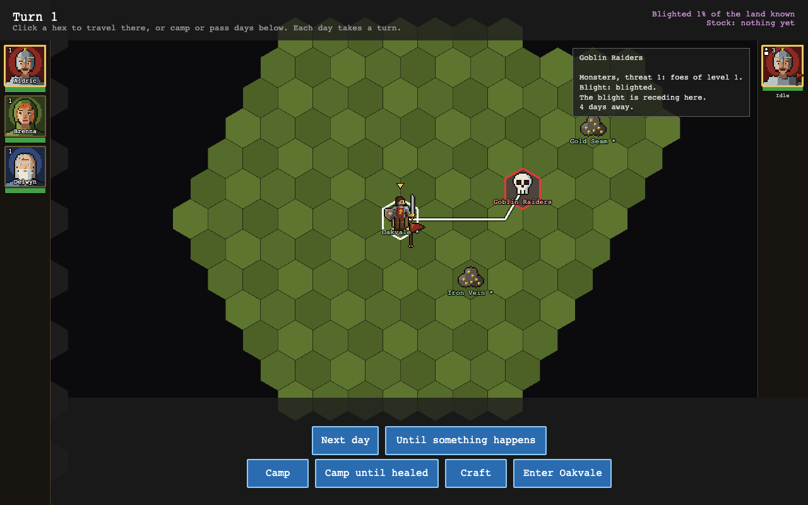

The world map is a large board of hexes, many screens wide (140 columns by 72 rows, running on past the Troll Lairs to the Source at its far east, the land more dangerous with every ring out from home, up to threat 18, and the Source itself at 20), and the view scrolls to follow your party. Your heroes' portraits run down the left side. Your party is listed down the right side of the map, with its leader's face, its banner and its hit points; click it to bring the view back to it (as the **Home** key does). Once the guild hall has raised a second or third party (see [Parties](#parties)), each is listed there by its name, and the left side shows the heroes of the party you have selected. The header shows the turn number, how much of the explored land is blighted (and, once it has grown, how much stronger the blight has become), and the encampment's **stock** of materials.

**Time passes only when you act.** Each hex you walk and each day you camp takes one turn, and each turn the blight takes another day to spread (see [The blight](#8-the-blight)).

Under each party's entry in the list is a line saying what it is doing: **Idle**, **Travelling to** a place you know of, **Returning home**, **Camping**, **Garrisoning** a site, **Meeting** another party, or the day's work it is at (scouting, waiting, building, crafting). While it stands before monsters, the line names them.

Two buttons in the footer let days pass without a walk or a camp of your own:

- **Next day** passes one day. Every party carries on with its order: a party that is travelling or camping carries on with it; an idle one stays where it is. Idle and garrisoned parties heal each member **1 HP per day**, up to their maximum, while away from monsters. This natural healing does not refill mana or gain infirmary bonuses; camp for those benefits.
- **Until something happens** passes days one after another until something important happens, a party arrives or finishes what it was doing, or thirty quiet days have gone by, in which case the map says so.
- **Return home**, shown while the party is away from the encampment, sends it walking home.
- **Garrison**, shown on a resource you hold, keeps the party there to guard it until you give it another order. No day passes. The blight never rises on a party's hex, and a party pushes it back around it (the more so the higher its heroes' levels), so a garrison holds a threatened site.

A walk cut short, or a stretch of camping interrupted, keeps its order: the line still says where the party was going, or that it is camping, and a walk's remaining road stays drawn on the map in pale blue to where it was going (hovering another hex shows that hex's route in its place until the pointer moves off), and **Next day** carries it on, a hex further along the road or another day of rest. Clicking a hex or a button gives the party a new order. Neither time button shows while the party stands at a monsters' lair, even once it has scouted them: there you scout, wait or attack, or walk away. While any other party stands before monsters it has not answered, no day can pass: the time buttons, a click on the map and **Return home** say so, give no order, and select that party, so that you can scout, wait or attack with it.

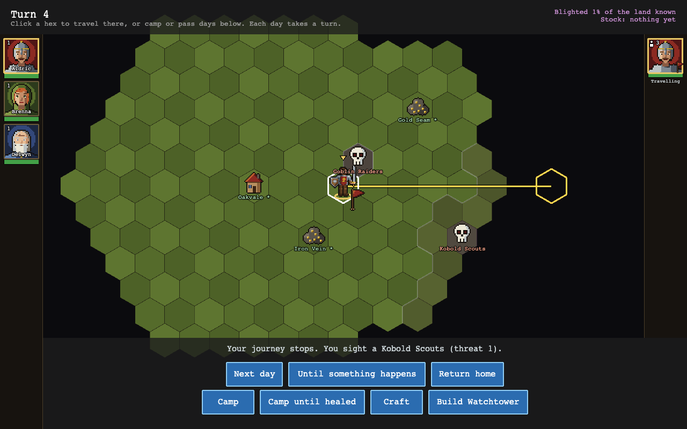

### Travel

Click a hex to travel there. Hovering over a hex first shows the route, and a panel at the top right tells what you know of it: what stands there, its blight (as you last saw it, if it is out of sight), whether the blight is gaining or receding there, how many days away it is, and the heroes' levels and hit points of every party standing on it. The party walks one hex per turn and stops early if something important happens on the way, such as monsters coming into view, a site you hold falling under threat, or monsters standing in the road. Routes avoid known monster lairs unless the lair is where you are going.

The map is larger than the window. It follows the party as it travels, but you can **drag** it with the mouse to look elsewhere; it stops at the map's edges, and a short click still travels. The view stays where you left it until the party next sets out, or you press the **Home** key or click your party's entry to bring it back to the party.

### Parties

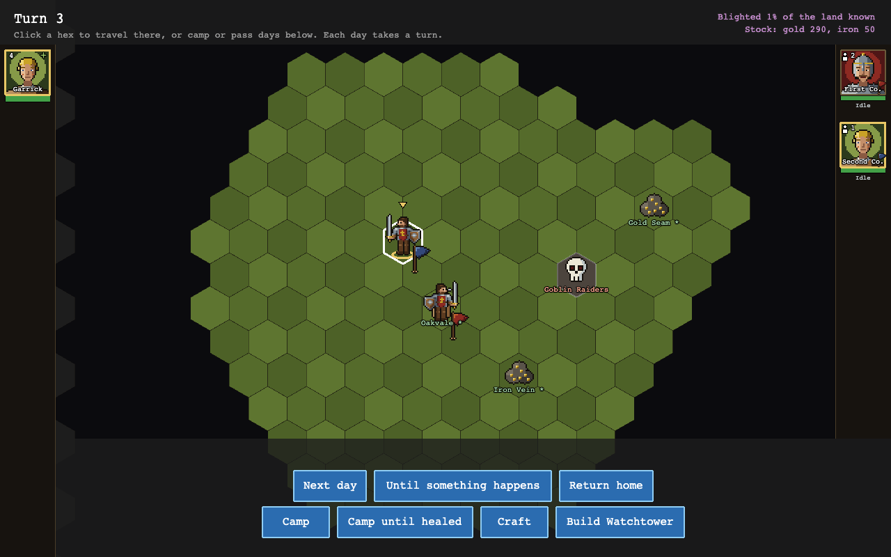

Raise the guild hall to level 4 and it can field a second party, at level 5 a third (see [The guild hall](#the-guild-hall)). Each party has its own banner, crimson, azure or green, drawn beside its leader on the map and on its entry in the list, which also shows its name, and its own baggage; the stock and the rune pouch are the company's.

- **Select** a party by clicking its entry down the right. Its heroes fill the left side, a gold ring marks it on the map, and the footer's buttons act for it. Parties sharing a hex stand side by side.
- **Every party moves at once.** Each carries on with its order whenever days pass, whoever you have selected. Only the selected party's walk is animated; the others step to where they have got to when it ends.
- **Meet** another party by clicking the hex it stands on (the header says "Meet Second Company" as you hover it). The selected party walks to it, following it if it moves, until the two stand together. A party that walks onto monsters another party already faces stands before them too.
- **Interruptions name the party.** When something stops the days, the message leads with the party it concerns ("Second Company: arrived at Kobold Scouts."), and the map selects that party and centres on it. A day the selected party spends scouting, waiting, camping or building is told the same way: what it did, then what another party met with that day. A saved game opens on a party standing before monsters, if one is.
- **One party before monsters holds up the days.** While a party stands before monsters it has not answered, no day passes for anyone: Next day, a click on the map, Return home, Camp, Craft in the field and the buildings are refused, and the map selects that party so you can scout, wait or attack.
- **Exchange** heroes and baggage when two parties stand on one hex (see [Meeting and exchange](#meeting-and-exchange)).
- Two parties never fight the same lair at once. A party cannot be sent to a lair another party already stands at (meet it there instead), and of two parties reaching a lair on the same day the first in the list takes it, the other waiting a hex short.

### Meeting and exchange

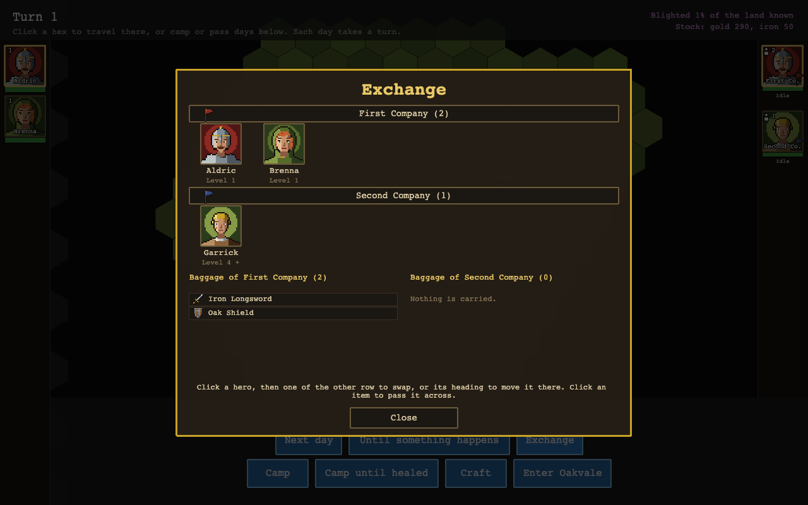

When another party stands on the selected party's hex, an **Exchange** button appears in the footer, and in the character panel's Inventory tab beside the baggage. It opens a screen with the two parties as two rows of faces and their two baggages below.

- **Click a hero**, then a hero of the other row to swap the two, or the other row's heading to move the hero across.
- **Click an item** in a baggage to pass it to the other party.
- With three parties on the hex, **Other party** changes which one the second row trades with.
- A party keeps at least one hero and at most the hall's party limit; a refusal is told at the bottom. Heroes keep what they wear and carry. Neither party may be standing before monsters the other does not face. **Close** (or Esc) goes back to the map. Reserves are not reached here; the guild hall moves them.

### Fog of war

Black hexes have never been seen. The party sees 5 hexes around it, the encampment 6, a resource you hold 2, and a watchtower 8. Land you have seen but cannot see now is drawn under a veil, showing the state it was in when you last saw it. Once you have spotted a monster lair it stays on your map. Whatever lies at the heart of the blight is as hidden as the rest, until you explore far enough to find it.

### Places

- **Your encampment**, the only settlement left, where the guild hall, the trading post and the rest of your facilities stand.
- **Resources** (Iron Vein, Gold Seam, Timber Stand and others; in the far rings the Ironwood Grove, the Mithril Lode, the Elder Grove, the Adamant Deep, the Wyrmwood Thicket, the Fallen Star and the Heartwood, each yielding a rare material that the trading post buys until the workshop learns to use it). A held site's name is starred and drawn in green. A site under threat is drawn in orange, along with the number of days left until it falls.
- **Monster lairs**, marked with a skull, each with a **threat**. The further a lair is from the encampment, the higher its threat, in rings around home:

  | Distance from the encampment | Threat |
  | --- | --- |
  | up to 10 hexes | 1 |
  | 11 to 21 | 2 |
  | 22 to 32 | 3 |
  | 33 to 43 | 4 |
  | 44 to 54 | 5 |
  | 55 to 67 | 7 |
  | 68 to 80 | 9 |
  | 81 to 94 | 12 |
  | 95 to 108 | 15 |
  | 109 to 122 | 18 |

  Past the Troll Lairs the land runs on: bandit camps, spider nests and salamander pools stand at threat 7, bandit companies at 9 and 12, and freebooter hosts at 15 and 18. The Source itself, 122 hexes out in the far east, is threat 20.
- **Trade partners** (Millbrook and Saltmere near home; far out, Stonehollow, a mountain hold that trades mithril, Elder Glade, a forest people's glade that trades elderwood, and Emberwatch, a fortified pass that trades adamant), neutral settlements with their own icons and names in gold. A partner is never held and never lost: walk a party onto its hex and it will trade with your encampment ("Millbrook will trade with Oakvale"). While its own land is blighted (level 2) or worse the partner falls silent, and its icon and name turn grey (once you have contacted it, or while a party can see it); it trades again once that land is clean. Hover a partner to see its good, whether it is contacted, and whether a route runs to it.

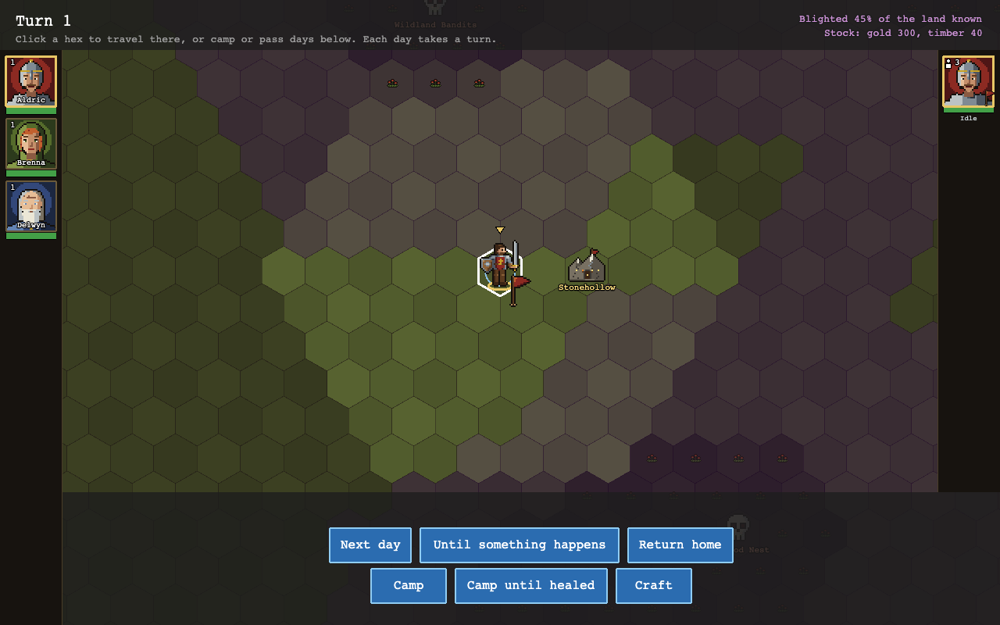

### Trade roads

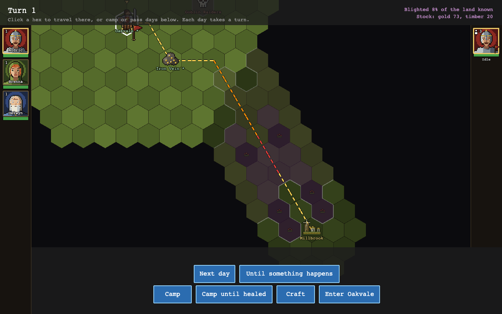

Once a trade route is open (see the trading post), the map draws its road from the encampment to the partner as a dashed line, through the fog, since the road is your own. Each stretch is **gold** where the land is clean, or tainted or blighted but guarded (a watchtower or one of your parties within 3 hexes; corrupted land cannot be guarded), **amber** where it is tainted, and **red** where it is blighted and unguarded. The whole road is red while it is raided: by raiders (a monster lair within 2 hexes of the road), by corrupted land on the road, or by a silent partner. An open route pays gold every 5 days, more for a longer road and less the lower its security, and every 10 days one of its partner's good (timber from Millbrook, salt from Saltmere, mithril from Stonehollow, elderwood from Elder Glade, adamant from Emberwatch) while its security is at least half. A raided road earns nothing, and one raided for 30 days in a row is abandoned, freeing its place at the trading post; the 30 days count afresh each time the road is told safe again. Clear the raiders, or the blight off the road, and it pays again from the next yield day. The day a road is raided the message line says so, and a journey stops there; the day it is safe again it says that too, and it tells when a road is abandoned. Hover any hex of the road for its security and what it brings every 5 days as things stand now (counting your watchtowers and your parties as guards), or that it pays nothing while raided, and the cause of a raid (a lair you have not sighted is just "raiders"); and the stock panel's last yield line counts what the routes brought ("routes 3 gold, 1 timber").

### Monsters

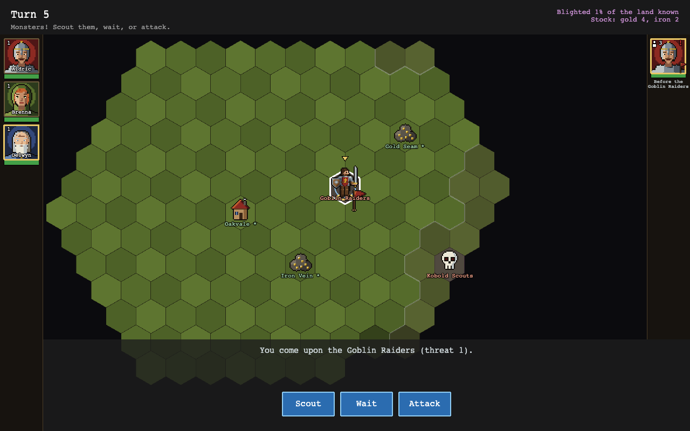

When you walk onto a monster lair, the footer offers four actions:

- **Attack** starts a battle.
- **Auto-resolve** fights the battle for you at once, your heroes played by the same rules as the monsters. The result is final, and heroes who fall are dead, as in any battle. The button carries the AI's chance of winning, as in "Auto-resolve (win 90%)"; see [Auto-resolve](#auto-resolve) in the Battle chapter.
- **Scout** and **Wait** each pass a turn without fighting. Neither does more yet.

You can also click a hex to walk away.

**Bandits.** Not every lair holds monsters. Bandits hold the **Bandit Camp** (threat 3) and the **Bandit Hideout** (threat 4), and new **Bandit Gangs** appear where the blight breeds lairs of threat 3 or more. Bandits are people, built the way your heroes are, and always led by a Captain with sword, shield and breastplate. At threat 3 a Brute with a battle axe and breastplate fights beside him; at threat 4 a Hedge-Mage takes the Brute's place, casting Magic Arrow, Flame Arrow and Shield (it never heals); at threat 5 a Bandit Archer takes the Hedge-Mage's place, standing back with a bow and shooting. They have a hero's hit points, the Captain and the Brute a hero's armour, and they carry Fine gear at threats 3 and 5 and plain gear at threat 4. Further out still, beyond threat 5, four bandits take the field together, a **Crossbowman** among them whose bolts punch through armour, all in Fine steel and ironwood from threat 6 and Masterwork steel and ironwood from threat 8: steel for the blades, the axe and the breastplates, ironwood for the shield, the bow, the crossbow and the wand. The far rings add the **Bandit Company** (threats 8 to 13) and the **Freebooter Host** (threats 14 to 20, led by a Freebooter Captain), four or five bandits strong. Expect a hard fight against a party of your level: bring a heavy weapon, or spells, for the armoured ones, and close in on the Archer and the Hedge-Mage, who wear none.

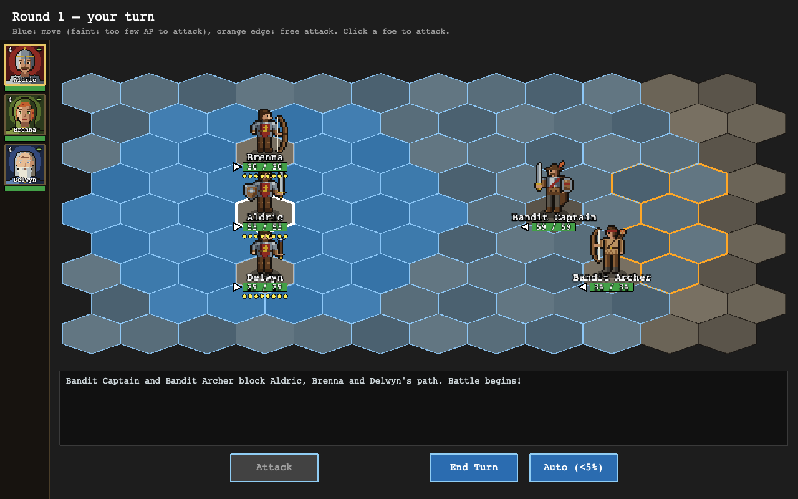

**Spiders and salamanders.** Far to the east, two lairs hold monsters that fight in new ways:

- The **Spider Nest** holds **Giant Spiders** with a Kobold Sneak. A spider spins a **web** at a hero up to 4 hexes off, which can catch everyone within a hex of where it lands (it rolls to hit each of them): a webbed hero has 4 fewer AP for 2 turns. Up close it bites twice in one action, and the second bite poisons. Spiders are quick to kill but hit hard; deal with them before they reach your archer and mage.
- The **Salamander Pool** holds a **Salamander** between two Kobolds. Every other turn the Salamander spits a **cone of fire** 2 hexes long that burns everyone in it, its own kobolds too if they stand in the way. Even when the spit misses a unit, the unit still takes half the damage. Fire does nothing to a Salamander: Flame Arrow and Fireball deal it 0 (the log says "warded"). Use blades, arrows and Magic Arrow on it, and don't stand bunched up in front of it.

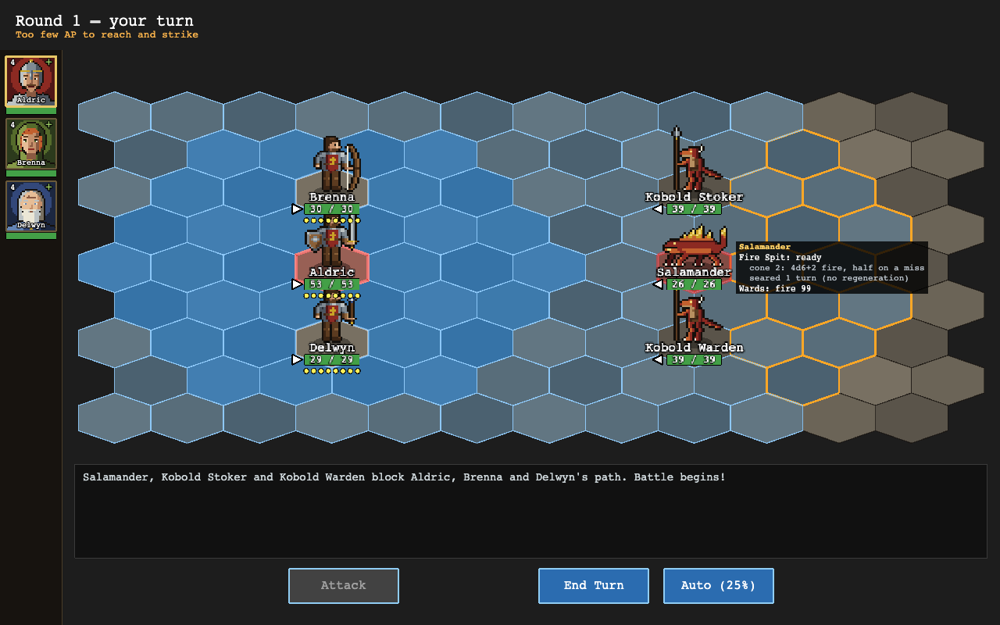

### Camping and other actions

When there are no monsters on your hex, the footer offers:

- **Camp**: rest for a day. Each day of camping heals every hero 1 hit point (more with an infirmary, see [The infirmary](#the-infirmary)) and refills every caster's mana.
- **Camp until healed**: your healers cast their heals with the mana they have, then the party camps a day and casts again, repeating until everyone is whole. Anything important that happens breaks camp.
- **Craft**: rework a piece of gear in the field, a day's work (see [Crafting](#crafting)).
- **Build Watchtower** or **Improve**, where the land allows (see [Building](#9-building)).
- **Return home** and **Garrison** sit in the row above, with the time buttons.
- **Enter** the encampment, when the party stands on it (see [The encampment](#the-encampment)).

---

## 4. The character panel

Press **C**, or click the portrait of the hero marked in gold, to open the character panel. It has four tabs. On the world map you can spend everything in it freely. In battle you can see everything, but you can only change gear, and each change costs an action point.

| Key | Tab |
| --- | --- |
| C | Character |
| S | Skills |
| B | Abilities |
| I | Inventory |
| P | Skill trees (press again to go back to Skills) |
| 1 to 4 | In the skill trees: Warrior, Scout, Mage, Cleric |
| Esc | Close, or step back from the skill trees |

To switch the panel to another hero, click their portrait on the left.

### Character

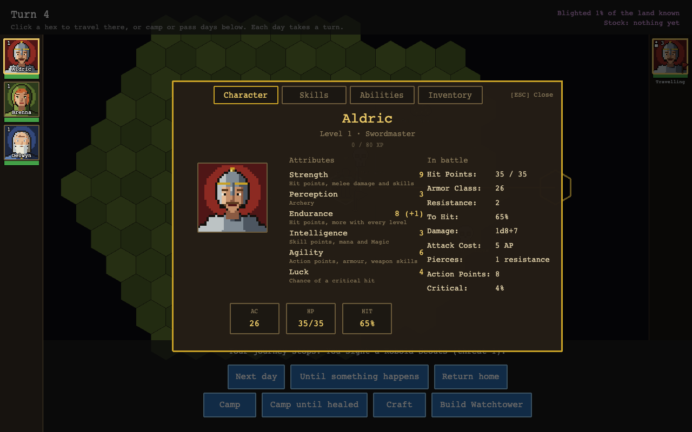

This tab shows the hero's attributes, their title (their level and their deepest path, with the second-deepest after a slash once it holds three nodes, as in "Level 9 · Heavy Knight / Paladin"), their experience, and what they fight with: hit points, armour class, resistance, chance to hit, damage, attack cost, how much resistance their blows pierce (if any), action points, critical chance and, for a caster, mana. A hero with runes that ward against an element shows a **Wards** line, for example "Wards: fire 2, frost 4", and one whose weapon has runes that add to a hit an **On a hit** line, for example "On a hit: +3 fire, lays Seared" (see "Runes" in chapter 9).

### Skills and perks

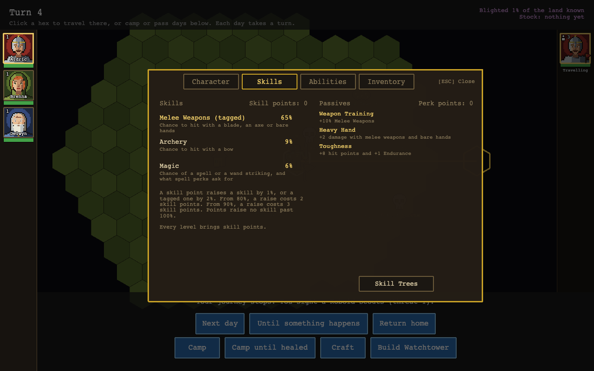

When the hero has skill points to spend, the tab says so in green over the skills ("5 skill points to spend") and a **+** appears beside each skill; the **+** greys out for a skill at 100%, which points raise no further (a node's bonus may still carry it past); point at a grey **+** to see why it is grey. The tab lists the passives the hero has taken, spells aside, and the perk points the hero has ("Perk points: 4"). Press **Skill Trees** (or P) to choose new ones: the view opens on the tree of the hero's deepest path, and its tabs (or 1 to 4) show the others.

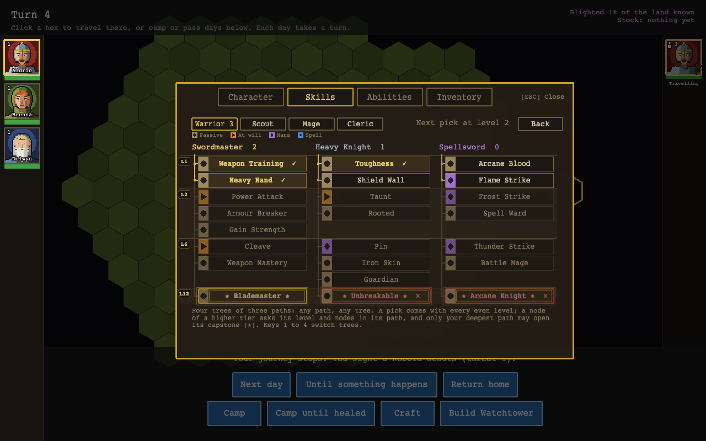

Nodes you can take now are framed in gold, and a click takes one for its cost in perk points. The digit on a node is that cost: gold when you can take it now, dim otherwise (a ✓ marks a taken node, drawn in gold, and a ✕ a locked capstone). The header's "Perk points: N" is what the hero has to spend. Point at an open node you cannot yet afford and the strip says when saving pays for it: "Needs 3 perk points; you have 1 — affordable at level 8". With the pointer on no node, a gold line under the rules names the next thing saving buys: the cheapest open node you cannot yet afford ("Saving: Pin (3 perk points) is yours at level 11"), or else your calling's capstone, as a goal with what it still asks while it waits on more than levels ("Goal: Blademaster, your calling's capstone: 4 perk points, 5 nodes in Swordmaster, level 12"). A dim node is closed: point at it to see what it still asks, a level, an attribute, a skill or nodes in its path. A capstone closed by another path being deeper, or by a capstone already held, is drawn in rust with a ✕. In battle the trees can be read but not changed.

### Abilities

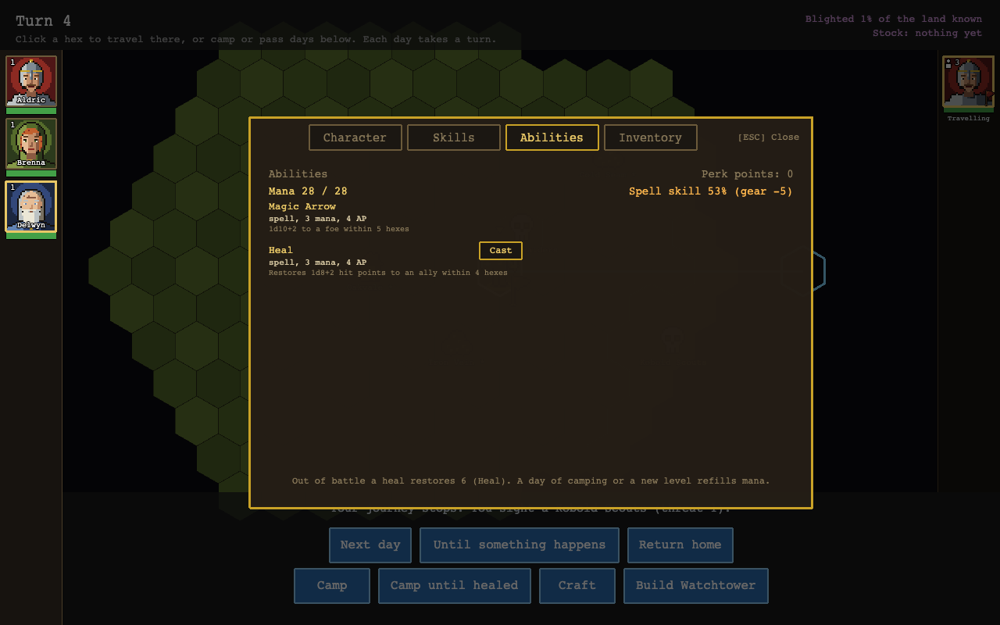

This tab lists the actives the hero knows, each with its kind, action points and mana, the mana they are carrying and their **spell skill**, the chance a spell strikes before the foe's armour, with what their gear adds or takes shown beside it. On the world map, the **Cast** button beside a heal casts it out of battle. A heal on one hero asks you to click that hero's portrait. A heal cast on the world map always restores the average of its dice.

### Inventory

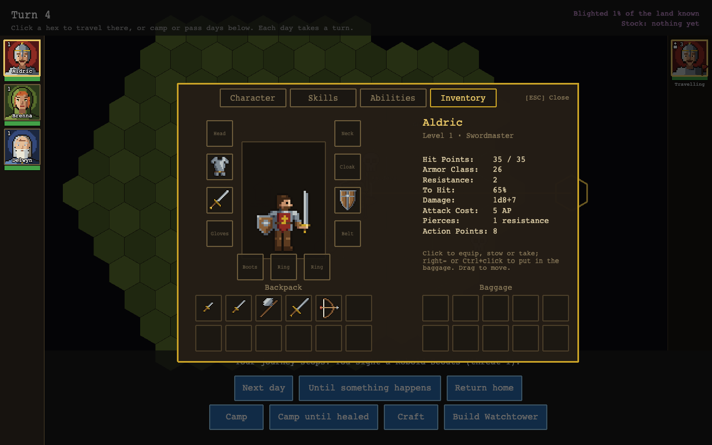

The paper doll shows what the hero wears: head, neck, body, cloak, both hands, gloves, belt, boots and two rings. Below it is the backpack. Heroes are drawn in the armour, headgear and cloak they wear, here, on the world map and in battle.

- **Click** a backpack item to equip it, or click a worn item to stow it.
- **Drag** an item to move it: from the backpack onto a slot to wear it, from a slot back to the backpack to stow it, from a slot onto the baggage (or the ground in battle) to put it there, from the baggage (or the ground) onto a slot to take it and wear it, and between the backpack and the baggage (or the ground). Drop it somewhere that does not fit and it returns to where it came from. **Esc** cancels a drag.
- On the world map, the right-hand grid is the party's shared **baggage**, which has no size limit. Click an item there to take it. **Right-click** (or Ctrl+click) an item to put it in the baggage. This is how you pass items between heroes.
- In battle, the right-hand grid is the **ground** under the hero. Right-click to drop an item, and click to pick one up.
- A two-handed weapon (the bows, the crossbow, the greatsword, the halberd, the staff) and an off-hand item cannot be held together. Equipping one stows the other.
- A clicked ring goes in whichever ring slot is free; a dragged one goes in the ring slot you drop it on.
- **Hover** an item to see its stats. An item with **sockets** shows small pips along the bottom of its icon, one a socket, filled in the rune's colour where a rune sits; its tooltip ends with the sockets filled and the runes in them, such as "Sockets: 1 of 2 (Ember I)", while what the runes do is in the stat lines above it, such as "On a hit: +1 fire".

---

## 5. Battle

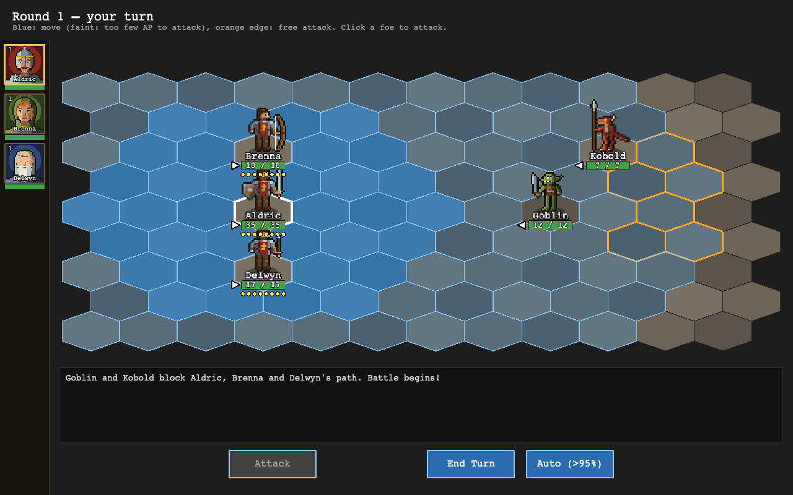

A battle starts with your party on the left and the foes on the right. Each side takes its turn in full. On your turn, your heroes act in any order and as often as their action points (AP) allow. Press **End Turn** when you are done.

The log at the bottom records every roll. The header tells you whose turn it is.

### Selecting and moving

Click a hero, or their portrait, to select them. The selected hero is marked in gold. The board then shows where they can go:

- **Blue** hexes are in reach. A **fainter** blue hex is in reach but would leave the hero too few AP to attack.
- An **orange edge** marks hexes inside a foe's zone of control (see below).

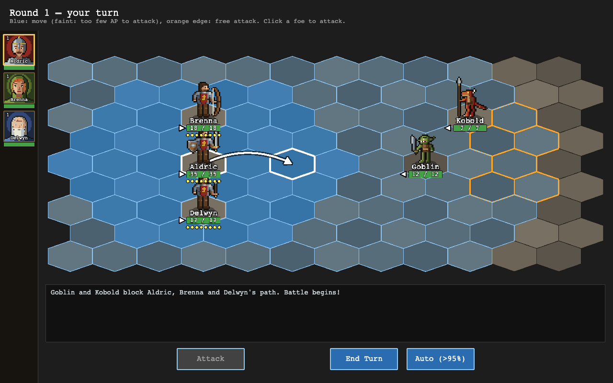

Hover over a hex to see the path, then click to move there. Each hex costs **1 AP**. A hero usually has **8 AP** a turn (5 plus half their Agility). Facing is automatic: a unit turns as it moves, attacks and casts.

### Auto-resolve

The fourth button on the battle screen, after Attack, Skills and End Turn, is **Auto**. It is enabled whenever End Turn is, and it has no key. Press it and the battle is finished at once, from wherever it stands, even in the middle of your turn: your heroes are played by the same rules as the monsters, the board shows the battle's end and the log lists every action. The result screen is the one a played battle gives, with "Auto-resolved in N rounds." after its first line. You can also auto-resolve from the world map, with the **Auto-resolve** button beside Attack, before the battle starts.

If the battle has not ended 50 rounds after you press, the log says "The battle drags on. It is yours to finish." and the battle is yours again.

**The estimate.** The figure on the button, as in "Auto (90%)", is the chance the AI wins the battle for you, worked out from 40 trial battles played in the background with the AI on your side; "(…)" means it is still working. Figures are rounded to the nearest 5% and never claim certainty: on the button the ends read ">95%" and "<5%", and in the hover text "over 95%" and "under 5%". Hover the button to read more (on the world map in a small panel above it, in battle in the hint line under the turn): the chance a hero dies, and how many trials dragged on past 50 rounds, if any. It is the AI's odds, not a promise, and a careful player usually does better. In battle the estimate is worked out again after each of your actions; on the world map, whenever something changes (a heal, new gear, another party, a day passing).

### Attacking

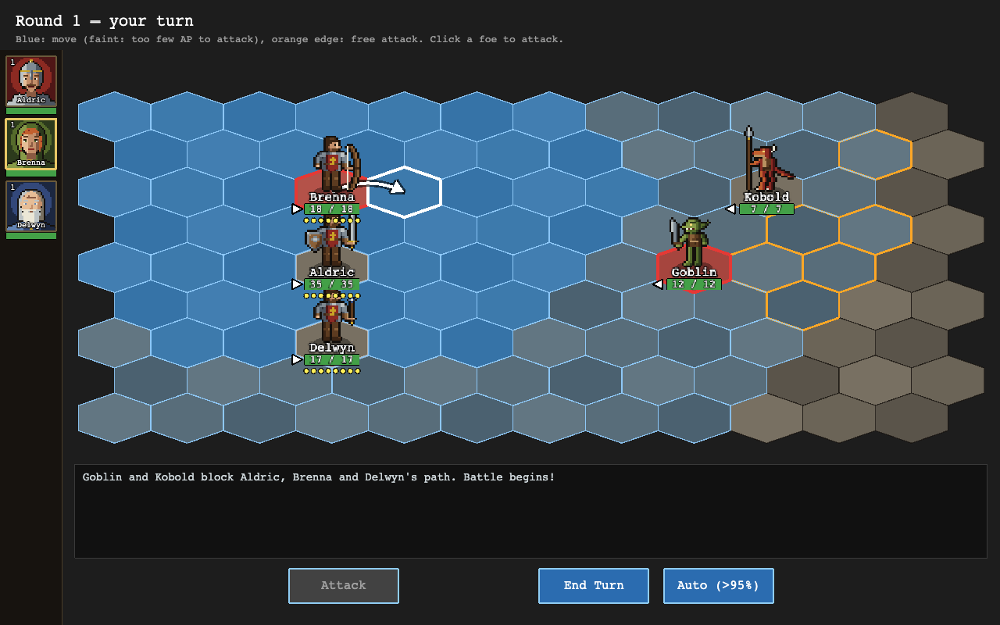

**Click a foe** to attack it. If it is out of reach, the hero first walks into range along the path shown, then strikes. If the walk would leave too few action points for the attack, the crossed swords are faded, the line under the round says "Too few AP to reach and strike" and a click does nothing: walk closer by clicking a hex. The **Attack** button strikes the only foe in reach, or, with several in reach, asks you to click one (it reads **Cancel** while it waits). The weapon decides both the cost and the reach:

| Weapon | Damage | AP | Reach | Pierces resistance | Strength |
| --- | --- | --- | --- | --- | --- |
| Iron Dagger | 1d4 | 3 | 1 | — | — |
| Iron Shortsword | 1d3+1 | 4 | 1 | — | — |
| Iron Rapier (critical +5%) | 1d6 | 4 | 1 | — | — |
| Iron Longsword | 1d8+3 | 5 | 1 | 1 | — |
| Iron Mace | 1d6+3 | 5 | 1 | 2 | 5 |
| Iron Spear | 1d8+1 | 5 | 2 | 1 | — |
| Iron Battle Axe | 1d12+2 | 6 | 1 | 2 | 5 |
| Iron War Hammer (to hit −5%) | 1d10+3 | 6 | 1 | 3 | 6 |
| Iron Greatsword (two hands) | 2d6+3 | 7 | 1 | 2 | 6 |
| Iron Halberd (two hands) | 1d12+3 | 7 | 2 | 2 | 6 |
| Yew Bow (two hands) | 1d6 | 4 | 5 | — | — |
| Yew Longbow (two hands) | 1d8 | 5 | 7 | — | 5 |
| Yew Crossbow (two hands) | 1d10 | 6 | 5 | 2 | — |
| Wand of Sparks (Magic) | 1d6 | 5 | 4 | — | — |
| Ash Staff (two hands, Magic; spells +5%, mana +4) | 1d6+1 | 5 | 1 | — | — |

These are the iron (and yew, and ash) weapons. Their **steel** and **ironwood** versions do 2 more damage and are otherwise the same. A hero weaker than a weapon's **Strength** loses 5% to hit with it for every point short (see "Gear families" in chapter 9).

The **spear** and the **halberd** strike from the second hex, past an ally standing in front, and count as melee weapons in every way: they use Melee Weapons, add strength's damage and pierce armour. Their zone of control is still only the hexes next to the wielder. The **crossbow** is the only shot that pierces armour.

A weapon costing 4 AP or less lets a hero who stands still attack twice in one turn.

A weapon with runes in it may do more on a hit (see "Runes" in chapter 9). An Ember rune adds fire damage: the hit reads "HITS Troll for 8 dmg +1 fire" in the log, and "+1 fire" rises from the foe. This extra damage is a fixed amount, not rolled: armour's resistance does not reduce it, a critical does not double it, and only a ward against its element does ("+1 fire (warded 1)"). A higher-ranked rune may also lay a lasting effect on the foe, such as Seared, which stops a troll regenerating for its next turn. A Life rune in a weapon heals the wielder a little on every hit.

### How a hit is rolled

Every attack rolls 1 to 100. It **hits** if the roll is at or under:

> skill + bonuses − the foe's armour class

The chance is always kept between 5% and 95%. A hit is **critical** if the roll also falls within the attacker's critical chance. The bonuses are:

- **Flanking**: +10% for each other ally standing next to the target.
- **Arc**: +5% from the foe's side and +10% from its rear. For a ranged attack, the arc is judged by the hex next to the target that the shot comes in over. But a unit struck in its side or rear by a melee weapon turns to face the attacker first, hit or miss, so the blow lands on its front. Bow and wand shots give no time to turn: they always strike the arc they come in over. It can turn like this only once per enemy turn: strike it from one side, then from the other, and the second attack finds its back. Your heroes turn the same way on the enemy's turn. A unit breaking away from a free attack cannot turn.
- **Helpless**: +20% against a sleeping target.

### Armour: dodging and resistance

Defence works in two ways. **Armour class** (from agility, shields and some magic) makes a hero or monster harder to hit. **Resistance** (from body armour, or a monster's own hide or bone plates) takes that many points off the damage of every weapon hit. A hit always does at least 1.

Because resistance comes off every hit, it hurts weapons that hit often for a little, such as the dagger, the shortsword and the bow, much more than weapons that hit hard. Those quick weapons are best against lightly armoured foes. Against heavily armoured ones, reach for a heavy weapon.

**Armour piercing**: melee blows ignore some points of the foe's resistance (see the table above, and the Bearded modifier and the Armour Breaker and Weapon Mastery nodes). Bow and wand shots pierce nothing and a crossbow bolt its own 2 points, never the melee nodes' piercing; a Deadeye's shots pierce 3 points more. Spells ignore resistance altogether, which makes a mage the other answer to armour.

When a hero is selected, every foe they can attack from where they stand shows on its nameplate your chance to hit, any bonus from flanking and the arc, and, after piercing, how much damage its armour will stop: "60% −3 dmg", or "70% +10 −3 dmg" from its flank.

**Regeneration**: trolls heal some hit points at the start of each of their turns. Acid (Acid Arrow, which also eats 2 points of resistance while it lasts) and fire (Fireball and Flame Arrow, for the turn after) stop it.

### Monsters' special attacks

Some monsters can do more than swing a weapon:

- **Routines**: several strikes as one action, such as a Troll's two claws or a Giant Spider's two bites. Each strike rolls on its own. If the target falls before the last strike, the rest go to the nearest other foe in reach.
- **Area attacks**: a burst, a cone or a line. An area attack rolls against everyone in it, friend or foe. Armour's resistance does not reduce its damage, and some area attacks (such as the Salamander's fire) still deal half damage on a miss.
- **Recharge**: special attacks cost no mana, but some of them, once used, have to wait some turns before they can be used again.

**Hover over a monster** to see what it can do: a small panel beside it, headed with its name, lists each special attack as "ready", "ready next turn" or "ready in 2 turns" (counting the monster's own turns), with what it does underneath (for example "cone 2: 4d6+2 fire, half on a miss" and "seared 1 turn (no regeneration)"), and any wards it has ("Wards: fire 99").

### Skills: spells and techniques

A hero who knows a spell or a **technique** has a **Skills** button (or M). It shows the mana the hero has left, if they have any magic, and reads **Cancel** while you aim. It opens one list of everything the hero can use besides a plain attack: their spells first, then their techniques, each with its mana cost and its AP. Pick one by clicking it or pressing its number.

```
1. Taunt  3 AP  (ready in 1)
2. Pin  3 mana  6 AP
3. Power Attack  7 AP
```

Techniques are nodes of the skill trees (chapter 7), most of them in the Warrior and Scout trees. Most are a blow or a shot of the hero's own weapon with something added: Power Attack strikes at −10 to hit for +6 damage, Pin pins the foe in place on a hit, Flame Strike adds fire. Their AP is the weapon's attack cost plus the technique's own (Pin is "weapon + 1": 6 AP with a longsword, 4 with a dagger), so the list always shows the cost for the weapon the hero holds now. Some cost mana as well; some, once used, have to wait a turn or more, and the list says "(ready in 1)".

A row you cannot use right now is greyed out. Hover over it to see why: "Needs a melee weapon" (a technique for a melee weapon while the hero holds a bow) or "Needs a ranged weapon", "Once a battle", "Recharging (ready in 2)", "Needs 3 mana", "Needs 6 AP", or "No foe in range" ("No target in range" for Revive with no fallen ally near). "Not now" means none of these, such as an area that would catch no foe where it can be aimed.

Once picked, a skill asks for its target, even when there is only one:

- A **strike** or a technique that marks a foe (Hunter's Mark) asks for a foe. Hovering over one shows your chance to hit, the technique's bonus or penalty included.
- A technique the hero uses on themselves (Sprint) asks you to click the hero.
- An area **around the hero** (Taunt, Consecrate) also asks you to click the hero. Hovering over them outlines the area and marks every foe it would touch.
- **Revive** asks for a fallen ally: click the hex where the ally lies (fallen allies stay on the board, faded, and are outlined while Revive is aimed). A hex a standing unit has taken offers nothing.
- Any other area (Volley) asks for a hex within reach. Hovering over one outlines the area and shows the odds for every unit inside, your own heroes included: a volley hits everyone under it.

Press **Cancel** or **Esc** to back out. Spells are aimed the same way (see chapter 6).

**Taunt** lays Taunted (**T** on the nameplate) on every foe within 2 hexes for a turn: they strike anyone but the taunter at −25, and it ends at once if the taunter falls. A hero with **Rooted** who ends a turn without moving stands rooted (**R**: +10 armour class, +2 resistance) through the enemy's turn, until they take a step or their next turn ends; standing still again renews it. **Pinned** foes (**N**), struck by Pin or Pinning Shot, cannot move, though they still attack and cast. Hunter's Mark leaves a foe **Marked** (**Y**, −10 armour class, easier for everyone to hit), and Hamstring leaves one **Slowed** (**L**, 3 AP fewer next turn). The table of lasting effects in chapter 6 lists them all. Foes that know techniques use them too: bandits grow into them as they level, the Captain taunting and pinning, the Brute power-attacking and cleaving, archers taking aimed shots.

Other things you will see in a battle: green **+3** floating over a unit is a restore at the start of its turn (Renewing, a Sanctuary's aura), and a blue **+2 mana** a Serenity's; **Endures** shows a hero kept standing at 1 hit point by Unbreakable; **Deathblow** a foe felled outright by a hit that left it a quarter of its hit points; **Ambush** and **+4 AP** an Ambush's first blow and the action points Blademaster gave back. A hero brought back by Revive stands up again at once. Hovering over a foe lists its abilities with their costs, and the on-hit damage of a technique such as Smite reads "+4 on hit".

Some nodes work by themselves, with nothing to click. **Auras** (Guardian, Aura of Courage, Aegis) help the allies near the hero for as long as the hero stands, and two of the same aura do not add up. **Traits** act when their moment comes: Counter strikes back at a melee blow, Backstab, Ambush and Executioner add to a blow in the right moment, Deathblow fells a weakened foe, Blademaster refunds the action points of a blow that felled one, and Unbreakable keeps a hero at 1 hit point the first time each battle that damage would fell them. Sanctuary, Serenity and Shadowdancer work as a turn begins. The tables in chapter 11 say what each asks and does.

### Zones of control and free attacks

A foe holding a **melee** weapon controls the hexes next to it. **Leaving** those hexes gives that foe one free attack on you; stepping to another hex next to the same foe does not. Each foe gets at most one free attack per enemy turn. A spear or halberd controls only the hexes next to it too, though it strikes from two. Ranged units (bows, crossbows, wands) and sleepers have no zone of control. Pathfinding prefers routes that provoke the fewest foes, and the orange edges show where the danger is. Your heroes threaten the enemy in exactly the same way. A hero with **Tumble** provokes no free attacks when moving, and one with **Counter** answers a melee blow that misses with a free attack of their own, once per enemy turn.

### Changing gear in battle

Press **I** to open the inventory for the selected hero. Equipping, stowing, dropping and picking up items share a single cost of **1 AP**, paid once. Further changes are free until the hero moves, attacks or ends the turn.

### Battle keys

| Key | Does |
| --- | --- |
| Click | Select a hero, move, or attack |
| M | Open the Skills list (heroes with spells or techniques) |
| 1–9 | Pick a spell or technique from the open list |
| I / C / S | Inventory / Character / Skills panel |
| Esc | Close the Skills list, cancel aiming, or open the menu |

While aiming, the pointer is crossed swords over a valid target of an attacking spell or a technique, and a green cross over a valid target of a healing or protective spell, or over the hero for a technique they use on themselves.

### Victory and defeat

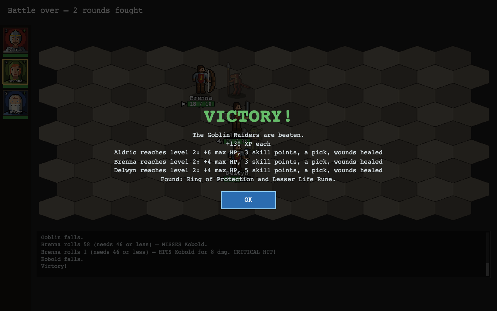

You win when every foe has fallen. Every surviving hero earns the full experience reward. The lair disappears from the map, the land around it is cleansed, and its loot goes into the baggage. A lair may also yield a **rune**, which goes into the party's rune pouch: the victory screen names it, as in "Found: Lesser Ember Rune". Lairs of threat 1 to 3 give a Lesser rune half the time; from threat 4 every win gives one, sometimes of the second rank. Further out the loot grows: from threat 9 a win gives one rune, and a second half the time, of the second or third rank; from threat 14 it gives two, of the second to fourth rank; and the Source gives three, of the third or fourth rank. The Salamander Pool favours Ember runes and the Spider Nest Venom.

The victory screen also says what the battle cost the party in hit points, counted before any level-up healed anyone: "The battle cost 23 HP: Aiko 12, Ren 8, Mia 3.". Heroes are listed most lost first, and a hero who fell counts for the hit points they started with. A battle that cost nothing has no such line.

An auto-resolved battle's rewards and losses are the same as a played one's: experience, loot, runes, the cleared lair and any heroes who fall. No confirmation is asked.

**Death is permanent.** A hero who fell in a battle you won is gone for good. Their gear goes to the baggage, and the party fights on smaller until the guild hall fills the place. If **every** hero in the battle falls, that party is wiped out: its heroes are dead, and everything they wore and carried, with the party's baggage, lies at the lair as its loot, for whoever beats it. The game goes on while you have a hero anywhere, in another party or in the guild hall's reserves; if the last party falls with reserves left, they form a new party at the encampment at once. Only when no hero is left is the game over and its save deleted.

Wounds carry over from battle to battle. Heal before you go looking for the next fight.

---

## 6. Magic

Every hero has **mana**: twice their Intelligence, plus half their Intelligence for each level after the first, plus 2 for each node they hold in the Mage and Cleric trees, plus whatever their gear and nodes add. A hero who knows no spell has mana but nothing to spend it on. Spells are nodes of the skill trees (chapter 7), bought with perk points like any other node and gated by the **Magic** skill, and they need no other skill: a warrior who trains Magic can learn them too. Every battle starts with full mana. Mana spent in battle does not come back until the battle ends. Whatever a winner has left is carried onto the world map, where it can be spent on heals. A day of camping or a new level refills it. At level 1 Aldric, the ready-made fighter, has 6 mana, which he has no spell to spend, and Delwyn, the mage, 28.

Several nodes sharpen a caster: some add flat **spell power** to each damaging spell (Destruction, Pyromancy, Numbing Cold), **Mending** adds to every heal, **Lingering Cold** and **Lasting Magic** lengthen the effects a spell lays, **Serenity** extends the reach of friendly spells and regains mana each turn, and **Quickened Casting** and **Swift Hands** take an action point off every spell or every heal, never below 2.

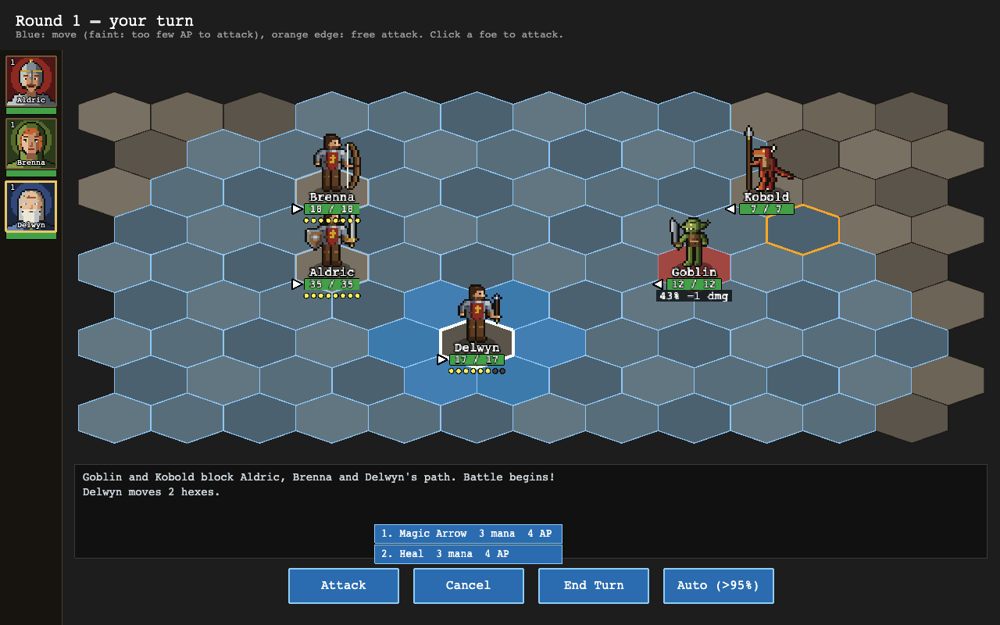

Spells are one kind of skill. To cast, select the hero and press **Skills** (or M); the button shows the mana the hero has left, and reads **Cancel** while you aim. The list holds the hero's spells first, then their techniques (see "Skills" in chapter 5), each spell with its mana and the AP it costs this hero. Pick a spell by clicking it or pressing its number. A spell you cannot cast right now is greyed out, and hovering it says why, for example "No foe in range" or "Needs 10 mana".

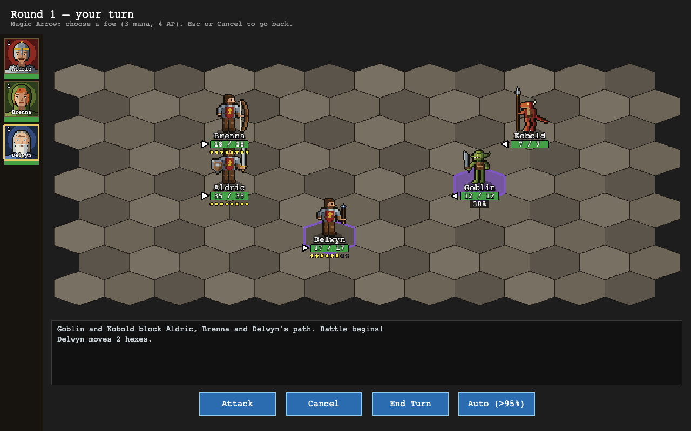

The spell then asks for a target. Valid targets are outlined, and hovering over one shows your chances. Press **Cancel** or **Esc** to back out.

- **Hostile spells** roll to hit like an attack, using the caster's Magic skill. Flanking and facing add nothing, so spells are the reliable strike while blades reward good positioning.
- **Area spells** touch **everyone** in the area, including your own heroes and the caster. Hovering over the centre of an area outlines it and shows the odds for every unit inside.
- **Friendly spells** never miss.

A technique that costs mana is not a spell: it is a blow or a shot of the hero's weapon, rolled with the weapon's skill, flanking and facing included, and it uses mana only as its price. Flame Strike, Frost Strike and Thunder Strike add their element's damage to the blow on a hit, and the foe's ward against that element takes its points off as it would from a spell.

Six of the later spells are special. **Ice Lance** (frost, 2d8) does 2d8 more to a foe already chilled, slowed, webbed, asleep or frozen. **Glacial Prison** freezes a foe within 5 hexes for 2 turns: **Frozen** (**I**) is helpless like sleep, but damage does not wake it. **Purify** ends every hostile effect on an ally and heals 1d6; the log names each effect it removed. **Revive** raises an ally that fell in this battle, on a free hex within 2, at a quarter of its hit points, once a battle. **Renew** gives each ally near the caster 3 hit points as its turn begins, for 3 turns (**U**). **Holy Light** is a bolt of light that deals double dice against the regenerating and the blightborn.

### Elements and wards

Some spells and effects carry an **element**. Flame Arrow and Fireball are fire, Frost Blast is frost, Acid Arrow and its corrosion are acid, and Death Cloud and its poison are poison. Magic Arrow has no element. A monster may have a **ward** against an element: the ward takes that many points off each hit and each tick of that element, and the log notes it, for example "HITS Salamander for 0 dmg (warded 9)". A ward never stops an effect from landing, only its damage. Choose spells with no element, or a different one, against a warded foe.

Heroes can have wards too, from **runes** in their armour and shields (see "Runes" in chapter 9): a breastplate with a Rime rune gives "Frost ward 2", and a Venom rune makes a Giant Spider's poison tick 2 less. Wards from every item worn add up.

Web and Curse, once only monsters cast them, are nodes in the Cryomancer and Saint paths, and heroes can learn them too. Monsters have spells of their own that heroes cannot learn, among them Lightning Bolt, Drain Life and Dark Shield.

### Lasting effects

The coloured letters over a unit's name show its current effects. An effect lasts for that unit's own turns. Casting the same effect again keeps whichever duration is longer, and different effects stack.

| Effect | What it does |
| --- | --- |
| Asleep | No AP, no zone of control, easy to hit. Any damage wakes it. |
| Chilled | −3 AP for a turn |
| Corroded | −5 armour class, −2 resistance, 1d4 damage a turn, no regeneration |
| Poisoned | 1d6 damage a turn |
| Shielded | +15 armour class |
| Protected | +10 armour class |
| Blessed | +10 to hit |
| Baned | −15 to hit |
| Hasted | +3 AP |
| Mirrored | Images take the next hits, and a hit on an image deals no damage |
| Seared | No regeneration for a turn |
| Cursed | −15 to hit and −5 armour class |
| Webbed | −4 AP |
| Warded | +4 ward against every element |
| Marked (Y) | −10 armour class |
| Slowed (L) | −3 AP |
| Taunted (T) | −25 to hit at anyone but the taunter |
| Pinned (N) | Cannot move, though it still attacks and casts |
| Frozen (I) | No AP, helpless like sleep, but damage does not wake it |
| Renewing (U) | Regains 3 hit points as its turn begins |
| Rooted (R) | +10 armour class, +2 resistance, until the unit moves or its next turn ends |

Damage over time strikes at the start of the affected unit's side's turn. Section 11 lists every spell.

---

## 7. Growing stronger

### Experience and levels

Winning a battle gives every surviving hero the experience its foes were worth. Stronger and higher-level foes are worth more, and each level costs more experience than the one before. Heroes waiting in the guild hall's reserves earn nothing.

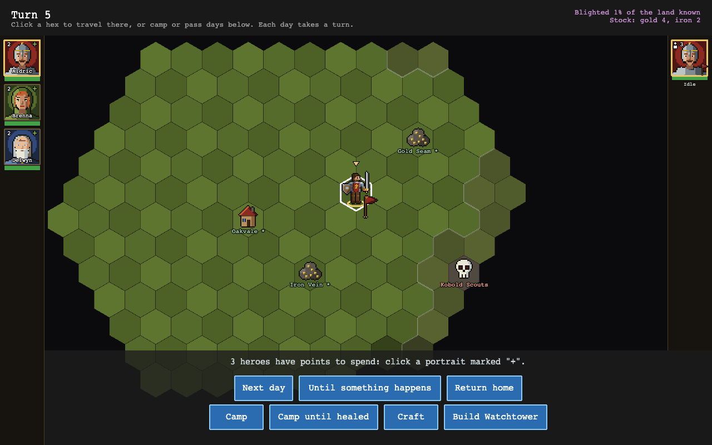

Each new level:

- raises maximum hit points (by 2 plus half the hero's Endurance) and **heals the hero fully**, refilling their mana as well
- gives **skill points**: 2 plus a third of the hero's Intelligence
- gives **1 perk point**, which buys nodes of the skill trees, spells included, at their cost; unspent points are kept

A **+** on a portrait means that hero has points to spend: skill points some skill can take, or perk points enough for a node open to them. The world map says so too ("Aldric has points to spend: click the portrait marked "+"."). Spend them from the character panel on the world map, since nothing can be spent in battle.

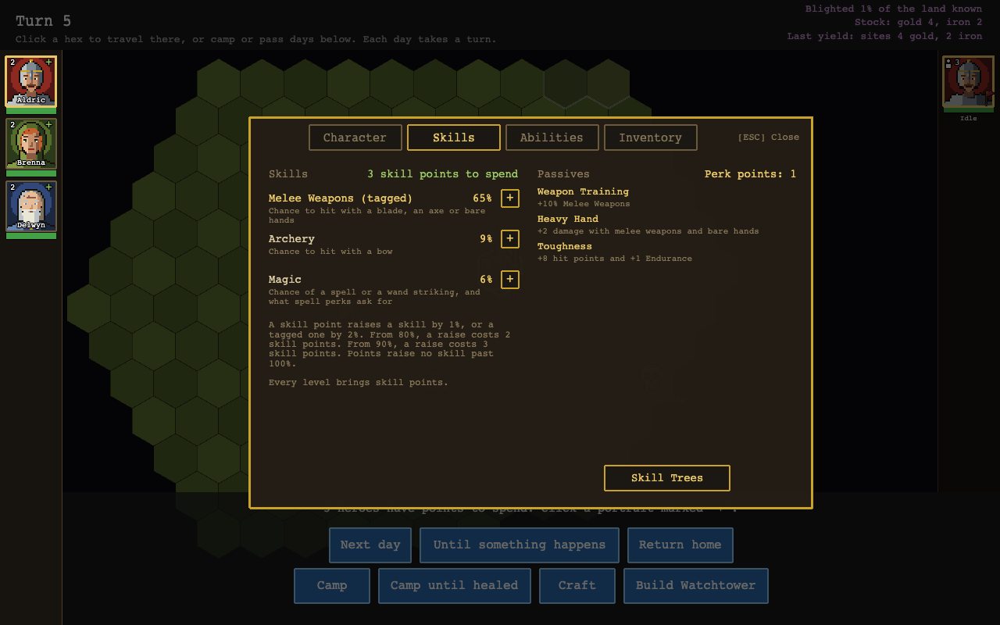

### Building a hero

There are no classes. A hero is defined by their attributes, the skill they tagged and the nodes they chose from four **skill trees**, Warrior, Scout, Mage and Cleric, each of three **paths**. Any hero may take nodes from any path of any tree, and mix them.

- Every node has **one rank**: perk points buy it once, and nothing is spent again on it.
- A node sits at a **tier**, and a tier asks a level and a **depth**, the nodes already held in the same path: tier 1 asks level 1 and none, tier 2 level 2 and 1, tier 3 level 6 and 3, and the **capstone** level 12 and 5. A node costs perk points by its tier (the table below). A node may also ask an attribute, a skill (or one of two skills, as Bless asks Melee 30% or Magic 40%) or a node of its own path before it.
- A hero's **calling** is the path they hold the most nodes in, shown under their name as "Level 9 · Heavy Knight" (two paths level for deepest are both named). Only the calling's capstone may be taken, and a hero may hold only one capstone: taking it closes every other for good.
- A node asks only to be taken; it is never lost afterwards. There is no respec, so choose with care.
- **Revive** and **Unbreakable** soften permadeath a little: Revive stands an ally who fell this battle up again, and Unbreakable keeps its holder at 1 hit point the first time damage would fell it, each once per battle. A hero who still falls and is not raised is dead for good.

| Tier | Level asked | Depth asked | Cost |
| --- | --- | --- | --- |
| 1 | 1 | 0 | 1 |
| 2 | 2 | 1 | 2 |
| 3 | 6 | 3 | 3 |
| Capstone | 12 | 5 | 4 |

Points you save buy deeper nodes; a hero who stays in one path reaches its tier 3 at level 6 and its capstone at 12, and one who mixes paths holds more nodes but reaches a capstone later.

A hero born with an attribute of 7 or 8 reaches the nodes that ask it from the start, and the trees' attribute nodes (Gain Strength, Toughness and others) raise one further.

---

## 8. The blight

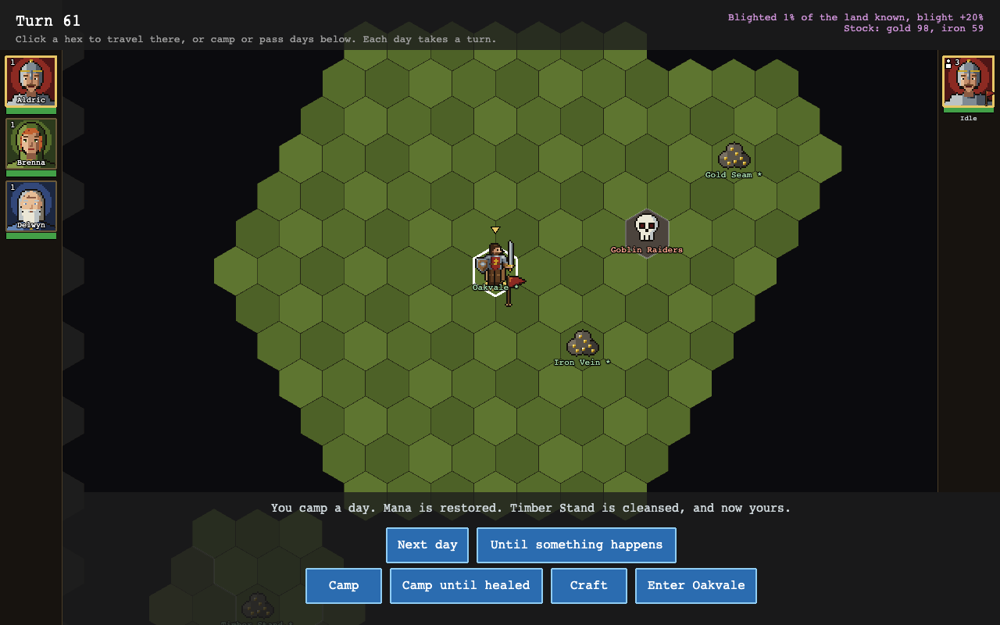

Every hex of land has a blight level from 0 (clean) to 3 (corrupted), shown as a tint over the grass. Corrupted land also shows dark growths. Every day, sources of influence push on the hexes around them, and their strength fades by a point for each hex of distance:

- **Pushing the blight forward**: monster lairs (more strongly the higher their threat), the Source itself, and corrupted land spreading to its neighbours. A lair pushes no harder than a threat 5 lair does, however far out it stands. The blight grows stronger over time, by a tenth every 30 days, up to half again as strong.
- **Pushing it back**: the encampment (stronger with its shrine), every resource you hold (stronger with an outpost, works or fort), every watchtower, every trade partner (a clean source that is never lost, silent or not), every hex of an open trade road once the Builders' Lodge is at level 3, and the party itself, which grows stronger as the heroes level up.

Consequences:

- **Corrupted land breeds new monster lairs.** A new lair's threat depends on how far from the encampment it appears: goblins and kobolds at any threat, bandits from threat 3, spiders and salamanders from threat 7, bandit companies from threat 8 and freebooter hosts from threat 14.
- **Winning a battle cleanses the land** around the lair, lowering every hex within 1 + its threat by two levels.
- **Resources** are captured when their land is clean (level 0) and lost when it reaches level 2, or, behind a fort, only when it is corrupted (level 3). A site lost razes whatever was built on it. While the blight gains on a site, the map shows it in orange with the number of days left until it falls. A watchtower can be lost the same way.
- **Stock**: every 5 days, each site you hold adds its yield to the encampment's stock (gold, iron, timber, silver and so on), and the encampment itself adds 2 gold, with more once its trading post is a Market (see [Building](#9-building)). A site whose land is tainted yields half, and so does the market while the encampment's is.

The header's percentage counts only the land you have explored.

---

## 9. Building

The stock pays for everything you build. On a held resource the **Improve** button names the next level and its cost ("Build a Mine: 30 gold, 15 stone"), or, when the Builders' Lodge is too low, what it needs ("A Mine needs the Builders' Lodge"); in a narrow window it drops the cost, which the hovered hex's panel still tells. The stock panel's third line sums the last yield day by source (in a narrow window it is set smaller); it starts blank when you load a game.

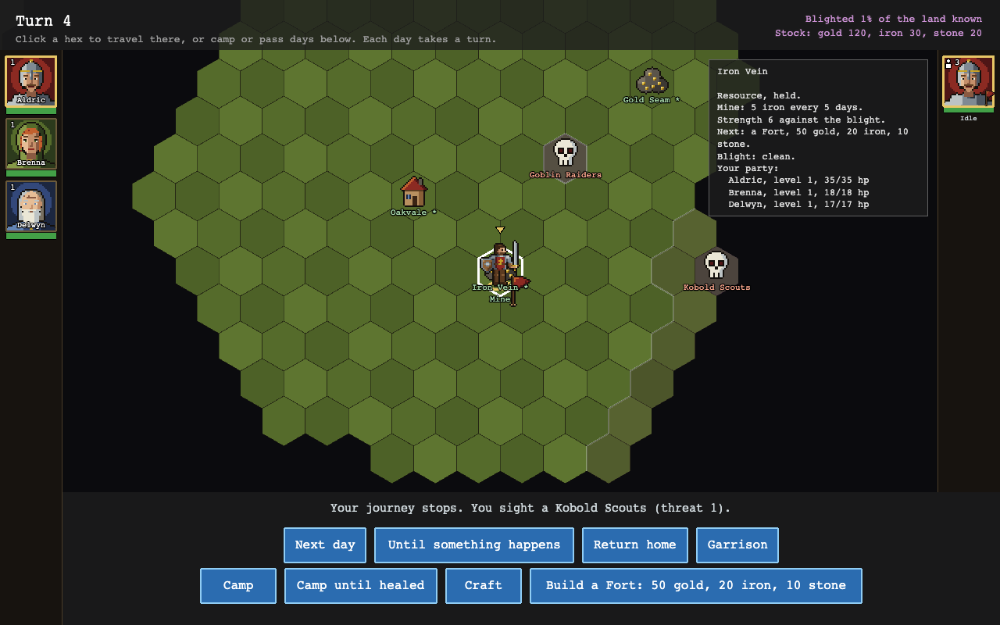

| Building | Where | Cost | Time | Effect |
| --- | --- | --- | --- | --- |
| Watchtower | Clean land off any location, 4+ hexes from other towers | 10 iron, 5 gold | A day | Sees 8 hexes and pushes the blight back. New lairs will not spawn close to it. |
| Outpost | A held resource without one | 15 gold, 10 timber | A day | The site resists the blight more strongly and yields 1 more. Lost with the site. |
| Works (Mine, Lumber Camp, Quarry, Saltworks or Peat Cuttings, by the resource) | A held resource with an outpost | 30 gold, 15 stone; Builders' Lodge level 1 | A day | Yields 3 more than the bare site, and stands as strong as an outpost against the blight. Razed with the site. |
| Fort | A held resource with a works | 50 gold, 20 iron, 10 stone; Builders' Lodge level 2 | A day | Much stronger against the blight, and lost only when its land is corrupted (level 3); yields as the works did. Razed with the site. A palisade marks it on the map. |
| Shrine | The encampment's empty plot | 20 gold, then 40 gold + 15 silver, then 80 gold + 30 silver | Instant | Each level strengthens the encampment against the blight |
| Guild hall | The encampment | 30 gold + 15 iron, then 60 gold + 30 iron | Instant | Party limit 3, then 4, then 5 |
| Trading post | The encampment | 40 gold + 15 stone, then 80 gold + 15 copper, then 120 gold + 20 silver, then 160 gold + 30 silver + 20 stone, then 220 gold + 40 silver + 10 crystal | Instant | Sells plain gear, then Fine and Lesser runes, then Masterwork, then steel and second-rank runes. Levels 4 to 6 (the Market, the Market Hall, the Trading House) also bring gold every 5 days, with the land's yields: 2, 3 and 5 gold, halved while the encampment's land is tainted |
| Builders' Lodge | The encampment's empty plot | 30 gold + 20 timber, then 60 gold + 25 stone (then a third level, 100 gold + 20 iron + 20 stone) | Instant | Level 1 lets you raise works on held resources, level 2 forts, level 3 roads: every open trade route's road pushes back the blight |
| Workshop | The encampment's empty plot | 25 gold + 15 iron, then 40 gold + 15 stone, then 60 gold + 10 crystal | Instant | Crafts more modifiers, at higher grades; sets and fuses runes from level 1, takes them out from level 2 |
| Infirmary | The encampment's empty plot | 20 gold + 10 timber, then 40 gold + 15 peat, then 60 gold + 20 salt | Instant | Faster healing while you camp |

The guild hall and the trading post stand from the start. The far-off materials (stone, copper, crystal, peat, salt) buy the higher levels, so the land you hold decides how far your encampment can grow.

If you click a build button without enough stock, the game tells you the cost.

### The encampment

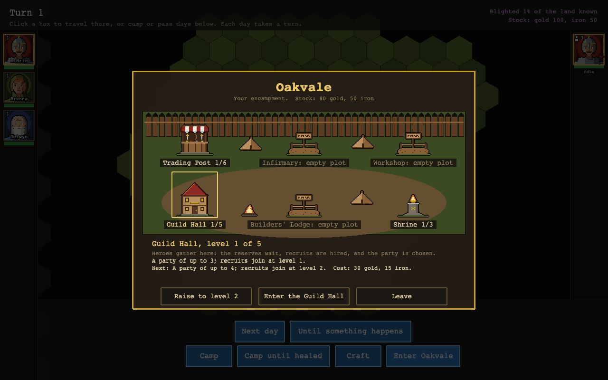

When the party stands on the encampment, **Enter** (the button carries the encampment's name) shows the place: every facility on its plot. A facility not yet built is an empty plot with a sign, and a built one is drawn at its level, so the encampment grows as you build. The Builders' Lodge stands in front of the infirmary, and the trading post is named for its level (Market, Market Hall, Trading House) on its plot and in its screen. Click a building or a plot to see what it does, what its next level brings and costs, and **Build** or **Raise** it; when the next level is barred (one the stock cannot pay for) the line under the details says why. Until the trading post is a Market, its details say what the market will bring (2 to 5 gold every 5 days from level 4). **Leave** (or Esc) goes back to the map.

### The guild hall

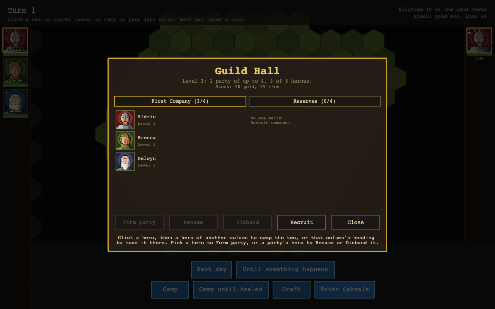

In the encampment, click the guild hall and then **Enter the Guild Hall**. It shows a column for each party standing at the encampment and one for the reserves waiting at the hall. **Close** goes back to the encampment. Levels 4 and 5 of the hall allow a second and a third party (see [Parties](#parties)).

- **Click a hero** to select them. Then click a hero in another column to swap the two, or that column's heading to move the hero there (a party keeps at least one hero and at most the hall's party limit; the reserves hold at most 4).
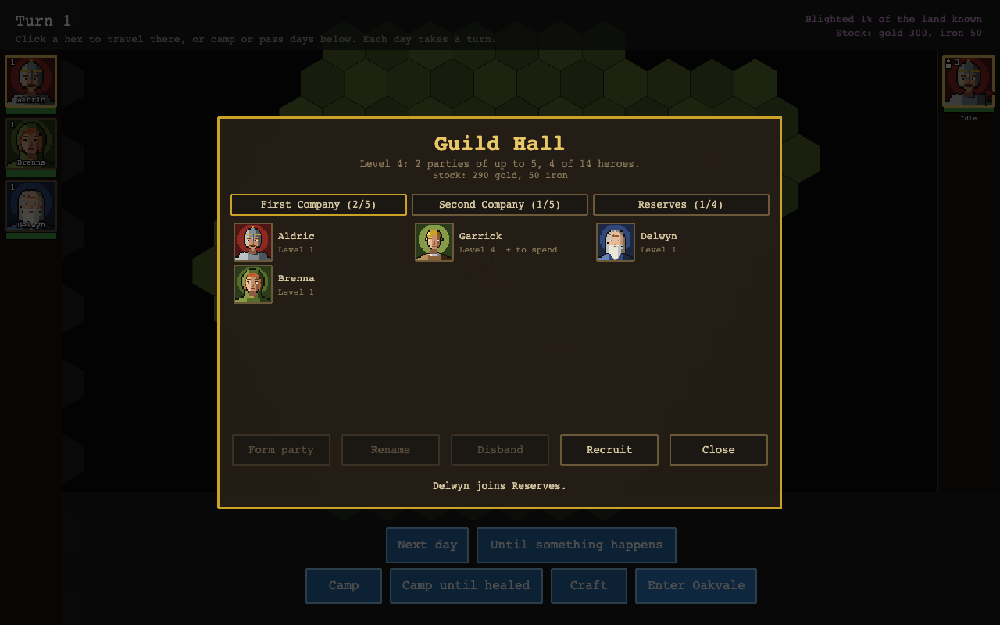

- **Form party** makes a new party at the encampment from the selected hero, if the hall's level allows another. It takes the next default name (Second Company, Third Company).
- **Rename** types a new name for the selected hero's party (1 to 16 letters, none shared with another party): the first key replaces the old name, Backspace starts it empty, Enter keeps it, Esc cancels.
- **Disband** sends the selected hero's party into the reserves and its baggage to another party at the encampment. The last party cannot be disbanded.
- **Recruit** hires a new hero for **10 gold**, who joins the reserves. The reserves hold at most 4, and the whole company is limited by the hall's level (7 heroes at level 1, up to 18 at level 5).
- While more than one party stands at the encampment, its screens (the encampment, the trading post and the workshop) say which party they act for ("For: Second Company"): the selected party if it is at home, else the first at home. The guild hall shows every party at home in a column of its own.

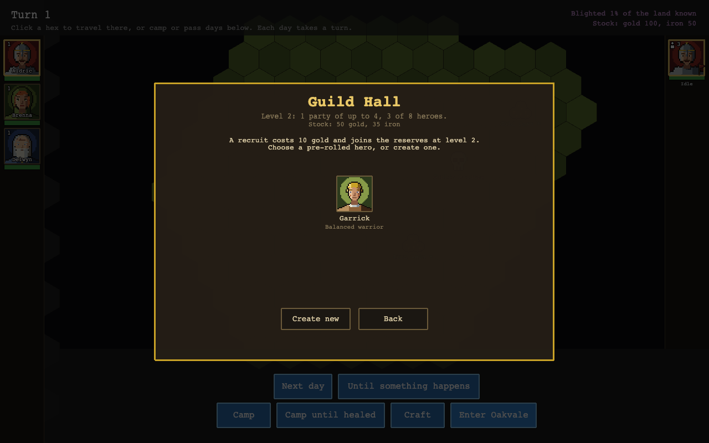

You can recruit one of the pre-rolled heroes not already in your company, or **Create new** to make one with character creation. A recruit joins at the hall's level, with that level's points left for you to spend.

### Gear families

Gear comes in **families**, each a trade-off: the weapons in the table in chapter 5, three shields, four body armours, and a light and a heavy choice for the head, hands and feet.

| Item | Armour class | Resistance | Strength | Other |
| --- | --- | --- | --- | --- |
| Iron Buckler | +6 | — | — | |
| Oak Shield | +10 | — | — | |
| Iron Tower Shield | +16 | 1 | 6 | AP −1 |
| Linen Robe | — | — | — | spells +5%, mana +6 |
| Leather Armor | +12 | 1 | — | |
| Iron Breastplate | +10 | 2 | 3 | spells −5% |
| Iron Plate | +6 | 4 | 6 | AP −1, spells −15% |
| Leather Cap / Leather Boots | +3 | — | — | |
| Leather Gloves | — | — | — | to hit +2% |
| Iron Helm | +2 | 1 | 4 | spells −5% |
| Iron Gauntlets | — | 1 | 4 | spells −5% |
| Iron Greaves | — | 1 | 4 | |

**Tiers.** Each family comes in a first and a second material: iron and **steel** for metal, yew or oak and **ironwood** for wood, leather and **wolfhide** for hide, linen and **silk** for cloth. The second tier is better: a weapon does 2 more damage, a shield adds 2 to armour class, body armour 2 to armour class and 1 to resistance, and a head, hands or feet item 1 to armour class. In the trading post and the inventory a second-tier item's icon is tinted. Only a level 4 trading post sells them.

**Weight.** Heavy gear asks for strength. For every point of strength a hero lacks for an item, they lose 5% to hit with weapon attacks (spells are not affected), and each item counts on its own: a strength 3 hero with a War Hammer (6) and Iron Gauntlets (4) loses 15% + 5%. An item's tooltip shows it, as "Strength: 6 (you have 3): to hit −15%".

Plate and the tower shield also take **1 AP** off every turn, and metal armour lowers the chance of a hero's **spells** (the breastplate, helm and gauntlets by 5% each, plate by 15%), which is the price a mage pays for armour. The Abilities tab shows a caster's spell skill with its gear counted. If the AP a hero's gear leaves is fewer than its weapon's attack costs (plate and a 7 AP halberd on a hero of 7 AP), the Character tab warns in amber, "Attack costs 7 AP, you have 6: cannot attack", as the hero could never strike.

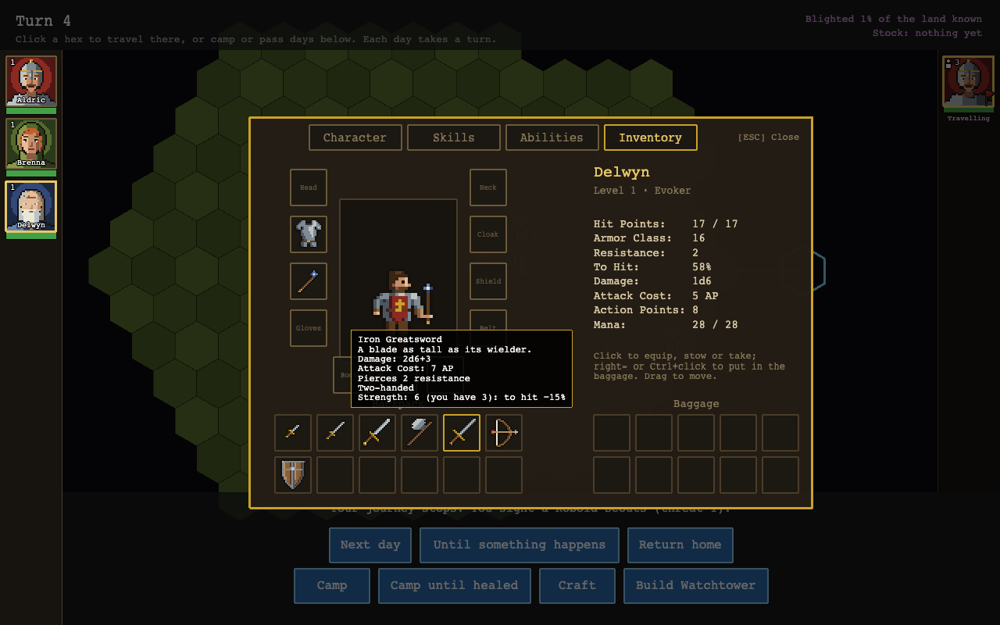

### Gear grades

Every plain item comes in three **grades**: plain, **Fine** and **Masterwork**. A Fine weapon does 1 more damage, and a Masterwork one 2 more and hits 5% more often; a Fine shield adds 3 to armour class and a Masterwork one 6; Fine body armour adds 1 to resistance and Masterwork 2; a Fine head, hands or feet item adds 1 to armour class and a Masterwork one 2. A grade never changes a weapon's AP cost, reach, armour piercing or the strength it asks. Enchanted items have no grade.

### The trading post

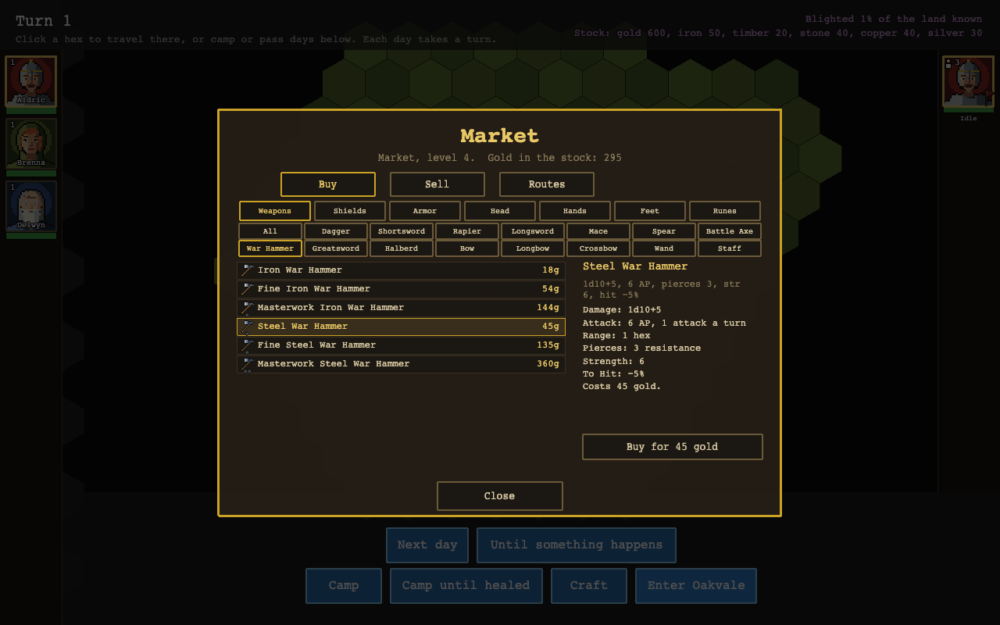

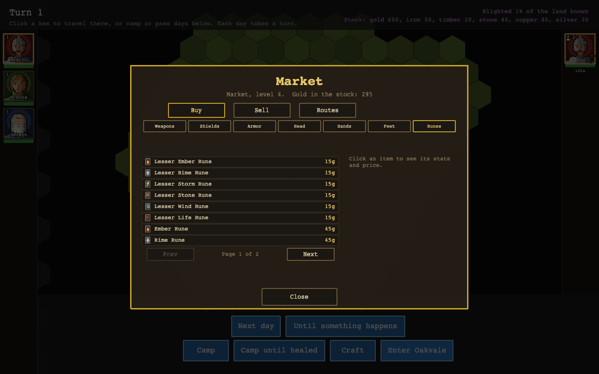

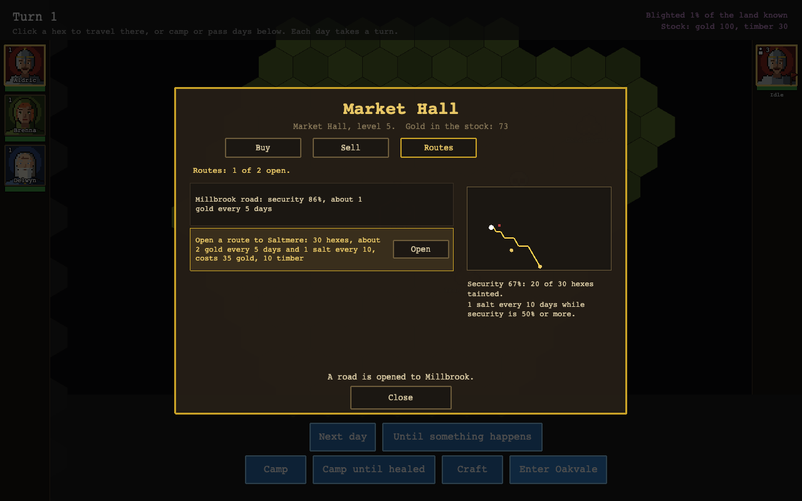

With more partners than a page holds, **Prev** and **Next** turn the page:

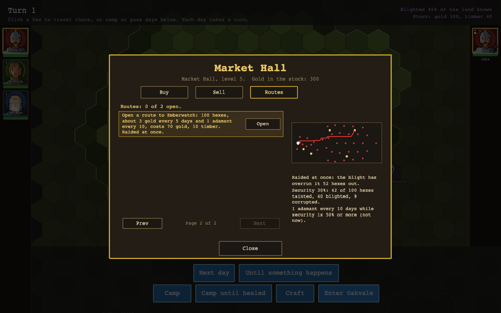

In the encampment, click the trading post and then **Enter the Trading Post**. Click a line to see the item's stats and price, then confirm with the button under them.

- **Buy** lists every plain item at each grade the post sells: plain at level 1, Fine from level 2, Masterwork at level 3, and from level 4 the second tier (steel, ironwood, wolfhide, silk) at every grade. The buttons along the top filter the list by slot (**Weapons**, **Shields**, **Armor**, **Head**, **Hands**, **Feet**) and, under them, by family, or **All** of the slot; the tab opens on weapons. A second-tier item costs 2.5 times the first tier's price, a Fine item 3 times the plain price and a Masterwork one 8 times: a Masterwork Steel Longsword costs 12 × 2.5 × 8 = 240 gold. What you buy goes into the baggage; equip it from the character panel.
- **Runes**, the button after the slot buttons, lists the runes the post sells: Lesser Ember, Rime, Storm, Stone, Wind and Life runes from level 2, for 15 gold each, and the same six of the second rank from level 4, for 45. Clicking a rune tells what it does in a weapon, in armour and in a shield, and that it is set in a socketed item. A rune bought goes into the pouch. Venom, Acid, Mind and Dawn runes, and anything of a higher rank, come only from lairs and fusing.
- **Sell** lists the baggage first, then what the heroes carry in their packs: each item fetches half its price, a modifier adding nothing, and an enchanted item half its worth. An item with runes in it fetches half its runes' prices on top. Worn gear is not offered, so take off anything you want to sell first. Then come the stock's materials, which sell at 1 gold for every 2, and the pouch's runes, which sell one at a time for a third of their price (5 gold for a Lesser rune). The post never sells materials, nor an item with runes in it.
- **Routes** lists each trade partner your party has contacted (walk onto its hex), in the order you met them, four to a page (with more partners, **Prev** and **Next** turn the page and select its first line). From the Market (trading post level 4) the post keeps routes open: 1 at the Market, 2 at the Market Hall and 4 at the Trading House; below level 4 the tab says routes need the Market. A partner you can trade with shows an offer: the road's length in hexes, about how much gold it brings every 5 days and the partner's good every 10, and what opening it costs (20 gold plus 1 for every 2 hexes, and 10 timber). Under the small map, the chosen line's notes say why its security is below 100% ("Security 79%: 4 of 14 hexes tainted, 1 corrupted.", counting your watchtowers as guards but not your parties, who move) and that the good comes only while security is at least half. **Open** builds the route at once; if it cannot be opened (the party is away from the encampment, the partner is silent, the post's routes are all open, no safe road reaches the partner, or the stock is short) the button is faint and clicking it says why. A small map of the world shows the selected line's road and the nests you know of; click a line to draw its road. The road keeps clear of every nest where it can, but where it cannot, the offer ends "Raided at once." and the notes name the raiders you have sighted, or, where the blight has overrun the road, how far out (if you have explored that hex). An open route shows its security, what it brings every 5 days (counting watchtowers as guards, not parties) and, in red, that it pays nothing while raided and for how many yield days.

The price of each family's plain first-tier item:

| Family | Price | Family | Price |
| --- | --- | --- | --- |
| Dagger, Buckler | 6 | Bow, Longsword, Mace, Spear | 12 |
| Shortsword | 8 | Battle Axe, Leather | 14 |
| Rapier, Shield, Robe | 10 | Staff, Longbow | 16 |
| Cap, Gloves, Boots | 4 | War Hammer, Crossbow, Tower Shield | 18 |
| Helm, Gauntlets, Greaves | 6 | Greatsword, Breastplate | 20 |
| Halberd | 22 | Wand, Plate | 30 |

### Crafting

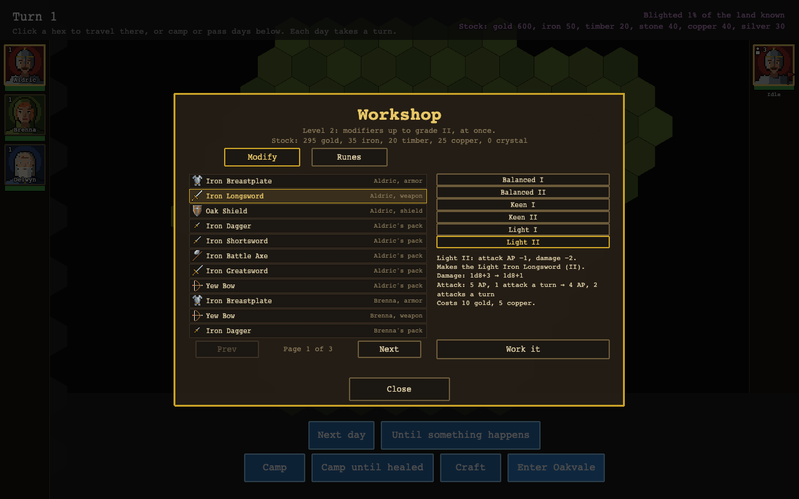

Crafting puts a **modifier** on a plain or graded item (never an enchanted one): it makes the item better at one thing and worse at another. An item carries one modifier, and working it again replaces the old one, at the full cost of the new.

- **In the field**: the world map's **Craft** button, anywhere you could camp, makes Balanced and Recurve at grade I, and takes a day.
- **At the workshop**: in the encampment, click the workshop and **Enter the Workshop**. It takes no time. A level 1 workshop also makes Bearded, Keen and Braced; level 2 adds Light, Long and Reinforced and makes grade II; level 3 makes grade III.

The screen opens on its **Modify** tab (its **Runes** tab is for runes, below). It lists every item your heroes wear or carry, then the baggage's, that a modifier fits; one that needs a better workshop is greyed and says so. Click an item, then a modifier and grade, to see what it changes, attacks a turn included, and what it costs; **Work it** confirms.

| Modifier | Fits | Better (grade I / II / III) | Worse |
| --- | --- | --- | --- |
| Balanced | shortsword, longsword, greatsword, spear | to hit +5 / +10 / +15% | damage −1 |
| Recurve | bow | damage +1 / +2 / +3 | range −1 |
| Bearded | battle axe, mace | pierces 1 / 2 / 3 more points of resistance | damage −2 |
| Keen | dagger, shortsword, longsword | critical +5 / +10 / +15% | damage −1 |
| Braced | shield | armour class +3 / +5 / +7 | to hit −5% |
| Light | longsword, battle axe | attack AP −1 | damage −3 / −2 / −1 |
| Long | bow, crossbow | range +1 / +2 / +3 | to hit −5% |
| Reinforced | breastplate, leather | resistance +1 / +2 / +3 | to hit −5% |

A craft costs 5 gold and 5 iron (5 timber for a bow, crossbow or wooden shield) at grade I, 10 gold and 5 copper at grade II, and 20 gold and 5 crystal at grade III. A Light Longsword costs 4 AP a blow, so a hero who stands still strikes twice a turn.

### Runes

Some gear has **sockets**, and a **rune** set in a socket adds to what the item does. Runes are found in lairs after a win, bought at the trading post and made by fusing. The party keeps them in its **rune pouch** until they are set; the pouch is shared, like the baggage.

**Sockets.** A first-tier item (iron, yew, leather, linen) has none, and a second-tier one (steel, ironwood, wolfhide, silk) has 1. A Masterwork item has one more: a Masterwork Iron Longsword has 1, a Masterwork Steel Longsword 2. A head, hands or feet item has at most 1. Among the magic items, the Emberblade, the Wand of Storms and the Hawkeye Bow have 1 socket each, and the rest none. An item with runes is named for them, as "Masterwork Iron Longsword [Ember I]".

**Ranks.** Each rune comes in four ranks, Lesser (I), plain (II), Greater (III) and Grand (IV), each stronger than the last. A rune does one thing in a weapon, another in armour (anything worn but a weapon or a shield) and another in a shield. At rank I:

| Rune | In a weapon | In armour | In a shield |
| --- | --- | --- | --- |
| Ember | +1 fire on a hit (rank III and up: also lays Seared) | Fire ward 2 | Fire ward 2 |
| Rime | +1 frost on a hit (rank III and up: a critical lays Chilled) | Frost ward 2 | Frost ward 2 |
| Storm | to hit +3% | Lightning ward 2 | Lightning ward 2 |
| Venom | +1 poison on a hit (rank II and up: a critical lays Poisoned) | Poison ward 2 | Poison ward 2 |
| Acid | pierces 1 more point of resistance (a melee weapon or the crossbow only: it cannot be set in a bow or a wand) | Acid ward 2 | Acid ward 2 |
| Stone | damage +1 | resistance +1 | armour class +3 |
| Wind | critical +3% | armour class +3 | armour class +2 |
| Life | heals the wielder 1 on a hit | max HP +4 | max HP +4 |
| Mind | spells +3% (a wand or a staff only) | mana +3 | mana +3 |
| Dawn | +2 blight on a hit, against regenerating foes and the blight's own | Blight ward 2 | Blight ward 2 |

The higher ranks raise the numbers: a ward is 2, 4, 6 and 9 by rank, and Ember's and Rime's damage 1, 2, 3 and 5. An item's stat lines tell what its runes add, at their ranks. A rune's on-hit damage is fixed, not rolled, and passes armour's resistance; only a ward against its element reduces it (chapter 5, "Attacking").

A **Life** rune in armour or a shield raises the hero's maximum hit points. When it comes off, or goes on, on the world map, the hero keeps the same share of their hit points: a hero at full health stays at full health, and one at half stays at about half. In battle, a change of gear never heals: putting Life armour on raises the maximum but not the hit points, and taking it off only lowers them to the new maximum if they were above it.

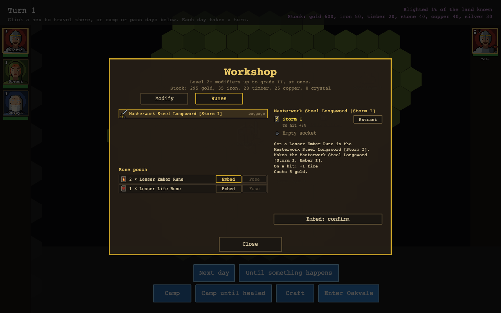

**Runecraft** is done on the **Runes** tab of the crafting screen. It lists every item with a socket, worn, carried or in the baggage, above the pouch; when the party has none, it says which gear has sockets instead. Hover a rune in the pouch to see what it does in a weapon, in armour and in a shield. Click an item to see its sockets, then:

- **Embed** beside a rune in the pouch sets it in the item's next empty socket, for 5 gold a rank. A full item must have a rune taken out first.
- **Extract** beside a socket takes its rune out, intact, back into the pouch, for 10 gold a rank. It needs a level 2 workshop.
- **Fuse** beside a rune makes three of the same rune and rank into one of the next rank, for 10 gold a rank of the new rune: three Lesser Storm Runes become a Storm Rune for 20 gold. A level 1 workshop fuses to the second rank; fusing higher needs a better workshop than can be built yet, and the button says so.

Each action shows what it does and costs before **Confirm** does it. At the workshop runecraft takes no time. In the field, the world map's **Craft** button opens the same screen anywhere you could camp, but there only a **Lesser** rune can be set, and it takes a day: the screen closes and the map reports the day, as a field craft does.

### The infirmary

The infirmary heals faster while you camp:

- **Level 1**: a day camped at the encampment heals each hero a third of their hit points.
- **Level 2**: a day camped at the encampment heals everyone fully.
- **Level 3**: as level 2, and elsewhere field dressings heal 3 hit points a day instead of 1.

It cannot raise the dead.

---

## 10. Winning, losing and saving

- **Victory**: find the heart of the blight and destroy it. It is not on your map when the game begins: explore, and the moment your party or a watchtower sights it, wherever it is, your journey stops and it is marked. It lies far in the east, 122 hexes from home, at threat 20, and what guards it fights at the strength of a level-6 foe, so plan a long march and to arrive with heroes around level 18. After the victory you can **End** the game or carry on in **endless** mode.
- **Defeat**: the game ends if a lost battle leaves you no hero in any party or the reserves, or if your encampment falls to the blight.

**Saving is automatic.** Each playthrough lives in one of three slots, and there is no save button. The world map saves after each journey, camp and panel change. A battle saves at the start of each of your turns, so reloading during a battle rewinds to the start of that turn with the same dice. A defeat that leaves no hero deletes its slot.

**Seeds**: add `?seed=42` (or any number) to the game's address to fight every battle in that session with fixed dice.

---

## 11. Reference

### Spells

| Spell | School | Mana | AP | Effect |
| --- | --- | --- | --- | --- |
| Magic Arrow | Offensive | 3 | 4 | 1d10 to a foe within 5 hexes |
| Flame Arrow | Offensive | 5 | 4 | 2d8 to a foe within 5 hexes, and no regeneration next turn |
| Sleep | Offensive | 5 | 4 | A foe within 5 hexes sleeps for 2 turns, helpless, until it is hurt |
| Frost Blast | Offensive | 6 | 5 | 1d8 and -3 AP for a turn to everyone within 1 hex of a point within 4 hexes |
| Fireball | Offensive | 10 | 6 | 3d6 to everyone within 1 hex of a point within 6 hexes, and no regeneration next turn |
| Acid Arrow | Offensive | 7 | 4 | 1d8 to a foe within 5 hexes, and -5 AC, -2 resistance, 1d4 a turn and no regeneration for 3 turns |
| Death Cloud | Offensive | 10 | 6 | Poisons everyone within 1 hex of a point within 5 hexes: 1d6 a turn for 3 turns |
| Heal | Healing | 3 | 4 | Restores 1d8+2 hit points to an ally within 4 hexes |
| Greater Heal | Healing | 6 | 4 | Restores 2d8+4 hit points to an ally within 4 hexes |
| Heal All | Healing | 8 | 5 | Restores 1d8 hit points to each ally within 2 hexes of the caster |
| Greater Heal All | Healing | 14 | 6 | Restores 2d8+2 hit points to each ally within 2 hexes of the caster |
| Shield | Support | 3 | 2 | +15 AC to the caster for 3 turns |
| Protect | Support | 3 | 3 | +10 AC to an ally within 4 hexes for 3 turns |
| Bless | Support | 4 | 4 | +10 to hit for each ally within 2 hexes of the caster, for 3 turns |
| Mirror Image | Support | 6 | 3 | 3 images of the caster take the next 3 hits on it, for 3 turns |
| Haste | Support | 7 | 4 | +3 AP to an ally within 4 hexes for 2 turns |
| Bane | Support | 5 | 4 | -15 to hit for everyone within 1 hex of a point within 5 hexes, for 3 turns |
| Frostbite | Offensive | 3 | 4 | 1d6+1 frost to a foe within 5 hexes, chilled for 1 turn |
| Meteor | Offensive | 16 | 7 | 4d8 to everyone within 2 hexes of a point within 6 hexes, and no regeneration next turn |
| Mass Haste | Support | 12 | 5 | +3 AP for 2 turns to each ally within 2 hexes of the caster |
| Lay on Hands | Healing | 4 | 3 | Restores 2d6+2 hit points to an ally within 1 hex |
| Ward | Support | 4 | 3 | +4 ward against every element to an ally within 4 hexes for 3 turns |
| Web | Offensive | 5 | 4 | -4 AP for 2 turns to everyone within 1 hex of a point within 4 hexes |
| Curse | Offensive | 5 | 4 | -15 to hit and -5 AC to a foe within 5 hexes, for 3 turns |
| Ice Lance | Offensive | 7 | 4 | 2d8 frost to a foe within 6 hexes, 2d8 more if it is chilled, slowed, webbed, asleep or frozen |
| Glacial Prison | Offensive | 12 | 5 | A foe within 5 hexes is frozen for 2 turns, helpless, even when hurt |
| Purify | Healing | 4 | 3 | Ends every hostile status on an ally within 4 hexes and restores 1d6 hit points |
| Revive | Healing | 20 | 6 | An ally within 2 hexes that fell this battle, on a free hex, stands again at a quarter of its hit points; once a battle |
| Renew | Support | 10 | 5 | Each ally within 2 hexes of the caster regains 3 hit points as its turn begins, for 3 turns |
| Holy Light | Offensive | 7 | 4 | 3d6 to a foe within 5 hexes, double the dice against the regenerating and the blightborn |

Each spell is a node of a path in the Mage or Cleric tree (Bless and Lay on Hands are in the Paladin's); the tables below say where, and what it asks. Some nodes lower a spell's cost or lengthen its reach (Quickened Casting, Swift Hands, Serenity), so the costs above are the base.

### Skill tree nodes

This lists every node of the game, 95 in all, by tree and path. **Tier** is the level a node asks (L1, L2, L6, L12; the capstone is marked ★), and each tier also asks depth, the nodes already held in the same path: none, 1, 3 and 5 (chapter 7). **Asks** is what a node needs beyond that: attributes, skills ("Melee 40% or Magic 40%" means either) and the node of its own path it follows. **Kind** is a passive (always in effect), an ability used **at will**, an ability that costs **mana**, or a **spell** (see above). A technique's cost reads "weapon AP + 1" where it is the weapon's attack cost plus 1.

#### Warrior

| Path | Node | Tier | Kind | Asks | Effect |
| --- | --- | --- | --- | --- | --- |
| Swordmaster | Weapon Training | L1 | Passive | Strength 5 | +10% Melee Weapons |
|  | Heavy Hand | L1 | Passive | Strength 6 | +2 damage with melee weapons and bare hands |
|  | Power Attack | L2 | At will | Melee 40% | weapon AP + 2. A weapon blow at −10 to hit for +6 damage. |
|  | Armour Breaker | L2 | Passive | Strength 6 | Melee blows pierce 2 points of a foe's resistance |
|  | Gain Strength | L2 | Passive | — | +2 Strength; not for one whose Strength is above 8 |
|  | Cleave | L6 | At will | Melee 55% | weapon AP + 2, recharge 2. Two weapon blows at −5 each, the second at another foe in reach if there is one. |
|  | Weapon Mastery | L6 | Passive | Strength 8 | +10% Melee Weapons, +2 melee damage, and melee blows pierce 1 more point of a foe's resistance |
|  | Blademaster | L12 ★ | Passive | Melee 70% | Once a turn, a weapon blow or strike technique of its own that fells a foe gives back the action points it cost |
| Heavy Knight | Toughness | L1 | Passive | Endurance 5 | +8 hit points and +1 Endurance |
|  | Shield Wall | L1 | Passive | — | +8 armour class while a shield is in the off hand |
|  | Taunt | L2 | At will | Endurance 5 | 3 AP, recharge 2. Lays Taunted on every foe within 2 hexes for a turn: they strike others at −25. |
|  | Rooted | L2 | Passive | Endurance 6 | At the end of its side's turn, if it has not moved, it is rooted: +10 armour class and +2 resistance until it moves or the end of its next turn |
|  | Pin | L6 | Mana | Melee 55% | 3 mana, weapon AP + 1, recharge 1. A weapon blow; a hit pins the foe for a turn. |
|  | Iron Skin | L6 | Passive | Endurance 7 | +2 resistance; its free attacks get +15 to hit and +3 damage |
|  | Guardian | L6 | Passive | Endurance 7 | Allies beside it (not itself) get +5 armour class; two Guardians do not add up |
|  | Unbreakable | L12 ★ | Passive | Endurance 8 | The first time each battle that damage would bring it to 0, it is left at 1 hit point and Shielded for 2 turns |
| Spellsword | Arcane Blood | L1 | Passive | Intelligence 3 | +10 mana |
|  | Flame Strike | L1 | Mana | Melee 30% | 3 mana, weapon AP + 1. A weapon blow; a hit adds 5 fire and sears the foe for a turn. |
|  | Frost Strike | L2 | Mana | Melee 40% | 3 mana, weapon AP + 1. A weapon blow; a hit adds 4 frost and chills the foe for a turn. |
|  | Spell Ward | L2 | Passive | — | +3 ward against every element |
|  | Thunder Strike | L6 | Mana | Melee 55% | 4 mana, weapon AP + 1. A weapon blow at +10 to hit; a hit adds 7 lightning. |
|  | Battle Mage | L6 | Passive | Intelligence 5 | +6 mana; each melee hit that strikes no image restores 1 mana; its Strikes' elemental damage +2 |
|  | Arcane Knight | L12 ★ | Passive | Melee 70% | Every melee hit adds 4 fire damage, as a rune does, and its Strikes cost only the weapon's AP |

#### Scout

| Path | Node | Tier | Kind | Asks | Effect |
| --- | --- | --- | --- | --- | --- |
| Ranger | Marksmanship | L1 | Passive | Perception 5 | +10% Archery |
|  | Deadly Aim | L1 | Passive | Perception 6 | +2 damage with ranged weapons |
|  | Aimed Shot | L2 | At will | Archery 40% | weapon AP + 2. A weapon shot at +20 to hit for +3 damage. |
|  | Far Shot | L2 | Passive | Perception 6 | Ranged weapons reach 2 hexes further; +1 Perception |
|  | Hunter's Mark | L2 | At will | Archery 40% | 2 AP, recharge 3. Marks a foe within weapon range for 2 turns: 10 off its armour class. |
|  | Volley | L6 | At will | Archery 55% | weapon AP + 2, recharge 2. A rain of shots on a hex within weapon range: everyone within 1 hex of it, allies too, takes a shot, through armour. |
|  | Pinning Shot | L6 | Mana | Archery 55% | 3 mana, weapon AP + 1, recharge 1. A weapon shot; a hit pins the foe for a turn. |
|  | Deadeye | L12 ★ | Passive | Archery 70% | +10% Archery; its shots pierce 3 points of resistance, and a critical shot rolls triple dice instead of double |
| Rogue | Dodger | L1 | Passive | Agility 6 | +10 armour class |
|  | Sprint | L1 | At will | Agility 5 | 0 AP, recharge 3. 3 more action points this turn. |
|  | Skirmisher | L2 | Passive | Agility 6 | +1 Agility; after it has moved this turn, its attacks get +10 to hit |
|  | Dirty Trick | L2 | At will | Melee 40% | weapon AP + 1, recharge 2. A weapon blow; a hit banes the foe for 2 turns: −15 to hit. |
|  | Tumble | L6 | Passive | Agility 7 | Its moves provoke no free attacks |
|  | Evasion | L6 | Passive | Agility 8 | +10 armour class and +1 action point every turn |
|  | Counter | L6 | Passive | Melee 55% | Once per enemy turn, when a foe's melee blow misses it, it strikes back with a free attack, if it holds a melee weapon and the foe is in reach |
|  | Shadowdancer | L12 ★ | Passive | Agility 8 | As its side's turn begins, it gains a mirror image for 2 turns, unless it has one already |
| Assassin | Keen Eye | L1 | Passive | Luck 6 | +10% chance of a critical hit |
|  | Backstab | L1 | Passive | Melee 30% or Archery 30% | +15 to hit and +4 damage on a weapon attack from a foe's rear arc |
|  | Venom Strike | L2 | Mana | Melee 40% or Archery 40% | 2 mana, weapon AP + 1. A weapon blow or shot; a hit poisons the foe for 3 turns. |
|  | Hamstring | L2 | At will | Melee 40% or Archery 40% | weapon AP + 1, recharge 2. A weapon blow or shot; a hit slows the foe for a turn: 3 fewer action points. |
|  | Fortune | L6 | Passive | Luck 7 | +10% chance of a critical hit and +1 Luck; its critical hits deal 4 more damage, after the dice are doubled |
|  | Ambush | L6 | Passive | Agility 6 | Its first weapon attack of a battle (not a free one) gets +25 to hit, and a hit is critical |
|  | Executioner | L6 | Passive | Melee 55% or Archery 55% | +5 damage against a foe at half its hit points or less |
|  | Deathblow | L12 ★ | Passive | Melee 70% or Archery 70% | A weapon hit that leaves a foe at a quarter of its maximum hit points or less fells it, unless the foe is blightborn |

#### Mage

| Path | Node | Tier | Kind | Asks | Effect |
| --- | --- | --- | --- | --- | --- |
| Evoker | Magic Arrow | L1 | Spell | Magic 40% | 1d10 to a foe within 5 hexes; 3 mana, 4 AP |
|  | Destruction | L1 | Passive | Intelligence 5 | +2 damage to each instance of its damaging spells; +4 mana |
|  | Flame Arrow | L2 | Spell | Magic 55%, Magic Arrow | 2d8 to a foe within 5 hexes, and no regeneration next turn; 5 mana, 4 AP |
|  | Pyromancy | L2 | Passive | Intelligence 6 | +3 damage to its fire spells |
|  | Fireball | L6 | Spell | Magic 65%, Flame Arrow | 3d6 to everyone within 1 hex of a point within 6 hexes, and no regeneration next turn; 10 mana, 6 AP |
|  | Acid Arrow | L6 | Spell | Magic 65%, Flame Arrow | 1d8 to a foe within 5 hexes, and -5 AC, -2 resistance, 1d4 a turn and no regeneration for 3 turns; 7 mana, 4 AP |
|  | Death Cloud | L6 | Spell | Magic 70% | Poisons everyone within 1 hex of a point within 5 hexes: 1d6 a turn for 3 turns; 10 mana, 6 AP |
|  | Meteor | L12 ★ | Spell | Magic 80% | 4d8 to everyone within 2 hexes of a point within 6 hexes, and no regeneration next turn; 16 mana, 7 AP |
| Cryomancer | Frostbite | L1 | Spell | Magic 40% | 1d6+1 frost to a foe within 5 hexes, chilled for 1 turn; 3 mana, 4 AP |
|  | Numbing Cold | L1 | Passive | Intelligence 5 | +3 damage to its frost spells |
|  | Sleep | L2 | Spell | Magic 55% | A foe within 5 hexes sleeps for 2 turns, helpless, until it is hurt; 5 mana, 4 AP |
|  | Frost Blast | L2 | Spell | Magic 55%, Frostbite | 1d8 and -3 AP for a turn to everyone within 1 hex of a point within 4 hexes; 6 mana, 5 AP |
|  | Web | L6 | Spell | Magic 65% | -4 AP for 2 turns to everyone within 1 hex of a point within 4 hexes; 5 mana, 4 AP |
|  | Ice Lance | L6 | Spell | Magic 70% | 2d8 frost to a foe within 6 hexes, 2d8 more if it is chilled, slowed, webbed, asleep or frozen; 7 mana, 4 AP |
|  | Lingering Cold | L6 | Passive | Intelligence 7 | Statuses its hostile spells lay last 1 turn longer; +10% Magic |
|  | Glacial Prison | L12 ★ | Spell | Magic 80% | A foe within 5 hexes is frozen for 2 turns, helpless, even when hurt; 12 mana, 5 AP |
| Arcanist | Shield | L1 | Spell | Magic 40% | +15 AC to the caster for 3 turns; 3 mana, 2 AP |
|  | Arcane Study | L1 | Passive | Intelligence 5 | +10% Magic |
|  | Mirror Image | L2 | Spell | Magic 55% | 3 images of the caster take the next 3 hits on it, for 3 turns; 6 mana, 3 AP |
|  | Ward | L2 | Spell | Magic 55% | +4 ward against every element to an ally within 4 hexes for 3 turns; 4 mana, 3 AP |
|  | Haste | L6 | Spell | Magic 65% | +3 AP to an ally within 4 hexes for 2 turns; 7 mana, 4 AP |
|  | Lasting Magic | L6 | Passive | Intelligence 7 | Statuses its friendly spells lay last 1 turn longer; +1 Intelligence |
|  | Quickened Casting | L6 | Passive | Magic 70% | Its spells cost 1 AP less (never below 2); +8 mana |
|  | Mass Haste | L12 ★ | Spell | Magic 80% | +3 AP for 2 turns to each ally within 2 hexes of the caster; 12 mana, 5 AP |

#### Cleric

| Path | Node | Tier | Kind | Asks | Effect |
| --- | --- | --- | --- | --- | --- |
| Healer | Heal | L1 | Spell | Magic 40% | Restores 1d8+2 hit points to an ally within 4 hexes; 3 mana, 4 AP |
|  | Mending | L1 | Passive | Magic 30% | Its heals restore 4 more |
|  | Greater Heal | L2 | Spell | Magic 55%, Heal | Restores 2d8+4 hit points to an ally within 4 hexes; 6 mana, 4 AP |
|  | Heal All | L2 | Spell | Magic 55%, Heal | Restores 1d8 hit points to each ally within 2 hexes of the caster; 8 mana, 5 AP |
|  | Greater Heal All | L6 | Spell | Magic 65%, Heal All | Restores 2d8+2 hit points to each ally within 2 hexes of the caster; 14 mana, 6 AP |
|  | Purify | L6 | Spell | Magic 55% | Ends every hostile status on an ally within 4 hexes and restores 1d6 hit points; 4 mana, 3 AP |
|  | Swift Hands | L6 | Passive | Magic 60% | Its healing spells cost 1 AP less (never below 2); +8 mana |
|  | Revive | L12 ★ | Spell | Magic 75% | An ally within 2 hexes that fell this battle, on a free hex, stands again at a quarter of its hit points; once a battle; 20 mana, 6 AP |
| Paladin | Bless | L1 | Spell | Melee 30% or Magic 40% | +10 to hit for each ally within 2 hexes of the caster, for 3 turns; 4 mana, 4 AP |
|  | Smite | L1 | Mana | Melee 30% | 3 mana, weapon AP + 1. A weapon blow; a hit adds 4 damage, and 6 more against the regenerating and the blightborn. |
|  | Lay on Hands | L2 | Spell | Melee 40% or Magic 40% | Restores 2d6+2 hit points to an ally within 1 hex; 4 mana, 3 AP |
|  | Blessed Armour | L2 | Passive | Endurance 5 | +1 resistance, +3 ward against blight, +6 mana |
|  | Aura of Courage | L6 | Passive | Melee 55% | Allies within 2 hexes (not itself) get +5 to hit; two such auras do not add up |
|  | Consecrate | L6 | Mana | Melee 55% | 5 mana, 5 AP, recharge 2. Every foe beside the user takes 2d6, half on a miss, double the dice against the regenerating and the blightborn. |
|  | Sacred Weapon | L6 | Passive | Melee 60% | +10% Melee Weapons; every melee hit adds 2 damage, and 4 more as bane |
|  | Aegis | L12 ★ | Passive | Melee 70% | Allies within 2 hexes, itself included, get +2 resistance and +2 ward against every element; two such auras do not add up |
| Saint | Serenity | L1 | Passive | Intelligence 5 | Regains 2 mana as its side's turn begins (never above its maximum); its friendly spells aimed at an ally or a point reach 2 hexes further |
|  | Bane | L1 | Spell | Magic 40% | -15 to hit for everyone within 1 hex of a point within 5 hexes, for 3 turns; 5 mana, 4 AP |
|  | Protect | L2 | Spell | Magic 55% | +10 AC to an ally within 4 hexes for 3 turns; 3 mana, 3 AP |
|  | Scholar | L2 | Passive | Intelligence 6 | +2 skill points every level |
|  | Curse | L6 | Spell | Magic 65% | -15 to hit and -5 AC to a foe within 5 hexes, for 3 turns; 5 mana, 4 AP |
|  | Renew | L6 | Spell | Magic 65% | Each ally within 2 hexes of the caster regains 3 hit points as its turn begins, for 3 turns; 10 mana, 5 AP |
|  | Holy Light | L6 | Spell | Magic 70% | 3d6 to a foe within 5 hexes, double the dice against the regenerating and the blightborn; 7 mana, 4 AP |
|  | Sanctuary | L12 ★ | Passive | Magic 80% | As its side's turn begins, every ally within 2 hexes, itself included, regains 3 hit points |

### Magic items

Lairs hold loot. Among the items you may find:

| Item | Effect |
| --- | --- |
| Wand of Storms | 1d10+1, 5 AP, reach 5, uses Magic skill; 1 socket |
| Emberblade | 1d8+4, 5 AP, +10% to hit, pierces 1; 1 socket |
| Hawkeye Bow | 1d6+2, 4 AP, reach 6, +10% to hit; 1 socket |
| Ring of Protection | +5 AC |
| Ring of Fortune | +5% critical chance |
| Amulet of Focus | +10% to spell chance |
| Sage's Circlet | +6 mana |
| Cloak of Shadows | +10 AC |

---

*The screenshots are taken from the running game by `npm run manual:screenshots`, which plays through `e2e/manual.shots.ts`. Run it again after changing how a screen looks.*
