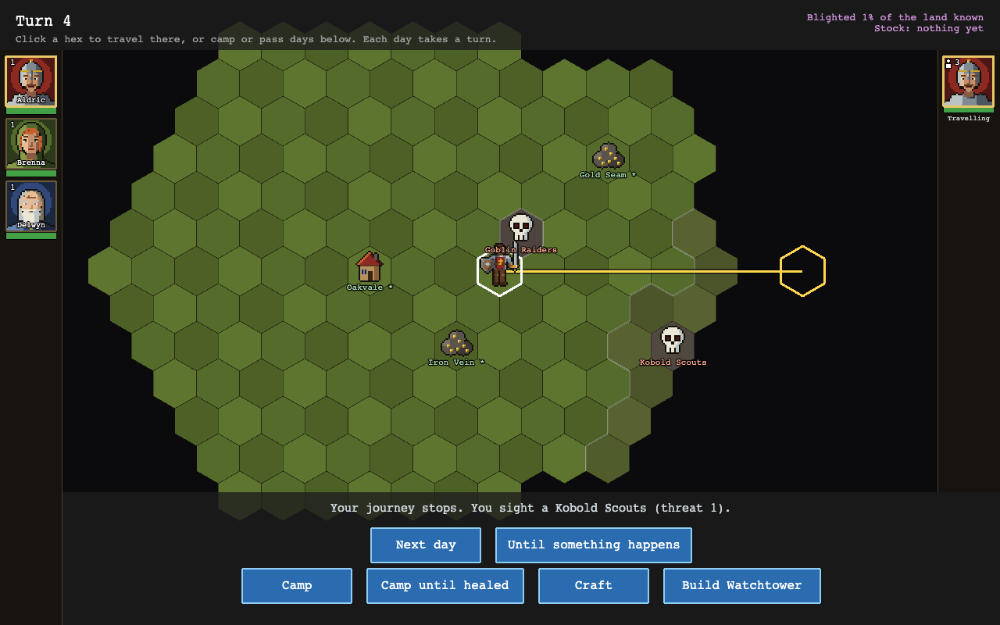
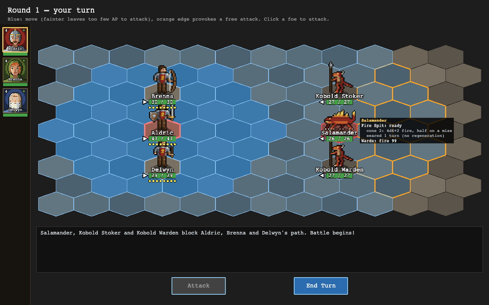
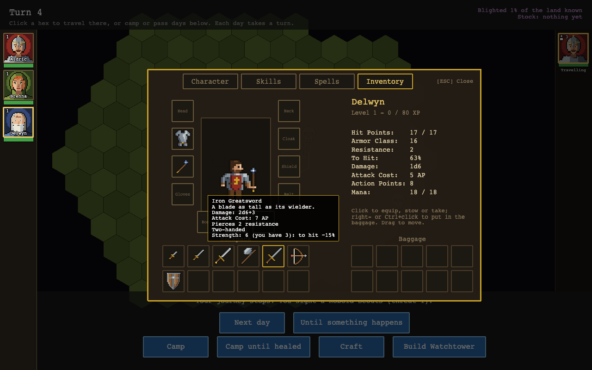
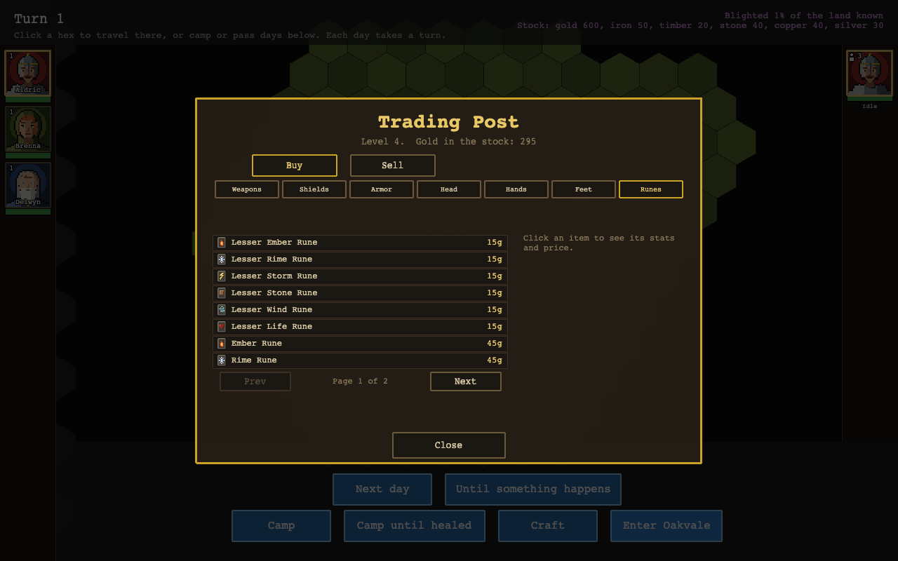
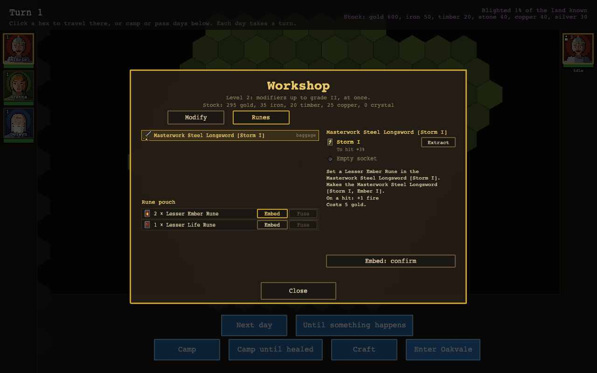

# Yomi: Player's Manual

The blight is spreading out of the east. Its corruption creeps over the land a hex at a time, and monsters breed wherever it runs deep. You lead a small company of heroes from your encampment, the last settlement standing, which you name when the game begins (Oakvale, unless you choose otherwise). Nobody knows what drives it. Your job is to hold the land, break the monster nests and beat back the encroachment, and, as you push further out, to find where the blight comes from and end it.

Yomi is a turn-based tactics game. You walk a world map of hexes from place to place, and battles are fought on a small hex board with action points, flanking, facing and zones of control.

---

## 1. Starting a game

The main menu offers:

- **New**: start a new game.
- **Continue**: return to the game paused under the menu or, if none is paused, load the game saved most recently.
- **Load**: choose one of the three save slots.
- **Options**: set the volume of the master channel, sound effects and music. Opened during a game, it also turns that game's tutorial on or off.
- **Manual**: read this manual. **Back to game** at its top, or **Esc**, returns to the menu, and the game paused under it is just as you left it.

Press **Esc** on the world map or in battle to open this menu over the game. Press it again to return.

### Choosing your party

A new game first asks how you want to start:

- **Ready-made party**: three heroes built to work together. **Aldric** is a melee fighter with a longsword and shield, **Brenna** is an archer, and **Delwyn** is a mage who casts Magic Arrow and Heal. Hover over a portrait to see what that hero can do.
- **Create your own**: start with empty places and fill them yourself.

Either choice takes you to the roster, which has one row for each place in the party. You start with three places. Members can be **edited** or **removed**. An empty place can be filled in two ways: **Create character** opens character creation, and **Choose pre-rolled** offers a ready-built hero.

A pre-rolled hero who is already in the party is greyed out, because every name in the party must be unique. Under the rows is the name of your encampment: type to change it (Backspace removes letters). The **Tutorial** box, ticked to begin with, shows tips as you meet each part of the game: each tip shows once, **Got it** (or Enter) moves on, and **Turn tutorial off** stops them; the menu's Options turn them back on, going on from where they stopped. When the party is ready, press **Begin**.

Now and then the story is told in a scene over the game. Click, or press Space or Enter, to read on, and Esc to skip the rest of it. The game takes the first empty save slot, or asks which slot to overwrite if all three are full.

---

## 2. Creating a character

Creation has four steps. You can move through them with **Next** and **Back**, or jump to any step with the tabs along the top. The column on the right always shows what the character will be: hit points, action points, armour class, critical chance, mana, and each skill.

### Attributes

Every attribute starts at 1, and you have **26 points** to place. You must place all of them, and no attribute can go above 10. Hold **+** or **−** to repeat.

| Attribute | What it gives |
| --- | --- |
| Strength | Hit points, melee damage, Melee Weapons skill |
| Perception | Archery skill |
| Endurance | Hit points, and more hit points with every level |
| Intelligence | Skill points each level, mana, Magic skill |
| Agility | Action points, armour class, the weapon skills |
| Luck | Chance of a critical hit |

The budget is tight. Raising one attribute to 10 leaves room for two at about 7 and the rest low. Perks can raise attributes later, from level 3 onward.

### Skills

There are three skills, each a percentage:

- **Melee Weapons**: your chance to hit with a blade, an axe or bare hands.
- **Archery**: your chance to hit with a bow.
- **Magic**: your chance of landing a spell or a wand shot. Spell perks also require a minimum Magic.

Skills start low and are set by attributes alone. **Tag** one skill: tagging adds 20% to it and makes each skill point raise it by 2% instead of 1%. You then have **10 skill points** to place. From 80% a raise costs 2 points, and from 90% it costs 3.

An untrained skill sits near 10%, and against an armoured foe that becomes the minimum 5% chance to hit. A hero who specialises (tags a skill, puts all 10 points into it and takes its skill perk) starts at around 60%.

### Perks and spells

You have **3 perk picks**. The perk tree has a branch for each attribute. Click an open perk to take it and click it again to give it back. A line between two perks means the one on the left must be taken first. Section 11 lists every perk.

Taking **Spellcasting** (an Intelligence perk that needs 40% Magic) opens the spell tree and gives **2 spell picks**. Use the **Perks / Spells** switch at the top left to move between the trees. Spells come in three schools, each marked by the colour on its node: red for offence, green for healing and blue for support.

If a change you make leaves a perk you already took without its requirements, that perk is dropped and its pick returned, and the screen says so.

### Name and face

Pick a portrait and type a name of up to 12 letters. Gear is not chosen: every hero starts holding the weapon of their tagged skill (a melee hero also holds an oak shield), wears an Iron Breastplate, and carries the other plain weapons in their backpack, and the oak shield too, unless they hold it.

Any skill points or picks you leave unspent stay with the character, and you can spend them later on the world map.

---

## 3. The world map

The world map is a large board of hexes, many screens wide, and the view scrolls to follow your party. Your heroes' portraits run down the left side. Your party is listed down the right side of the map, with its leader's face and its hit points; click it to bring the view back to it (as **Home** does). The header shows the turn number, how much of the explored land is blighted (and, once it has grown, how much stronger the blight has become), and the encampment's **stock** of materials.

**Time passes only when you act.** Each hex you walk and each day you camp takes one turn, and each turn the blight takes another day to spread (see [The blight](#8-the-blight)).

Under each party's entry in the list is a line saying what it is doing: **Idle**, **Travelling to** a place you know of, **Camping**, or the day's work it is at (scouting, waiting, building, crafting). While it stands before monsters, the line names them.

Two buttons in the footer let days pass without a walk or a camp of your own:

- **Next day** passes one day. A party that is travelling or camping carries on with it; an idle one stays where it is.
- **Until something happens** passes days one after another until something important happens, the party arrives or finishes what it was doing, or thirty quiet days have gone by, in which case the map says so.

A walk cut short, or a stretch of camping interrupted, keeps its order: the line still says where the party was going, or that it is camping, and a walk's remaining road stays drawn on the map in amber to where it was going (hovering another hex shows that hex's route in its place until the pointer moves off), and **Next day** carries it on, a hex further along the road or another day of rest. Clicking a hex or a button gives the party a new order. Neither time button shows while the party stands at a monsters' lair, even once it has scouted them: there you scout, wait or attack, or walk away.

### Travel

Click a hex to travel there. Hovering over a hex first shows the route, and a panel at the top right tells what you know of it: what stands there, its blight (as you last saw it, if it is out of sight), whether the blight is gaining or receding there, how many days away it is, and your heroes' levels and hit points on the party's own hex. The party walks one hex per turn and stops early if something important happens on the way, such as monsters coming into view, a site you hold falling under threat, or monsters standing in the road. Routes avoid known monster lairs unless the lair is where you are going.

The map is larger than the window. It follows the party as it travels, but you can **drag** it with the mouse to look elsewhere; it stops at the map's edges, and a short click still travels. The view stays where you left it until the party next sets out, or you press **Home** or click your party's entry to bring it back to the party.

### Fog of war

Black hexes have never been seen. The party sees 5 hexes around it, the encampment 6, a resource you hold 2, and a watchtower 8. Land you have seen but cannot see now is drawn under a veil, showing the state it was in when you last saw it. Once you have spotted a monster lair it stays on your map. Whatever lies at the heart of the blight is as hidden as the rest, until you explore far enough to find it.

### Places

- **Your encampment**, the only settlement left, where the guild hall, the trading post and the rest of your facilities stand.
- **Resources** (Iron Vein, Gold Seam, Timber Stand and others). A held site's name is starred and drawn in green. A site under threat is drawn in orange, along with the number of days left until it falls.
- **Monster lairs**, marked with a skull, each with a **threat** from 1 to 5. The further a lair is from the encampment, the higher its threat.

### Monsters

When you walk onto a monster lair, the footer offers three actions:

- **Attack** starts a battle.
- **Scout** and **Wait** each pass a turn without fighting. Neither does more yet.

You can also click a hex to walk away.

**Bandits.** Not every lair holds monsters. Bandits hold the **Bandit Camp** (threat 3) and the **Bandit Hideout** (threat 4), and new **Bandit Gangs** appear where the blight breeds lairs of threat 3 or more. Bandits are people, built the way your heroes are, and always led by a Captain with sword, shield and breastplate. At threat 3 a Brute with a battle axe and breastplate fights beside him; at threat 4 a Hedge-Mage takes the Brute's place, casting Magic Arrow, Flame Arrow and Shield and healing; at threat 5 a Bandit Archer takes the Hedge-Mage's place, standing back with a bow and shooting. They have a hero's hit points, the Captain and the Brute a hero's armour, and at threat 5 they carry Fine gear. Further out still, beyond threat 5, four bandits take the field together, a **Crossbowman** among them whose bolts punch through armour, all in Fine steel. Expect a hard fight against a party of your level: bring a heavy weapon, or spells, for the armoured ones, and close in on the Archer and the Hedge-Mage, who wear none.

**Spiders and salamanders.** Far to the east, two lairs hold monsters that fight in new ways:

- The **Spider Nest** holds **Giant Spiders** with a Kobold Sneak. A spider spins a **web** at a hero up to 4 hexes off, which can catch everyone within a hex of where it lands (it rolls to hit each of them): a webbed hero has 4 fewer AP for 2 turns. Up close it bites twice in one action, and the second bite poisons. Spiders are quick to kill but hit hard; deal with them before they reach your archer and mage.
- The **Salamander Pool** holds a **Salamander** between two Kobolds. Every other turn the Salamander spits a **cone of fire** 2 hexes long that burns everyone in it, its own kobolds too if they stand in the way. Even when the spit misses a unit, the unit still takes half the damage. Fire does nothing to a Salamander: Flame Arrow and Fireball deal it 0 (the log says "warded"). Use blades, arrows and Magic Arrow on it, and don't stand bunched up in front of it.

### Camping and other actions

When there are no monsters on your hex, the footer offers:

- **Camp**: rest for a day. Each day of camping heals every hero 1 hit point (more with an infirmary, see [The infirmary](#the-infirmary)) and refills every caster's mana.
- **Camp until healed**: your healers cast their heals with the mana they have, then the party camps a day and casts again, repeating until everyone is whole. Anything important that happens breaks camp.
- **Craft**: rework a piece of gear in the field, a day's work (see [Crafting](#crafting)).
- **Build Watchtower** or **Build Outpost**, where the land allows (see [Building](#9-building)).
- **Enter** the encampment, when the party stands on it (see [The encampment](#the-encampment)).

---

## 4. The character panel

Press **C**, or click the portrait of the hero marked in gold, to open the character panel. It has four tabs. On the world map you can spend everything in it freely. In battle you can see everything, but you can only change gear, and each change costs an action point.

| Key | Tab |
| --- | --- |
| C | Character |
| S | Skills |
| B | Spells |
| I | Inventory |
| P | Perk tree (press again to go back to Skills) |
| K | Spell tree (press again to go back to Spells) |
| Esc | Close, or step back from a tree |

To switch the panel to another hero, click their portrait on the left.

### Character

This tab shows the hero's attributes, their level and experience, and what they fight with: hit points, armour class, resistance, chance to hit, damage, attack cost, how much resistance their blows pierce (if any), action points, critical chance and, for a caster, mana. A hero with runes that ward against an element shows a **Wards** line, for example "Wards: fire 2, frost 4", and one whose weapon has runes that add to a hit an **On a hit** line, for example "On a hit: +3 fire, lays Seared" (see "Runes" in chapter 9).

### Skills and perks

When the hero has skill points to spend, a **+** appears beside each skill. The tab lists the perks the hero has taken. Press **Perk Tree** (or P) to choose new ones.

Perks you can take now are drawn brightly, and a taken perk shows its ranks (for example 1/2). Most perks also ask a minimum in their attribute, so a dim perk may be waiting for a higher attribute rather than a higher level.

### Spells

This tab lists the spells the hero knows, the mana they are carrying and their **spell skill**, the chance a spell strikes before the foe's armour, with what their gear adds or takes shown beside it. On the world map, the **Cast** button beside a heal casts it out of battle. A heal on one hero asks you to click that hero's portrait. A heal cast on the world map always restores the average of its dice. **Spell Tree** (or K) opens the spell tree.

### Inventory

The paper doll shows what the hero wears: head, neck, body, cloak, both hands, gloves, belt, boots and two rings. Below it is the backpack. Heroes are drawn in the armour, headgear and cloak they wear, here, on the world map and in battle.

- **Click** a backpack item to equip it, or click a worn item to stow it.
- **Drag** an item to move it: from the backpack onto a slot to wear it, from a slot back to the backpack to stow it, from a slot onto the baggage (or the ground in battle) to put it there, from the baggage (or the ground) onto a slot to take it and wear it, and between the backpack and the baggage (or the ground). Drop it somewhere that does not fit and it returns to where it came from. **Esc** cancels a drag.
- On the world map, the right-hand grid is the party's shared **baggage**, which has no size limit. Click an item there to take it. **Right-click** (or Ctrl+click) an item to put it in the baggage. This is how you pass items between heroes.
- In battle, the right-hand grid is the **ground** under the hero. Right-click to drop an item, and click to pick one up.
- A two-handed weapon (the bows, the crossbow, the greatsword, the halberd, the staff) and an off-hand item cannot be held together. Equipping one stows the other.
- A clicked ring goes in whichever ring slot is free; a dragged one goes in the ring slot you drop it on.
- **Hover** an item to see its stats. An item with **sockets** shows small pips along the bottom of its icon, one a socket, filled in the rune's colour where a rune sits; its tooltip ends with the sockets filled and the runes in them, such as "Sockets: 1 of 2 (Ember I)", while what the runes do is in the stat lines above it, such as "On a hit: +1 fire".

---

## 5. Battle

A battle starts with your party on the left and the foes on the right. Each side takes its turn in full. On your turn, your heroes act in any order and as often as their action points (AP) allow. Press **End Turn** when you are done.

The log at the bottom records every roll. The header tells you whose turn it is.

### Selecting and moving

Click a hero, or their portrait, to select them. The selected hero is marked in gold. The board then shows where they can go:

- **Blue** hexes are in reach. A **fainter** blue hex is in reach but would leave the hero too few AP to attack.
- An **orange edge** marks hexes inside a foe's zone of control (see below).

Hover over a hex to see the path, then click to move there. Each hex costs **1 AP**. A hero usually has **8 AP** a turn (5 plus half their Agility). Facing is automatic: a unit turns as it moves, attacks and casts.

### Attacking

**Click a foe** to attack it. If it is out of reach, the hero first walks into range along the path shown, then strikes. If the walk would leave too few action points for the attack, the crossed swords are faded, the line under the round says "Too few AP to reach and strike" and a click does nothing: walk closer by clicking a hex. The **Attack** button strikes the only foe in reach, or, with several in reach, asks you to click one (it reads **Cancel** while it waits). The weapon decides both the cost and the reach:

| Weapon | Damage | AP | Reach | Pierces resistance | Strength |
| --- | --- | --- | --- | --- | --- |
| Iron Dagger | 1d4 | 3 | 1 | — | — |
| Iron Shortsword | 1d3+1 | 4 | 1 | — | — |
| Iron Rapier (critical +5%) | 1d6 | 4 | 1 | — | — |
| Iron Longsword | 1d8+3 | 5 | 1 | 1 | — |
| Iron Mace | 1d6+3 | 5 | 1 | 2 | 5 |
| Iron Spear | 1d8+1 | 5 | 2 | 1 | — |
| Iron Battle Axe | 1d12+2 | 6 | 1 | 2 | 5 |
| Iron War Hammer (to hit −5%) | 1d10+3 | 6 | 1 | 3 | 6 |
| Iron Greatsword (two hands) | 2d6+3 | 7 | 1 | 2 | 6 |
| Iron Halberd (two hands) | 1d12+3 | 7 | 2 | 2 | 6 |
| Yew Bow (two hands) | 1d6 | 4 | 5 | — | — |
| Yew Longbow (two hands) | 1d8 | 5 | 7 | — | 5 |
| Yew Crossbow (two hands) | 1d10 | 6 | 5 | 2 | — |
| Wand of Sparks (Magic) | 1d6 | 5 | 4 | — | — |
| Ash Staff (two hands, Magic; spells +5%, mana +4) | 1d6+1 | 5 | 1 | — | — |

These are the iron (and yew, and ash) weapons. Their **steel** and **ironwood** versions do 2 more damage and are otherwise the same. A hero weaker than a weapon's **Strength** loses 5% to hit with it for every point short (see "Gear families" in chapter 9).

The **spear** and the **halberd** strike from the second hex, past an ally standing in front, and count as melee weapons in every way: they use Melee Weapons, add strength's damage and pierce armour. Their zone of control is still only the hexes next to the wielder. The **crossbow** is the only shot that pierces armour.

A weapon costing 4 AP or less lets a hero who stands still attack twice in one turn.

A weapon with runes in it may do more on a hit (see "Runes" in chapter 9). An Ember rune adds fire damage: the hit reads "HITS Troll for 8 dmg +1 fire" in the log, and "+1 fire" rises from the foe. This extra damage is a fixed amount, not rolled: armour's resistance does not reduce it, a critical does not double it, and only a ward against its element does ("+1 fire (warded 1)"). A higher-ranked rune may also lay a lasting effect on the foe, such as Seared, which stops a troll regenerating for its next turn. A Life rune in a weapon heals the wielder a little on every hit.

### How a hit is rolled

Every attack rolls 1 to 100. It **hits** if the roll is at or under:

> skill + bonuses − the foe's armour class

The chance is always kept between 5% and 95%. A hit is **critical** if the roll also falls within the attacker's critical chance. The bonuses are:

- **Flanking**: +10% for each other ally standing next to the target.
- **Arc**: +5% from the foe's side and +10% from its rear. For a ranged attack, the arc is judged by the hex next to the target that the shot comes in over. But a unit struck in its side or rear by a melee weapon turns to face the attacker first, hit or miss, so the blow lands on its front. Bow and wand shots give no time to turn: they always strike the arc they come in over. It can turn like this only once per enemy turn: strike it from one side, then from the other, and the second attack finds its back. Your heroes turn the same way on the enemy's turn. A unit breaking away from a free attack cannot turn.
- **Helpless**: +20% against a sleeping target.

### Armour: dodging and resistance

Defence works in two ways. **Armour class** (from agility, shields and some magic) makes a hero or monster harder to hit. **Resistance** (from body armour, or a monster's own hide or bone plates) takes that many points off the damage of every weapon hit. A hit always does at least 1.

Because resistance comes off every hit, it hurts weapons that hit often for a little, such as the dagger, the shortsword and the bow, much more than weapons that hit hard. Those quick weapons are best against lightly armoured foes. Against heavily armoured ones, reach for a heavy weapon.

**Armour piercing**: melee blows ignore some points of the foe's resistance (see the table above, and the Bearded modifier and the Armour Breaker and Sunder perks). Bow and wand shots pierce nothing; a crossbow bolt pierces its own 2 points, but not the perks'. Spells ignore resistance altogether, which makes a mage the other answer to armour.

When a hero is selected, every foe they can attack from where they stand shows on its nameplate your chance to hit, any bonus from flanking and the arc, and, after piercing, how much damage its armour will stop: "60% −3 dmg", or "70% +10 −3 dmg" from its flank.

**Regeneration**: trolls heal some hit points at the start of each of their turns. Acid (Acid Arrow, which also eats 2 points of resistance while it lasts) and fire (Fireball and Flame Arrow, for the turn after) stop it.

### Monsters' special attacks

Some monsters can do more than swing a weapon:

- **Routines**: several strikes as one action, such as a Troll's two claws or a Giant Spider's two bites. Each strike rolls on its own. If the target falls before the last strike, the rest go to the nearest other foe in reach.
- **Area attacks**: a burst, a cone or a line. An area attack rolls against everyone in it, friend or foe. Armour's resistance does not reduce its damage, and some area attacks (such as the Salamander's fire) still deal half damage on a miss.
- **Recharge**: special attacks cost no mana, but some of them, once used, have to wait some turns before they can be used again.

**Hover over a monster** to see what it can do: a small panel beside it, headed with its name, lists each special attack as "ready", "ready next turn" or "ready in 2 turns" (counting the monster's own turns), with what it does underneath (for example "cone 2: 4d6+2 fire, half on a miss" and "seared 1 turn (no regeneration)"), and any wards it has ("Wards: fire 99").

### Zones of control and free attacks

A foe holding a **melee** weapon controls the hexes next to it. **Leaving** those hexes gives that foe one free attack on you; stepping to another hex next to the same foe does not. Each foe gets at most one free attack per enemy turn. A spear or halberd controls only the hexes next to it too, though it strikes from two. Ranged units (bows, crossbows, wands) and sleepers have no zone of control. Pathfinding prefers routes that provoke the fewest foes, and the orange edges show where the danger is. Your heroes threaten the enemy in exactly the same way.

### Changing gear in battle

Press **I** to open the inventory for the selected hero. Equipping, stowing, dropping and picking up items share a single cost of **1 AP**, paid once. Further changes are free until the hero moves, attacks or ends the turn.

### Battle keys

| Key | Does |
| --- | --- |
| Click | Select a hero, move, or attack |
| M | Open the Cast list (heroes with magic) |
| 1–9 | Pick a spell from the open list |
| I / C / S | Inventory / Character / Skills panel |
| Esc | Close the spell list, cancel aiming, or open the menu |

While aiming a spell the pointer is crossed swords over a valid target of an attacking spell, and a green cross over a valid target of a healing or protective one.

### Victory and defeat

You win when every foe has fallen. Every surviving hero earns the full experience reward. The lair disappears from the map, the land around it is cleansed, and its loot goes into the baggage. A lair may also yield a **rune**, which goes into the party's rune pouch: the victory screen names it, as in "Found: Lesser Ember Rune". Lairs of threat 1 to 3 give a Lesser rune half the time; from threat 4 every win gives one, sometimes of the second rank. The Salamander Pool favours Ember runes and the Spider Nest Venom.

**Death is permanent.** A hero who fell in a battle you won is gone for good. Their gear goes to the baggage, and the party fights on smaller until the guild hall fills the place. If **every** hero falls, the game is over and its save is deleted.

Wounds carry over from battle to battle. Heal before you go looking for the next fight.

---

## 6. Magic

A hero who knows a spell has **mana**: twice their Intelligence, plus half their Intelligence for each level after the first, plus whatever their gear and perks add. Every battle starts with full mana. Mana spent in battle does not come back until the battle ends. Whatever a winner has left is carried onto the world map, where it can be spent on heals. A day of camping or a new level refills it.

To cast, select the hero and press **Cast** (or M); the button shows the mana the hero has left, and reads **Cancel** while you aim. Pick a spell by clicking it or pressing its number. A spell you cannot cast right now is greyed out, for example because no target is in range or the hero lacks the AP or mana.

The spell then asks for a target. Valid targets are outlined, and hovering over one shows your chances. Press **Cancel** or **Esc** to back out.

- **Hostile spells** roll to hit like an attack, using the caster's Magic skill. Flanking and facing add nothing, so spells are the reliable strike while blades reward good positioning.
- **Area spells** touch **everyone** in the area, including your own heroes and the caster. Hovering over the centre of an area outlines it and shows the odds for every unit inside.
- **Friendly spells** never miss.

### Elements and wards

Some spells and effects carry an **element**. Flame Arrow and Fireball are fire, Frost Blast is frost, Acid Arrow and its corrosion are acid, and Death Cloud and its poison are poison. Magic Arrow has no element. A monster may have a **ward** against an element: the ward takes that many points off each hit and each tick of that element, and the log notes it, for example "HITS Salamander for 0 dmg (warded 9)". A ward never stops an effect from landing, only its damage. Choose spells with no element, or a different one, against a warded foe.

Heroes can have wards too, from **runes** in their armour and shields (see "Runes" in chapter 9): a breastplate with a Rime rune gives "Frost ward 2", and a Venom rune makes a Giant Spider's poison tick 2 less. Wards from every item worn add up.

Monsters have spells of their own that heroes cannot learn, among them Web and Curse.

### Lasting effects

The letters beside a unit's health bar show its current effects. An effect lasts for that unit's own turns. Casting the same effect again keeps whichever duration is longer, and different effects stack.

| Effect | What it does |
| --- | --- |
| Asleep | No AP, no zone of control, easy to hit. Any damage wakes it. |
| Chilled | −3 AP for a turn |
| Corroded | −5 armour class, −2 resistance, 1d4 damage a turn, no regeneration |
| Poisoned | 1d6 damage a turn |
| Shielded | +15 armour class |
| Protected | +10 armour class |
| Blessed | +10 to hit |
| Baned | −15 to hit |
| Hasted | +3 AP |
| Mirrored | Images take the next hits, and a hit on an image deals no damage |
| Seared | No regeneration for a turn |
| Cursed | −15 to hit and −5 armour class (laid by monsters) |
| Webbed | −4 AP (laid by a Giant Spider's web) |

Damage over time strikes at the start of the affected unit's side's turn. Section 11 lists every spell.

---

## 7. Growing stronger

### Experience and levels

Winning a battle gives every surviving hero the experience its foes were worth. Stronger and higher-level foes are worth more, and each level costs more experience than the one before. Heroes waiting in the guild hall's reserves earn nothing.

Each new level:

- raises maximum hit points (by 2 plus half the hero's Endurance) and **heals the hero fully**, refilling their mana as well
- gives **skill points**: 2 plus a third of the hero's Intelligence
- gives a **perk pick** every 3rd level (3, 6, 9 and so on)
- gives a **spell pick**, for a hero who has Spellcasting

A **+** on a portrait means that hero has something to spend. Spend it from the character panel on the world map, since nothing can be spent in battle.

### Building a hero

There are no classes. A hero is defined by their attributes, the skill they tagged and the perks they chose. Each attribute's branch of the perk tree has:

- a **trunk** perk that raises the attribute by 1, for two ranks, from level 3 onward
- perks that open at level 1
- **masteries** at level 6 that need 8 in the attribute

A hero born with an attribute of 7 can reach that attribute's masteries by taking its trunk perk.

---

## 8. The blight

Every hex of land has a blight level from 0 (clean) to 3 (corrupted), shown as a tint over the grass. Corrupted land also shows dark growths. Every day, sources of influence push on the hexes around them, and their strength fades by a point for each hex of distance:

- **Pushing the blight forward**: monster lairs (more strongly the higher their threat), the Source itself, and corrupted land spreading to its neighbours. The blight grows stronger over time, by a tenth every 30 days, up to half again as strong.
- **Pushing it back**: the encampment (stronger with its shrine), every resource you hold (stronger with an outpost), every watchtower, and the party itself, which grows stronger as the heroes level up.

Consequences:

- **Corrupted land breeds new monster lairs.** A new lair's threat depends on how far from the encampment it appears: goblins and kobolds at any threat, and bandits from threat 3.
- **Winning a battle cleanses the land** around the lair, lowering every hex within 1 + its threat by two levels.
- **Resources** are captured when their land is clean (level 0) and lost when it reaches level 2. While the blight gains on a site, the map shows it in orange with the number of days left until it falls. A watchtower can be lost the same way.
- **Stock**: every 5 days, each site you hold adds its yield to the encampment's stock (gold, iron, timber, silver and so on), and the encampment itself adds 2 gold. A site whose land is tainted yields half.

The header's percentage counts only the land you have explored.

---

## 9. Building

The stock pays for everything you build.

| Building | Where | Cost | Time | Effect |
| --- | --- | --- | --- | --- |
| Watchtower | Clean land off any location, 4+ hexes from other towers | 10 iron, 5 gold | A day | Sees 8 hexes and pushes the blight back. New lairs will not spawn close to it. |
| Outpost | A held resource without one | 15 gold, 10 timber | A day | The site resists the blight more strongly and yields more. Lost with the site. |
| Shrine | The encampment's empty plot | 20 gold, then 40 gold + 15 silver, then 80 gold + 30 silver | Instant | Each level strengthens the encampment against the blight |
| Guild hall | The encampment | 30 gold + 15 iron, then 60 gold + 30 iron | Instant | Party limit 3, then 4, then 5 |
| Trading post | The encampment | 40 gold + 15 stone, then 80 gold + 15 copper, then 120 gold + 20 silver | Instant | Sells plain gear, then Fine and Lesser runes, then Masterwork, then steel and second-rank runes |
| Workshop | The encampment's empty plot | 25 gold + 15 iron, then 40 gold + 15 stone, then 60 gold + 10 crystal | Instant | Crafts more modifiers, at higher grades; sets and fuses runes from level 1, takes them out from level 2 |
| Infirmary | The encampment's empty plot | 20 gold + 10 timber, then 40 gold + 15 peat, then 60 gold + 20 salt | Instant | Faster healing while you camp |

The guild hall and the trading post stand from the start. The far-off materials (stone, copper, crystal, peat, salt) buy the higher levels, so the land you hold decides how far your encampment can grow.

If you click a build button without enough stock, the game tells you the cost.

### The encampment

When the party stands on the encampment, **Enter** (the button carries the encampment's name) shows the place: every facility on its plot. A facility not yet built is an empty plot with a sign, and a built one is drawn at its level, so the encampment grows as you build. Click a building or a plot to see what it does, what its next level brings and costs, and **Build** or **Raise** it. **Leave** (or Esc) goes back to the map.

### The guild hall

In the encampment, click the guild hall and then **Enter the Guild Hall**. It shows your party and the reserves waiting at the hall. **Close** goes back to the encampment.

- **Click a hero** to select them. Then click a hero in the other row to swap the two, or use **To reserves** / **To party**.
- **Recruit** hires a new hero for **10 gold**, who joins the reserves. The reserves hold at most 4.

You can recruit one of the pre-rolled heroes not already in your company, or **Create new** to make one with character creation. A recruit joins at the hall's level or your party's lowest level, whichever is lower, with that level's points left for you to spend.

### Gear families

Gear comes in **families**, each a trade-off: the weapons in the table in chapter 5, three shields, four body armours, and a light and a heavy choice for the head, hands and feet.

| Item | Armour class | Resistance | Strength | Other |
| --- | --- | --- | --- | --- |
| Iron Buckler | +6 | — | — | |
| Oak Shield | +10 | — | — | |
| Iron Tower Shield | +16 | 1 | 6 | AP −1 |
| Linen Robe | — | — | — | spells +5%, mana +6 |
| Leather Armor | +12 | 1 | — | |
| Iron Breastplate | +10 | 2 | 3 | spells −5% |
| Iron Plate | +6 | 4 | 6 | AP −1, spells −15% |
| Leather Cap / Leather Boots | +3 | — | — | |
| Leather Gloves | — | — | — | to hit +2% |
| Iron Helm | +2 | 1 | 4 | spells −5% |
| Iron Gauntlets | — | 1 | 4 | spells −5% |
| Iron Greaves | — | 1 | 4 | |

**Tiers.** Each family comes in a first and a second material: iron and **steel** for metal, yew or oak and **ironwood** for wood, leather and **wolfhide** for hide, linen and **silk** for cloth. The second tier is better: a weapon does 2 more damage, a shield adds 2 to armour class, body armour 2 to armour class and 1 to resistance, and a head, hands or feet item 1 to armour class. In the trading post and the inventory a second-tier item's icon is tinted. Only a level 4 trading post sells them.

**Weight.** Heavy gear asks for strength. For every point of strength a hero lacks for an item, they lose 5% to hit with weapon attacks (spells are not affected), and each item counts on its own: a strength 3 hero with a War Hammer (6) and Iron Gauntlets (4) loses 15% + 5%. An item's tooltip shows it, as "Strength: 6 (you have 3): to hit −15%".

Plate and the tower shield also take **1 AP** off every turn, and metal armour lowers the chance of a hero's **spells** (the breastplate, helm and gauntlets by 5% each, plate by 15%), which is the price a mage pays for armour. The Spells tab shows a caster's spell skill with its gear counted. If the AP a hero's gear leaves is fewer than its weapon's attack costs (plate and a 7 AP halberd on a hero of 7 AP), the Character tab warns in amber, "Attack costs 7 AP, you have 6: cannot attack", as the hero could never strike.

### Gear grades

Every plain item comes in three **grades**: plain, **Fine** and **Masterwork**. A Fine weapon does 1 more damage, and a Masterwork one 2 more and hits 5% more often; a Fine shield adds 3 to armour class and a Masterwork one 6; Fine body armour adds 1 to resistance and Masterwork 2; a Fine head, hands or feet item adds 1 to armour class and a Masterwork one 2. A grade never changes a weapon's AP cost, reach, armour piercing or the strength it asks. Enchanted items have no grade.

### The trading post

In the encampment, click the trading post and then **Enter the Trading Post**. Click a line to see the item's stats and price, then confirm with the button under them.

- **Buy** lists every plain item at each grade the post sells: plain at level 1, Fine from level 2, Masterwork at level 3, and from level 4 the second tier (steel, ironwood, wolfhide, silk) at every grade. The buttons along the top filter the list by slot (**Weapons**, **Shields**, **Armor**, **Head**, **Hands**, **Feet**) and, under them, by family, or **All** of the slot; the tab opens on weapons. A second-tier item costs 2.5 times the first tier's price, a Fine item 3 times the plain price and a Masterwork one 8 times: a Masterwork Steel Longsword costs 12 × 2.5 × 8 = 240 gold. What you buy goes into the baggage; equip it from the character panel.
- **Runes**, the button after the slot buttons, lists the runes the post sells: Lesser Ember, Rime, Storm, Stone, Wind and Life runes from level 2, for 15 gold each, and the same six of the second rank from level 4, for 45. Clicking a rune tells what it does in a weapon, in armour and in a shield, and that it is set in a socketed item. A rune bought goes into the pouch. Venom, Acid, Mind and Dawn runes, and anything of a higher rank, come only from lairs and fusing.
- **Sell** lists the baggage first, then what the heroes carry in their packs: each item fetches half its price, a modifier adding nothing, and an enchanted item half its worth. An item with runes in it fetches half its runes' prices on top. Worn gear is not offered, so take off anything you want to sell first. Then come the stock's materials, which sell at 1 gold for every 2, and the pouch's runes, which sell one at a time for a third of their price (5 gold for a Lesser rune). The post never sells materials, nor an item with runes in it.

The price of each family's plain first-tier item:

| Family | Price | Family | Price |
| --- | --- | --- | --- |
| Dagger, Buckler | 6 | Bow, Longsword, Mace, Spear | 12 |
| Shortsword | 8 | Battle Axe, Leather | 14 |
| Rapier, Shield, Robe | 10 | Staff, Longbow | 16 |
| Cap, Gloves, Boots | 4 | War Hammer, Crossbow, Tower Shield | 18 |
| Helm, Gauntlets, Greaves | 6 | Greatsword, Breastplate | 20 |
| Halberd | 22 | Wand, Plate | 30 |

### Crafting

Crafting puts a **modifier** on a plain or graded item (never an enchanted one): it makes the item better at one thing and worse at another. An item carries one modifier, and working it again replaces the old one, at the full cost of the new.

- **In the field**: the world map's **Craft** button, anywhere you could camp, makes Balanced and Recurve at grade I, and takes a day.
- **At the workshop**: in the encampment, click the workshop and **Enter the Workshop**. It takes no time. A level 1 workshop also makes Bearded, Keen and Braced; level 2 adds Light, Long and Reinforced and makes grade II; level 3 makes grade III.

The screen opens on its **Modify** tab (its **Runes** tab is for runes, below). It lists every item your heroes wear or carry, then the baggage's, that a modifier fits; one that needs a better workshop is greyed and says so. Click an item, then a modifier and grade, to see what it changes, attacks a turn included, and what it costs; **Work it** confirms.

| Modifier | Fits | Better (grade I / II / III) | Worse |
| --- | --- | --- | --- |
| Balanced | shortsword, longsword, greatsword, spear | to hit +5 / +10 / +15% | damage −1 |
| Recurve | bow | damage +1 / +2 / +3 | range −1 |
| Bearded | battle axe, mace | pierces 1 / 2 / 3 more points of resistance | damage −2 |
| Keen | dagger, shortsword, longsword | critical +5 / +10 / +15% | damage −1 |
| Braced | shield | armour class +3 / +5 / +7 | to hit −5% |
| Light | longsword, battle axe | attack AP −1 | damage −3 / −2 / −1 |
| Long | bow, crossbow | range +1 / +2 / +3 | to hit −5% |
| Reinforced | breastplate, leather | resistance +1 / +2 / +3 | to hit −5% |

A craft costs 5 gold and 5 iron (5 timber for a bow, crossbow or wooden shield) at grade I, 10 gold and 5 copper at grade II, and 20 gold and 5 crystal at grade III. A Light Longsword costs 4 AP a blow, so a hero who stands still strikes twice a turn.

### Runes

Some gear has **sockets**, and a **rune** set in a socket adds to what the item does. Runes are found in lairs after a win, bought at the trading post and made by fusing. The party keeps them in its **rune pouch** until they are set; the pouch is shared, like the baggage.

**Sockets.** A first-tier item (iron, yew, leather, linen) has none, and a second-tier one (steel, ironwood, wolfhide, silk) has 1. A Masterwork item has one more: a Masterwork Iron Longsword has 1, a Masterwork Steel Longsword 2. A head, hands or feet item has at most 1. Among the magic items, the Emberblade, the Wand of Storms and the Hawkeye Bow have 1 socket each, and the rest none. An item with runes is named for them, as "Masterwork Iron Longsword [Ember I]".

**Ranks.** Each rune comes in four ranks, Lesser (I), plain (II), Greater (III) and Grand (IV), each stronger than the last. A rune does one thing in a weapon, another in armour (anything worn but a weapon or a shield) and another in a shield. At rank I:

| Rune | In a weapon | In armour | In a shield |
| --- | --- | --- | --- |
| Ember | +1 fire on a hit (rank III and up: also lays Seared) | Fire ward 2 | Fire ward 2 |
| Rime | +1 frost on a hit (rank III and up: a critical lays Chilled) | Frost ward 2 | Frost ward 2 |
| Storm | to hit +3% | Lightning ward 2 | Lightning ward 2 |
| Venom | +1 poison on a hit (rank II and up: a critical lays Poisoned) | Poison ward 2 | Poison ward 2 |
| Acid | pierces 1 more point of resistance (a melee weapon or the crossbow only: it cannot be set in a bow or a wand) | Acid ward 2 | Acid ward 2 |
| Stone | damage +1 | resistance +1 | armour class +3 |
| Wind | critical +3% | armour class +3 | armour class +2 |
| Life | heals the wielder 1 on a hit | max HP +4 | max HP +4 |
| Mind | spells +3% (a wand or a staff only) | mana +3 | mana +3 |
| Dawn | +2 blight on a hit, against regenerating foes and the blight's own | Blight ward 2 | Blight ward 2 |

The higher ranks raise the numbers: a ward is 2, 4, 6 and 9 by rank, and Ember's and Rime's damage 1, 2, 3 and 5. An item's stat lines tell what its runes add, at their ranks. A rune's on-hit damage is fixed, not rolled, and passes armour's resistance; only a ward against its element reduces it (chapter 5, "Attacking").

A **Life** rune in armour or a shield raises the hero's maximum hit points. When it comes off, or goes on, on the world map, the hero keeps the same share of their hit points: a hero at full health stays at full health, and one at half stays at about half. In battle, a change of gear never heals: putting Life armour on raises the maximum but not the hit points, and taking it off only lowers them to the new maximum if they were above it.

**Runecraft** is done on the **Runes** tab of the crafting screen. It lists every item with a socket, worn, carried or in the baggage, above the pouch; when the party has none, it says which gear has sockets instead. Hover a rune in the pouch to see what it does in a weapon, in armour and in a shield. Click an item to see its sockets, then:

- **Embed** beside a rune in the pouch sets it in the item's next empty socket, for 5 gold a rank. A full item must have a rune taken out first.
- **Extract** beside a socket takes its rune out, intact, back into the pouch, for 10 gold a rank. It needs a level 2 workshop.
- **Fuse** beside a rune makes three of the same rune and rank into one of the next rank, for 10 gold a rank of the new rune: three Lesser Storm Runes become a Storm Rune for 20 gold. A level 1 workshop fuses to the second rank; fusing higher needs a better workshop than can be built yet, and the button says so.

Each action shows what it does and costs before **Confirm** does it. At the workshop runecraft takes no time. In the field, the world map's **Craft** button opens the same screen anywhere you could camp, but there only a **Lesser** rune can be set, and it takes a day: the screen closes and the map reports the day, as a field craft does.

### The infirmary

The infirmary heals faster while you camp:

- **Level 1**: a day camped at the encampment heals each hero a third of their hit points.
- **Level 2**: a day camped at the encampment heals everyone fully.
- **Level 3**: as level 2, and elsewhere field dressings heal 3 hit points a day instead of 1.

It cannot raise the dead.

---

## 10. Winning, losing and saving

- **Victory**: find the heart of the blight and destroy it. It is not on your map when the game begins: explore, and the moment your party or a watchtower sights it, wherever it is, your journey stops and it is marked. What guards it fights at threat 5, so plan to arrive with heroes around level 7. After the victory you can **End** the game or carry on in **endless** mode.
- **Defeat**: the game ends if your whole party falls in a battle, or if your encampment falls to the blight.

**Saving is automatic.** Each playthrough lives in one of three slots, and there is no save button. The world map saves after each journey, camp and panel change. A battle saves at the start of each of your turns, so reloading during a battle rewinds to the start of that turn with the same dice. A defeat deletes its slot.

**Seeds**: add `?seed=42` (or any number) to the game's address to fight every battle in that session with fixed dice.

---

## 11. Reference

### Spells

| Spell | School | Mana | AP | Effect |
| --- | --- | --- | --- | --- |
| Magic Arrow | Offence | 3 | 4 | 1d10 to a foe within 5 hexes |
| Flame Arrow | Offence | 5 | 4 | 2d8 to a foe within 5 hexes |
| Sleep | Offence | 5 | 4 | A foe within 5 hexes sleeps for 2 turns, helpless until hurt |
| Frost Blast | Offence | 6 | 5 | 1d8 and −3 AP for a turn to everyone within 1 hex of a point within 4 |
| Fireball | Offence | 10 | 6 | 3d6 to everyone within 1 hex of a point within 6 |
| Acid Arrow | Offence | 7 | 4 | 1d8 to a foe within 5 hexes, then −5 AC and 1d4 a turn for 3 turns |
| Death Cloud | Offence | 10 | 6 | Poisons everyone within 1 hex of a point within 5: 1d6 a turn for 3 turns |
| Heal | Healing | 3 | 4 | Restores 1d8+2 to an ally within 4 hexes |
| Greater Heal | Healing | 6 | 4 | Restores 2d8+4 to an ally within 4 hexes |
| Heal All | Healing | 8 | 5 | Restores 1d8 to each ally within 2 hexes of the caster |
| Greater Heal All | Healing | 14 | 6 | Restores 2d8+2 to each ally within 2 hexes of the caster |
| Shield | Support | 3 | 2 | +15 AC to the caster for 3 turns |
| Protect | Support | 3 | 3 | +10 AC to an ally within 4 hexes for 3 turns |
| Bless | Support | 4 | 4 | +10 to hit for each ally within 2 hexes of the caster, for 3 turns |
| Mirror Image | Support | 6 | 3 | 3 images of the caster take the next 3 hits, for 3 turns |
| Haste | Support | 7 | 4 | +3 AP to an ally within 4 hexes for 2 turns |
| Bane | Support | 5 | 4 | −15 to hit for everyone within 1 hex of a point within 5, for 3 turns |

Spells further out in a school need the spell before them, and their tier asks more: level 1 and 40% Magic, then level 3 and 55%, then level 5 and 70%.

### Perks

| Branch | Perk | Effect |
| --- | --- | --- |
| Strength | Heavy Hand | +1 melee damage |
| | Weapon Training | +5% Melee Weapons |
| | Armour Breaker | Melee blows pierce 1 point of resistance |
| | Mighty Blow | +2 melee damage |
| | Weapon Mastery | +10% Melee Weapons |
| | Sunder | Melee blows pierce 2 more points of resistance |
| Perception | Deadly Aim | +1 ranged damage |
| | Marksmanship | +5% Archery |
| | Far Shot | Ranged weapons reach 2 hexes further |
| | Eagle Eye | +10% Archery |
| Endurance | Toughness | +6 hit points |
| | Tireless | +1 AP every turn |
| Intelligence | Quick Study | +10% experience |
| | Spellcasting | Opens the spell tree: 2 spells now and 1 every level |
| | Arcane Study | +5% Magic |
| | Scholar | +2 skill points every level |
| | Deep Well | +6 mana |
| | Arcane Mastery | +10% Magic |
| Agility | Dodger | +5 armour class |
| | Evasion | +10 armour class |
| Luck | Keen Eye | +5% critical chance |
| | Fortune | +10% critical chance |

Each branch also has its trunk perk, which gives +1 to the attribute per rank. The perks in the right-hand column of the tree are the level 6 masteries, which need 8 in their attribute. Most of the other perks have two ranks.

### Magic items

Lairs hold loot. Among the items you may find:

| Item | Effect |
| --- | --- |
| Wand of Storms | 1d10+1, 5 AP, reach 5, uses Magic skill; 1 socket |
| Emberblade | 1d8+4, 5 AP, +10% to hit, pierces 1; 1 socket |
| Hawkeye Bow | 1d6+2, 4 AP, reach 6, +10% to hit; 1 socket |
| Ring of Protection | +5 AC |
| Ring of Fortune | +5% critical chance |
| Amulet of Focus | +10% to spell chance |
| Sage's Circlet | +6 mana |
| Cloak of Shadows | +10 AC |

---

*The screenshots are taken from the running game by `npm run manual:screenshots`, which plays through `e2e/manual.shots.ts`. Run it again after changing how a screen looks.*
