# Yomi: Player's Manual

The blight is spreading out of the east. Its corruption creeps over the land a hex at a time, and monsters breed wherever it runs deep. You lead a small company of heroes from the encampment at Oakvale. Your job is to hold the land, break the monster nests, grow strong enough to march on the Source of the blight, and destroy it.

Yomi is a turn-based tactics game. You walk a world map of hexes from place to place, and battles are fought on a small hex board with action points, flanking, facing and zones of control.

**Contents**

1. [Starting a game](#1-starting-a-game)
2. [Creating a character](#2-creating-a-character)
3. [The world map](#3-the-world-map)
4. [The character panel](#4-the-character-panel)
5. [Battle](#5-battle)
6. [Magic](#6-magic)
7. [Growing stronger](#7-growing-stronger)
8. [The blight](#8-the-blight)
9. [Building](#9-building)
10. [Winning, losing and saving](#10-winning-losing-and-saving)
11. [Reference](#11-reference)

---

## 1. Starting a game

The main menu offers:

- **New**: start a new game.
- **Continue**: return to the game paused under the menu or, if none is paused, load the game saved most recently.
- **Load**: choose one of the three save slots.
- **Options**: set the volume of the master channel, sound effects and music.
- **Manual**: read this manual. **Back to game** at its top, or **Esc**, returns to the menu, and the game paused under it is just as you left it.

Press **Esc** on the world map or in battle to open this menu over the game. Press it again to return.

### Choosing your party

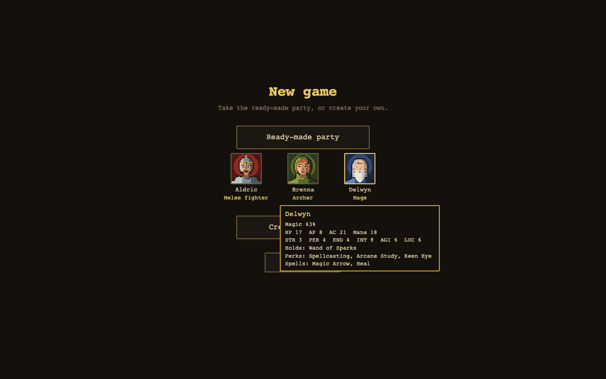

A new game first asks how you want to start:

- **Ready-made party**: three heroes built to work together. **Aldric** is a melee fighter with a longsword and shield, **Brenna** is an archer, and **Delwyn** is a mage who casts Magic Arrow and Heal. Hover over a portrait to see what that hero can do.
- **Create your own**: start with empty places and fill them yourself.

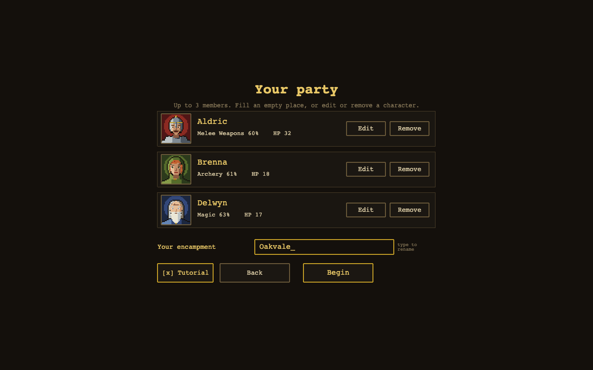

Either choice takes you to the roster, which has one row for each place in the party. You start with three places. Members can be **edited** or **removed**. An empty place can be filled in two ways: **Create** opens character creation, and **Preroll** offers a ready-built hero.

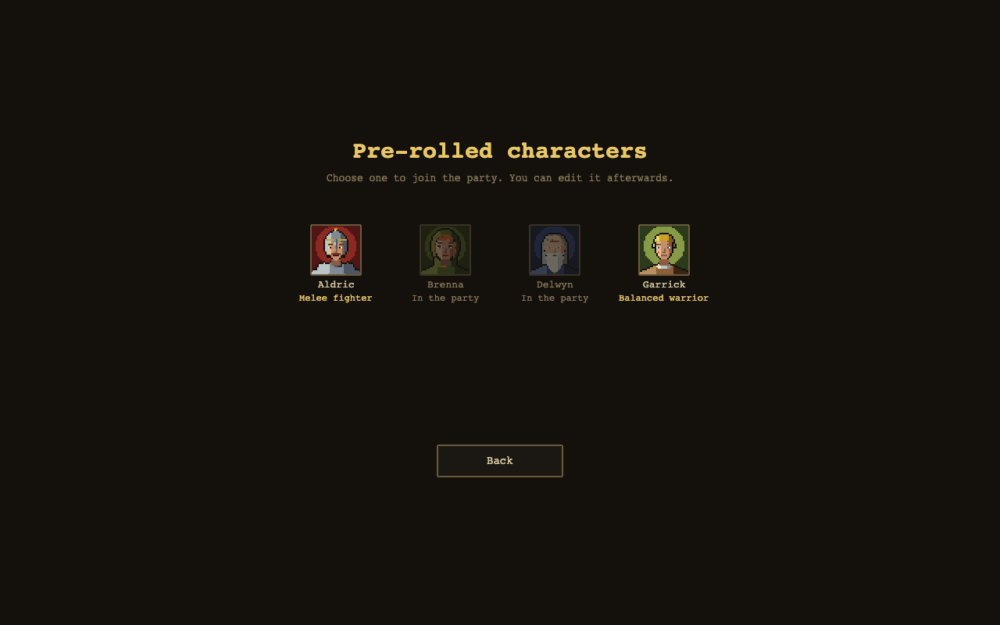

A pre-rolled hero who is already in the party is greyed out, because every name in the party must be unique. When the party is ready, press **Begin**. The game takes the first empty save slot, or asks which slot to overwrite if all three are full.

---

## 2. Creating a character

Creation has four steps. You can move through them with **Next** and **Back**, or jump to any step with the tabs along the top. The column on the right always shows what the character will be: hit points, action points, armour class, critical chance, mana, and each skill.

### Attributes

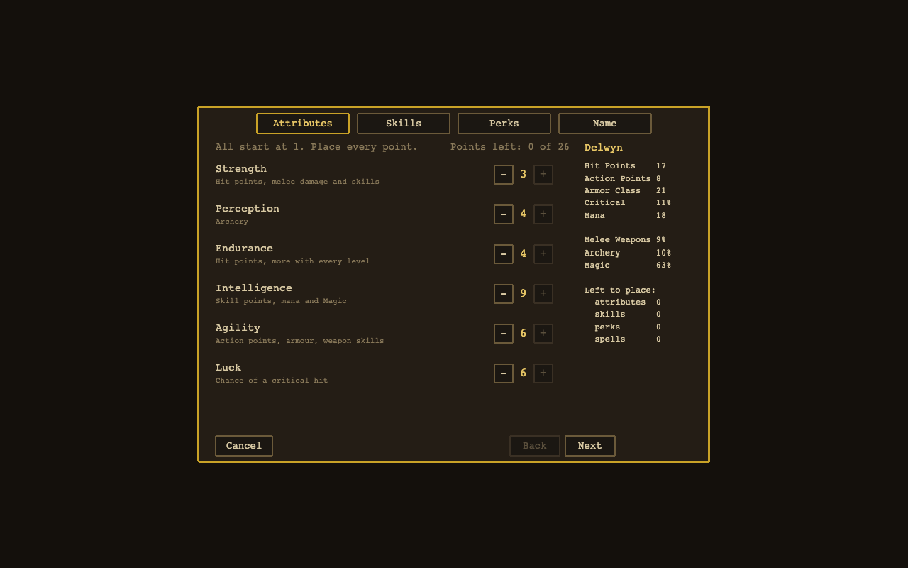

Every attribute starts at 1, and you have **26 points** to place. You must place all of them, and no attribute can go above 10. Hold **+** or **−** to repeat.

| Attribute | What it gives |
| --- | --- |
| Strength | Hit points, melee damage, Melee Weapons skill |
| Perception | Archery skill |
| Endurance | Hit points, and more hit points with every level |
| Intelligence | Skill points each level, mana, Magic skill |
| Agility | Action points, armour class, the weapon skills |
| Luck | Chance of a critical hit |

The budget is tight. Raising one attribute to 10 leaves room for two at about 7 and the rest low. Perks can raise attributes later, from level 3 onward.

### Skills

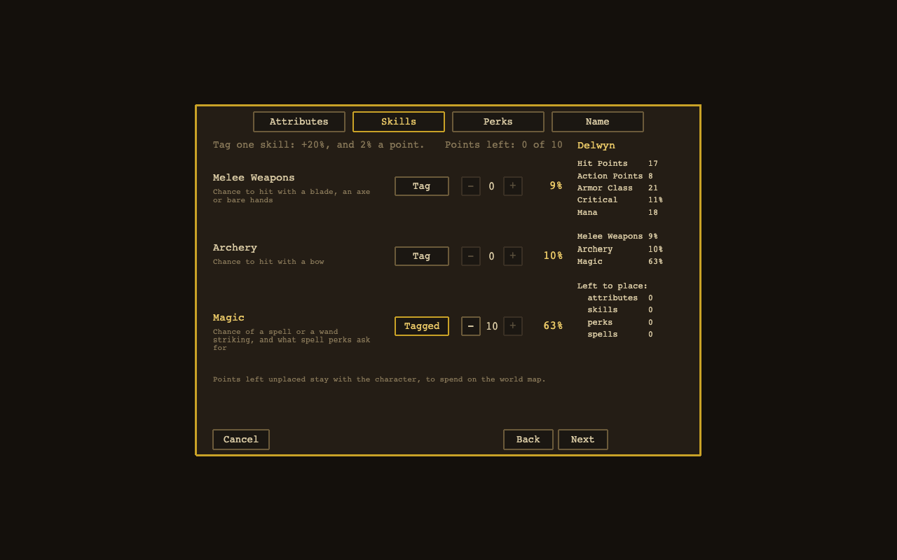

There are three skills, each a percentage:

- **Melee Weapons**: your chance to hit with a blade, an axe or bare hands.
- **Archery**: your chance to hit with a bow.
- **Magic**: your chance of landing a spell or a wand shot. Spell perks also require a minimum Magic.

Skills start low and are set by attributes alone. **Tag** one skill: tagging adds 20% to it and makes each skill point raise it by 2% instead of 1%. You then have **10 skill points** to place. Above 80% a raise costs 2 points, and above 90% it costs 3.

An untrained skill sits near 10%, and against an armoured foe that becomes the minimum 5% chance to hit. A hero who specialises (tags a skill, puts all 10 points into it and takes its skill perk) starts at around 60%.

### Perks and spells

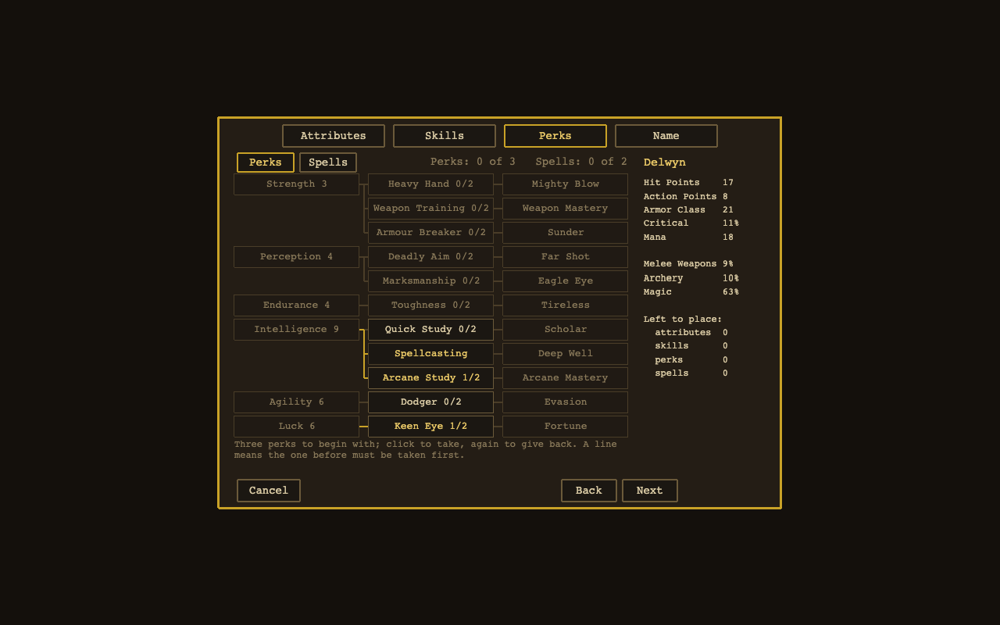

You have **3 perk picks**. The perk tree has a branch for each attribute. Click an open perk to take it and click it again to give it back. A line between two perks means the one on the left must be taken first. Section 11 lists every perk.

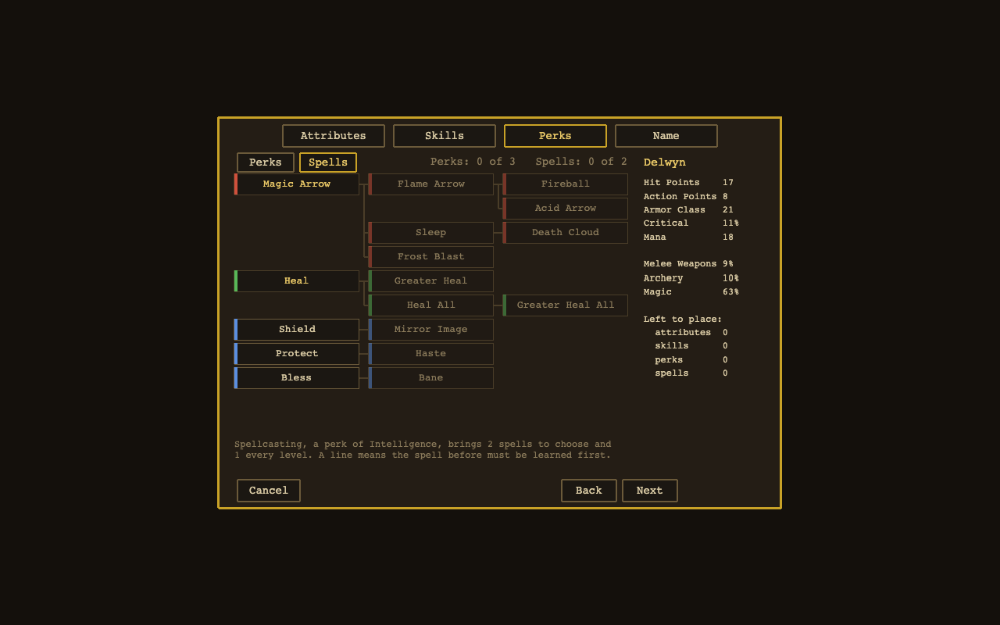

Taking **Spellcasting** (an Intelligence perk that needs 40% Magic) opens the spell tree and gives **2 spell picks**. Use the **Perks / Spells** switch at the top left to move between the trees. Spells come in three schools, each marked by the colour on its node: red for offence, green for healing and blue for support.

If a change you make leaves a perk you already took without its requirements, that perk is dropped and its pick returned, and the screen says so.

### Name and face

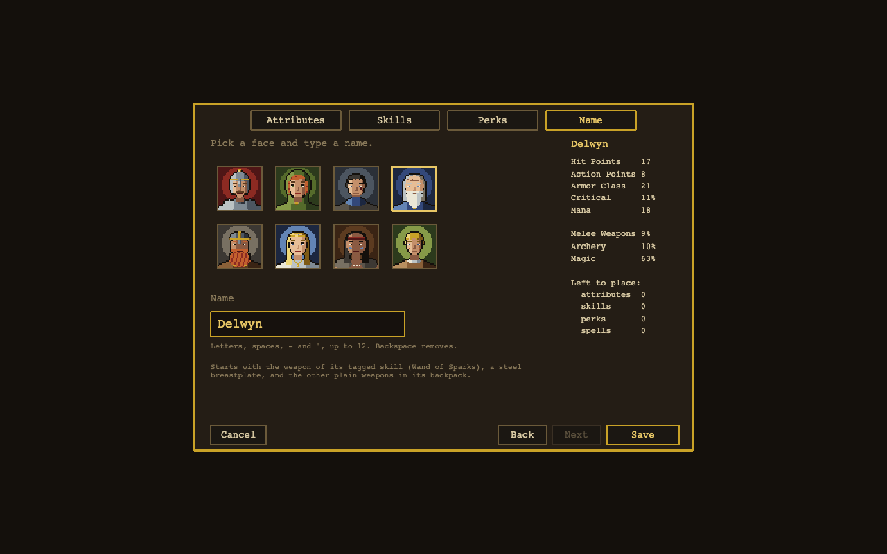

Pick a portrait and type a name of up to 12 letters. Gear is not chosen: every hero starts holding the weapon of their tagged skill, wears a steel breastplate, and carries the other plain weapons in their backpack.

Any skill points or picks you leave unspent stay with the character, and you can spend them later on the world map.

---

## 3. The world map

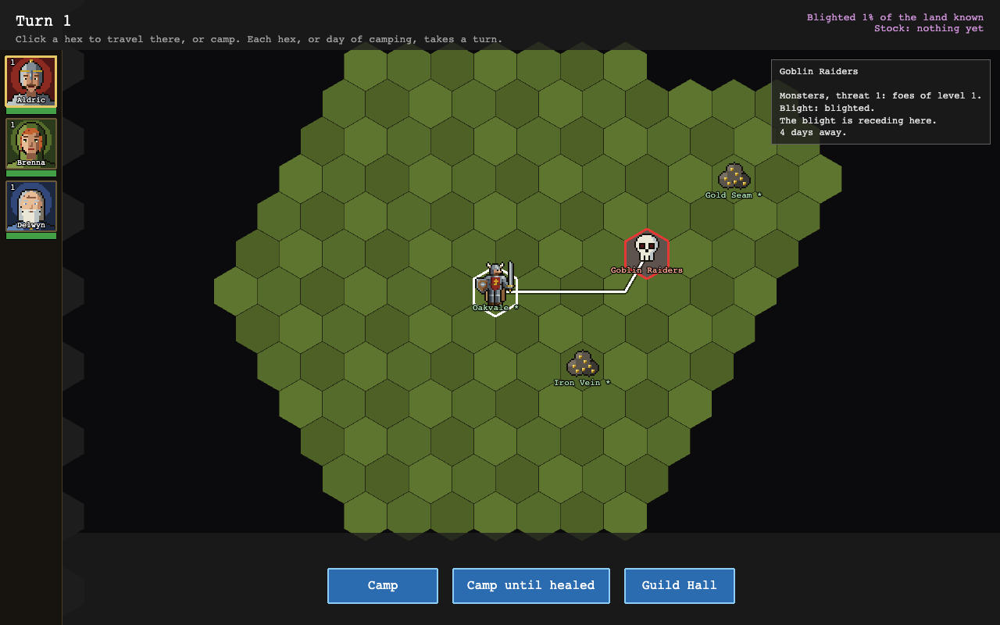

The world map is a large board of hexes, many screens wide, and the view scrolls to follow your party. Your heroes' portraits run down the left side. The header shows the turn number, how much of the explored land is blighted, and the encampment's **stock** of materials.

**Time passes only when you act.** Each hex you walk and each day you camp takes one turn, and each turn the blight takes another day to spread (see [The blight](#8-the-blight)).

### Travel

Click a hex to travel there. Hovering over a hex first shows the route. The party walks one hex per turn and stops early if something important happens on the way, such as monsters coming into view, a site you hold falling under threat, or monsters standing in the road. Routes avoid known monster lairs unless the lair is where you are going.

### Fog of war

Black hexes have never been seen. The party sees 5 hexes around it, Oakvale 6, a town you hold 3, a resource you hold 2, and a watchtower 8. Land you have seen but cannot see now is drawn under a veil, showing the state it was in when you last saw it. Once you have spotted a monster lair it stays on your map. The Source of the blight is known from the start.

### Places

- **Oakvale**, your encampment, which is home to the guild hall and the shrine.
- **Towns** and **resources** (Iron Vein, Gold Seam, Timber Stand and others). A held site's name is starred and drawn in green. A site under threat is drawn in orange, along with the number of days left until it falls.
- **Monster lairs**, marked with a skull, each with a **threat** from 1 to 5. The further a lair is from Oakvale, the higher its threat.

### Monsters

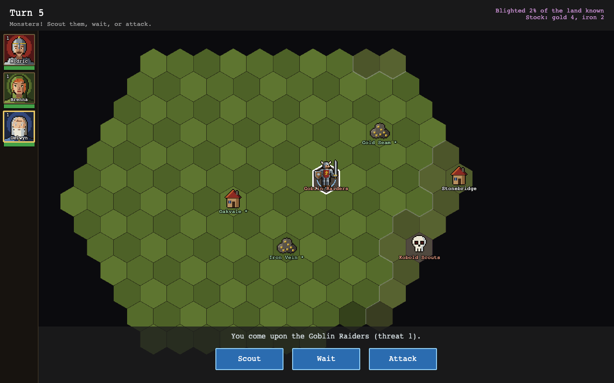

When you walk onto a monster lair, the footer offers three actions:

- **Attack** starts a battle.
- **Scout** and **Wait** each pass a turn without fighting. Neither does more yet.

You can also click a hex to walk away.

### Camping and other actions

When there are no monsters on your hex, the footer offers:

- **Camp**: rest for a day. Each day of camping heals every hero 1 hit point and refills every caster's mana.
- **Camp until healed**: your healers cast their heals with the mana they have, then the party camps a day and casts again, repeating until everyone is whole. Anything important that happens breaks camp.
- **Build Watchtower** or **Build Outpost**, where the land allows (see [Building](#9-building)).
- **Guild Hall**, at Oakvale.

---

## 4. The character panel

Press **C**, or click the portrait of the hero marked in gold, to open the character panel. It has four tabs. On the world map you can spend everything in it freely. In battle you can see everything, but you can only change gear, and each change costs an action point.

| Key | Tab |
| --- | --- |
| C | Character |
| S | Skills |
| B | Spells |
| I | Inventory |
| P | Perk tree (from Skills) |
| K | Spell tree (from Spells) |
| Esc | Close, or step back from a tree |

To switch the panel to another hero, click their portrait on the left.

### Character

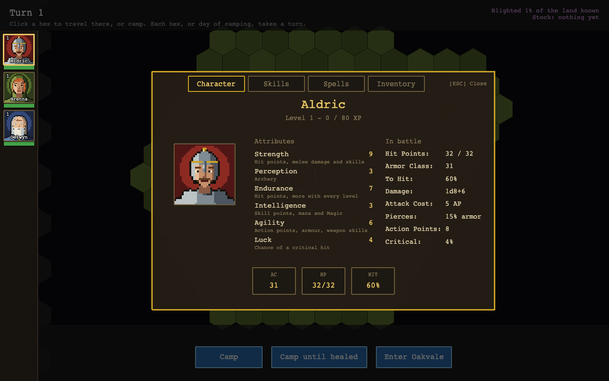

This tab shows the hero's attributes, their level and experience, and what they fight with: hit points, armour class, chance to hit, damage, attack cost, how much armour their blows pierce, action points and critical chance.

### Skills and perks

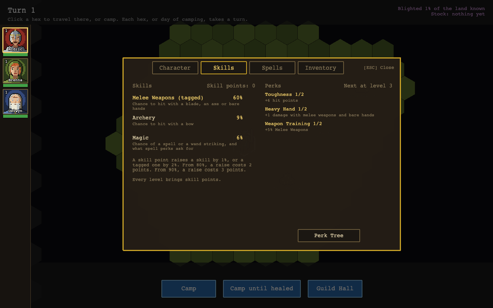

When the hero has skill points to spend, a **+** appears beside each skill. The tab lists the perks the hero has taken. Press **Perk Tree** (or P) to choose new ones.

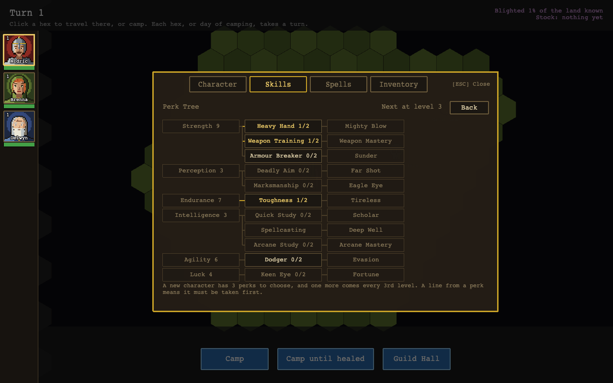

Perks you can take now are drawn brightly, and a taken perk shows its ranks (for example 1/2).

### Spells

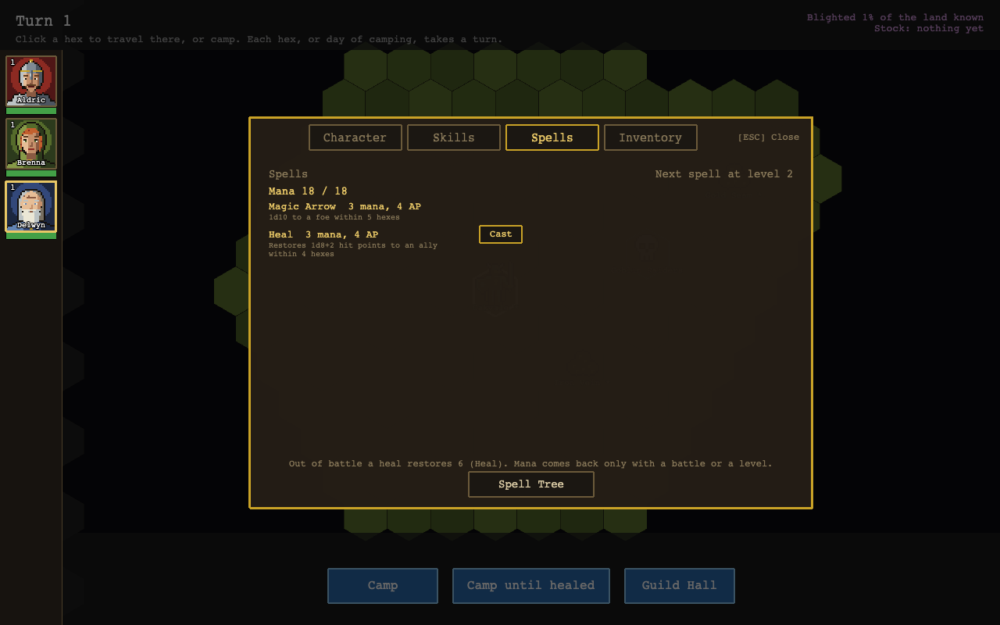

This tab lists the spells the hero knows and the mana they are carrying. On the world map, the **Cast** button beside a heal casts it out of battle. A heal on one hero asks you to click that hero's portrait. A heal cast on the world map always restores the average of its dice. **Spell Tree** (or K) opens the spell tree.

### Inventory

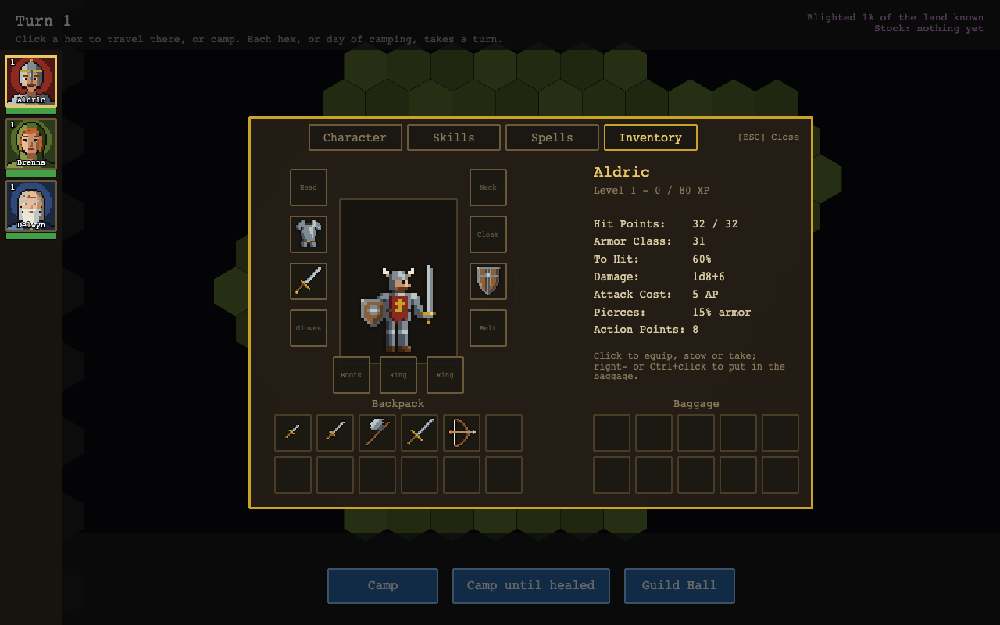

The paper doll shows what the hero wears: head, neck, body, cloak, both hands, gloves, belt, boots and two rings. Below it is the backpack.

- **Click** a backpack item to equip it, or click a worn item to stow it.
- On the world map, the right-hand grid is the party's shared **baggage**, which has no size limit. Click an item there to take it. **Right-click** (or Ctrl+click) an item to put it in the baggage. This is how you pass items between heroes.
- In battle, the right-hand grid is the **ground** under the hero. Right-click to drop an item, and click to pick one up.
- A two-handed weapon (the bow, the greatsword) and an off-hand item cannot be held together. Equipping one stows the other.
- A ring goes in whichever ring slot is free.

---

## 5. Battle

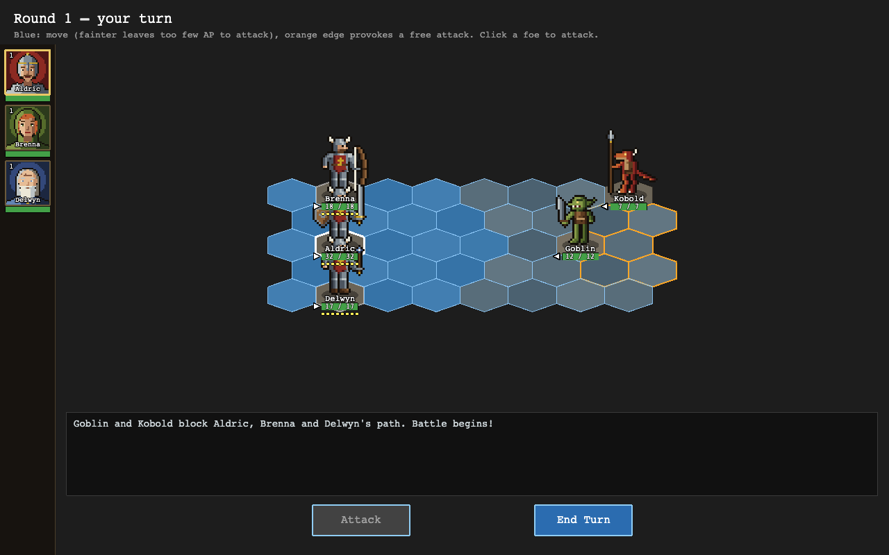

A battle starts with your party on the left and the foes on the right. Each side takes its turn in full. On your turn, your heroes act in any order and as often as their action points (AP) allow. Press **End Turn** when you are done.

The log at the bottom records every roll. The header tells you whose turn it is.

### Selecting and moving

Click a hero, or their portrait, to select them. The selected hero is marked in gold. The board then shows where they can go:

- **Blue** hexes are in reach. A **fainter** blue hex is in reach but would leave the hero too few AP to attack.
- An **orange edge** marks hexes inside a foe's zone of control (see below).

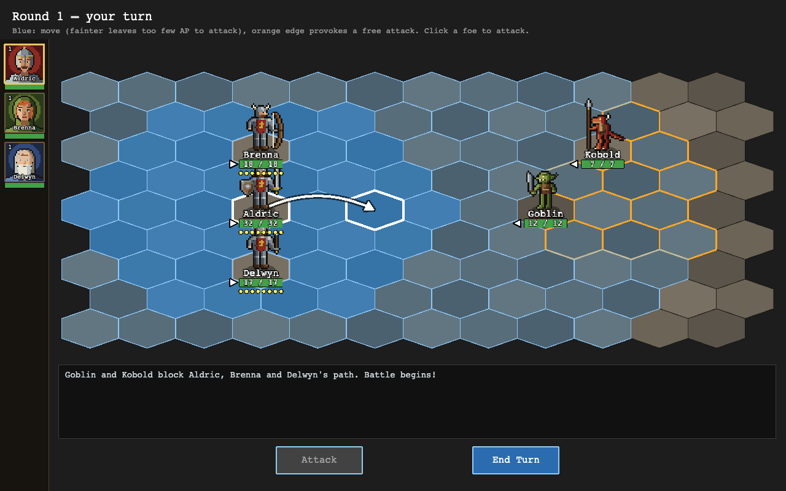

Hover over a hex to see the path, then click to move there. Each hex costs **1 AP**. A hero usually has **8 AP** a turn (5 plus half their Agility). Facing is automatic: a unit turns as it moves, attacks and casts.

### Attacking

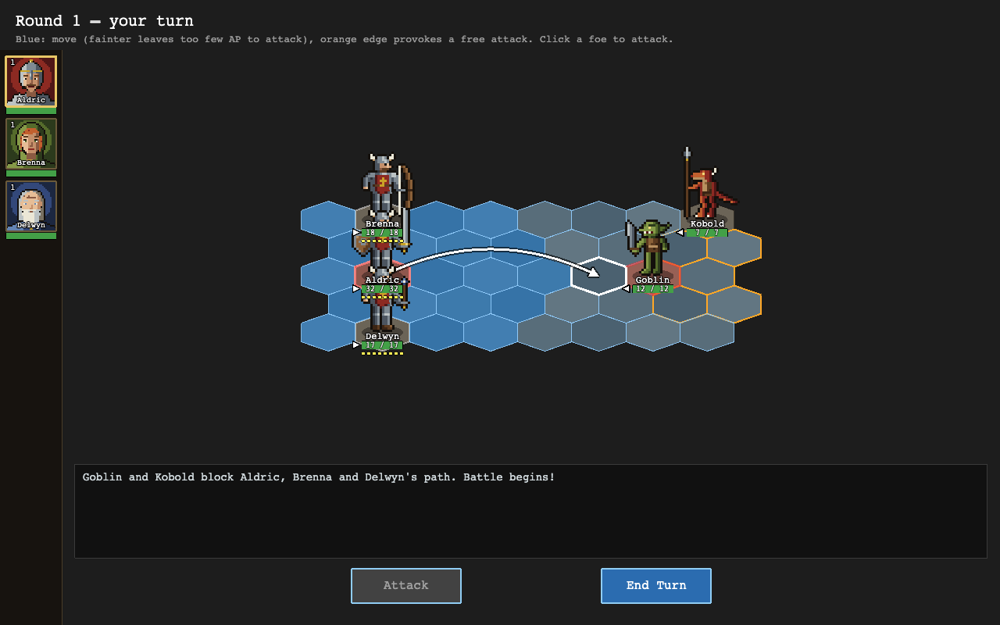

**Click a foe** to attack it. If it is out of reach, the hero first walks into range along the path shown, then strikes. The weapon decides both the cost and the reach:

| Weapon | Damage | AP | Reach | Pierces armour |
| --- | --- | --- | --- | --- |
| Iron Dagger | 1d4 | 3 | 1 | 20% |
| Iron Shortsword | 1d3+1 | 4 | 1 | 10% |
| Iron Longsword | 1d8+3 | 5 | 1 | 15% |
| Iron Battle Axe | 1d12+2 | 6 | 1 | 25% |
| Steel Greatsword (two hands) | 2d6+3 | 7 | 1 | 25% |
| Yew Bow (two hands) | 1d6 | 4 | 5 | — |
| Wand of Sparks | 1d6 | 5 | 4 | — |

A weapon costing 4 AP or less lets a hero who stands still attack twice in one turn.

### How a hit is rolled

Every attack rolls 1 to 100. It **hits** if the roll is at or under:

> skill + bonuses − the foe's armour class

The chance is always kept between 5% and 95%. A hit is **critical** if the roll also falls within the attacker's critical chance. The bonuses are:

- **Flanking**: +10% for each other ally standing next to the target.
- **Arc**: +5% from the foe's side and +10% from its rear. For a ranged attack, the arc is judged by the hex next to the target that the shot comes in over.
- **Helpless**: +20% against a sleeping target.

**Armour piercing**: melee blows ignore part of the foe's armour class (see the table above, and the Armour Breaker and Sunder perks). This makes heavy weapons the answer to heavy armour. Bow shots, wand shots and spells pierce nothing.

### Zones of control and free attacks

A foe holding a **melee** weapon controls the hexes next to it. **Leaving** one of those hexes gives that foe one free attack on you. Each foe gets at most one free attack per enemy turn. Ranged units, wand-wielders and sleepers have no zone of control. Pathfinding prefers routes that provoke the fewest foes, and the orange edges show where the danger is. Your heroes threaten the enemy in exactly the same way.

### Changing gear in battle

Press **I** to open the inventory for the selected hero. Equipping, stowing, dropping and picking up items share a single cost of **1 AP**, paid once. Further changes are free until the hero moves, attacks or ends the turn.

### Battle keys

| Key | Does |
| --- | --- |
| Click | Select a hero, move, or attack |
| M | Open the Cast list (heroes with magic) |
| 1–9 | Pick a spell from the open list |
| I / C / S | Inventory / Character / Skills panel |
| Esc | Close the spell list, cancel aiming, or open the menu |

### Victory and defeat

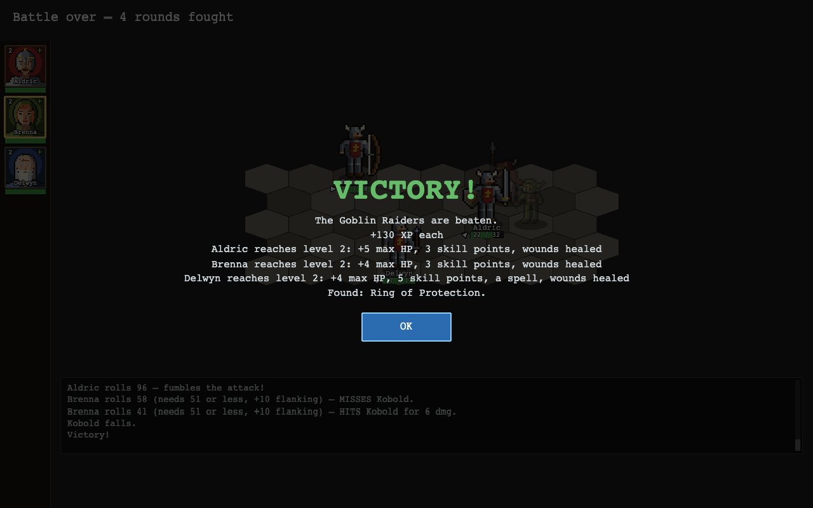

You win when every foe has fallen. Every surviving hero earns the full experience reward. The lair disappears from the map, the land around it is cleansed, and its loot goes into the baggage.

**Death is permanent.** A hero who fell in a battle you won is gone for good. Their gear goes to the baggage, and the party fights on smaller until the guild hall fills the place. If **every** hero falls, the game is over and its save is deleted.

Wounds carry over from battle to battle. Heal before you go looking for the next fight.

---

## 6. Magic

A hero who knows a spell has **mana**: twice their Intelligence, plus half their Intelligence for each level after the first, plus whatever their gear and perks add. Every battle starts with full mana. Mana spent in battle does not come back until the battle ends. Whatever a winner has left is carried onto the world map, where it can be spent on heals. A day of camping or a new level refills it.

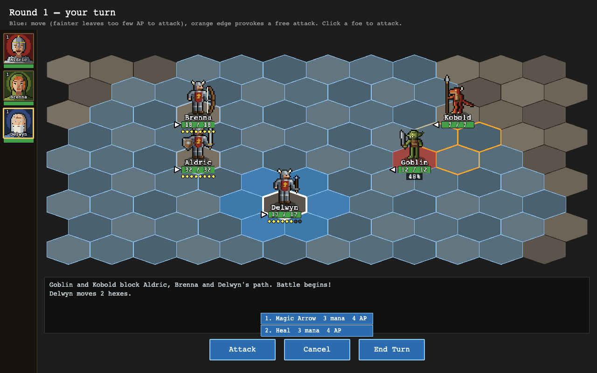

To cast, select the hero and press **Cast** (or M). Pick a spell by clicking it or pressing its number. A spell you cannot cast right now is greyed out, for example because no target is in range or the hero lacks the AP or mana.

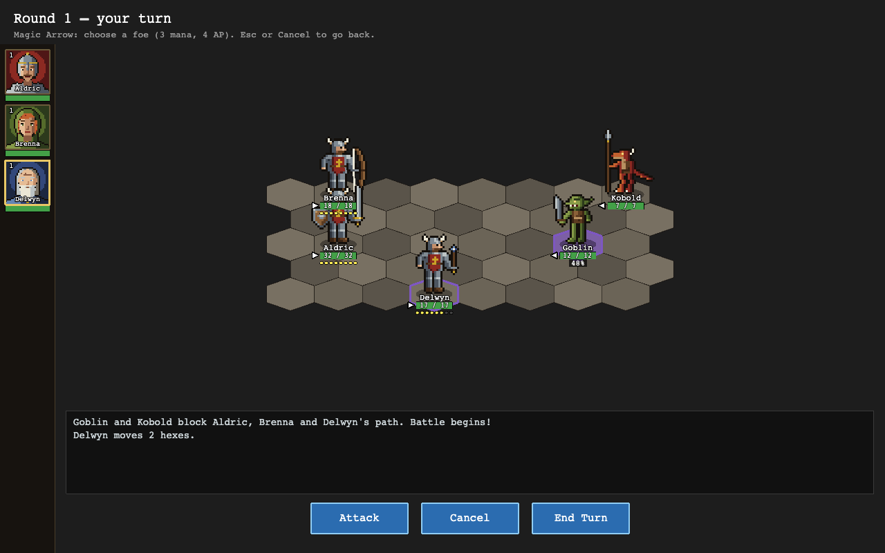

The spell then asks for a target. Valid targets are outlined, and hovering over one shows your chances. Press **Cancel** or **Esc** to back out.

- **Hostile spells** roll to hit like an attack, using the caster's Magic skill. Flanking and facing add nothing, so spells are the reliable strike while blades reward good positioning.
- **Area spells** touch **everyone** in the area, including your own heroes and the caster. Hovering over the centre of an area outlines it and shows the odds for every unit inside.
- **Friendly spells** never miss.

### Lasting effects

The letters beside a unit's health bar show its current effects. An effect lasts for that unit's own turns. Casting the same effect again keeps whichever duration is longer, and different effects stack.

| Effect | What it does |
| --- | --- |
| Asleep | No AP, no zone of control, easy to hit. Any damage wakes it. |
| Chilled | −3 AP for a turn |
| Corroded | −5 armour class, 1d4 damage a turn |
| Poisoned | 1d6 damage a turn |
| Shielded | +15 armour class |
| Protected | +10 armour class |
| Blessed | +10 to hit |
| Baned | −15 to hit |
| Hasted | +3 AP |
| Mirrored | Images take the next hits, and a hit on an image deals no damage |

Damage over time strikes at the start of the affected unit's side's turn. Section 11 lists every spell.

---

## 7. Growing stronger

### Experience and levels

Winning a battle gives every surviving hero the experience its foes were worth. Stronger and higher-level foes are worth more, and each level costs more experience than the one before. Heroes waiting in the guild hall's reserves earn nothing.

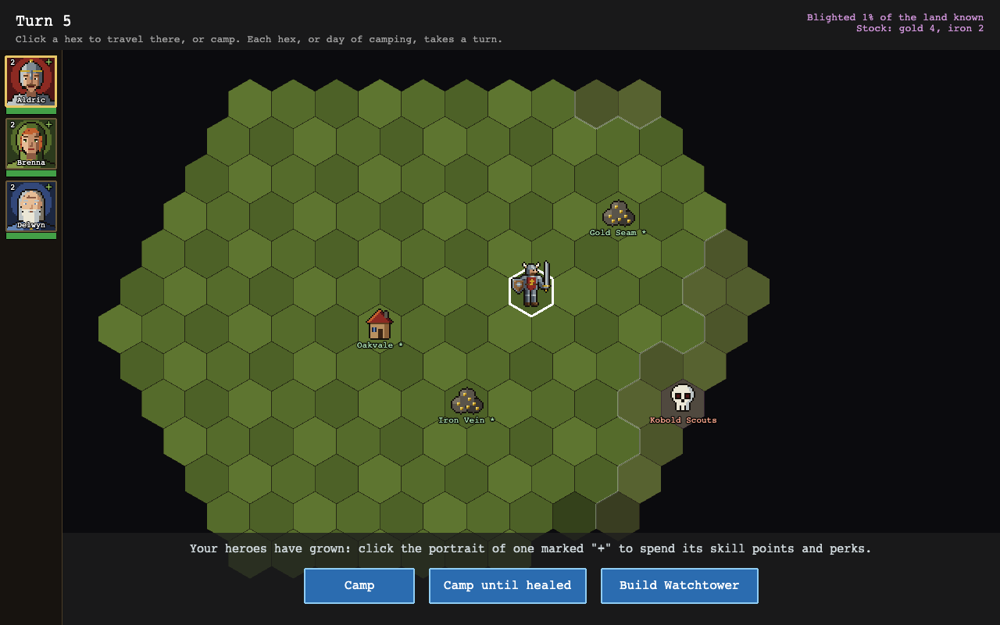

Each new level:

- raises maximum hit points (by 2 plus half the hero's Endurance) and **heals the hero fully**, refilling their mana as well
- gives **skill points**: 2 plus a third of the hero's Intelligence
- gives a **perk pick** every 3rd level (3, 6, 9 and so on)
- gives a **spell pick**, for a hero who has Spellcasting

A **+** on a portrait means that hero has something to spend. Spend it from the character panel on the world map, since nothing can be spent in battle.

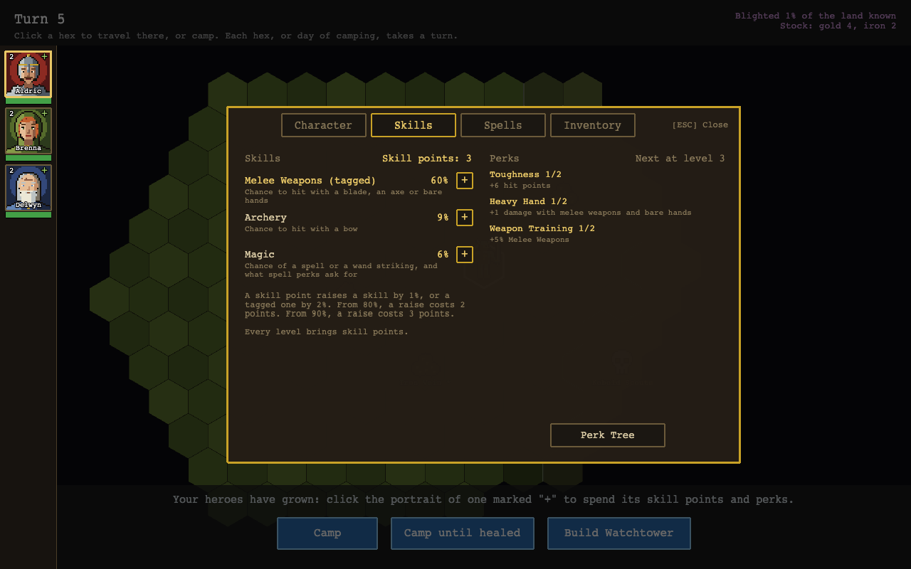

### Building a hero

There are no classes. A hero is defined by their attributes, the skill they tagged and the perks they chose. Each attribute's branch of the perk tree has:

- a **trunk** perk that raises the attribute by 1, for two ranks, from level 3 onward
- perks that open at level 1
- **masteries** at level 6 that need 8 in the attribute

A hero born with an attribute of 7 can reach that attribute's masteries by taking its trunk perk.

---

## 8. The blight

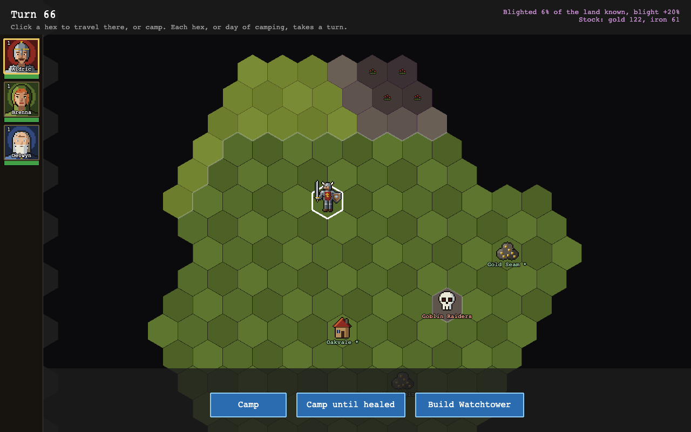

Every hex of land has a blight level from 0 (clean) to 3 (corrupted), shown as a tint over the grass. Corrupted land also shows dark growths. Every day, sources of influence push on the hexes around them, and their strength fades by a point for each hex of distance:

- **Pushing the blight forward**: monster lairs (more strongly the higher their threat), the Source itself, and corrupted land spreading to its neighbours. The blight grows stronger over time, by a tenth every 30 days.
- **Pushing it back**: Oakvale (stronger with its shrine), every town and resource you hold (stronger with an outpost), every watchtower, and the party itself, which grows stronger as the heroes level up.

Consequences:

- **Corrupted land breeds new monster lairs.** A new lair's threat depends on how far from Oakvale it appears.
- **Winning a battle cleanses the land** around the lair, lowering every hex within 1 + its threat by two levels.
- **Towns and resources** are captured when their land is clean (level 0) and lost when it reaches level 2. While the blight gains on a site, the map shows it in orange with the number of days left until it falls. A watchtower can be lost the same way.
- **Stock**: every 5 days, each site you hold adds its yield to the encampment's stock (gold, iron, timber, silver and so on). A site whose land is tainted yields half.

The header's percentage counts only the land you have explored.

---

## 9. Building

The stock pays for everything you build.

| Building | Where | Cost | Time | Effect |
| --- | --- | --- | --- | --- |
| Watchtower | Clean land off any location, 4+ hexes from other towers | 10 iron, 5 gold | A day | Sees 8 hexes and pushes the blight back. New lairs will not spawn close to it. |
| Outpost | A held town or resource without one | 15 gold, 10 timber | A day | The site resists the blight more strongly and yields more. Lost with the site. |
| Shrine | Oakvale (Guild Hall screen) | 20 gold, then 40 gold + 15 silver, then 80 gold + 30 silver | Instant | Each level strengthens Oakvale against the blight |
| Guild hall | Oakvale (Guild Hall screen) | 30 gold + 15 iron, then 60 gold + 30 iron | Instant | Party limit 3, then 4, then 5 |

If you click a build button without enough stock, the game tells you the cost.

### The guild hall

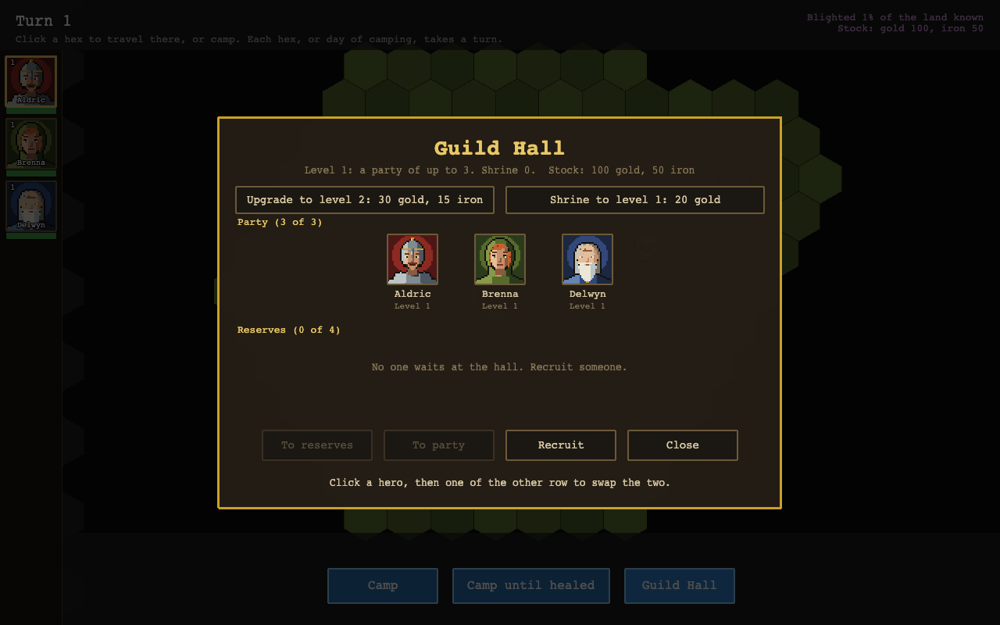

At Oakvale, the **Guild Hall** button opens this screen. It shows your party, the reserves waiting at the hall, and the upgrades for the hall and the shrine.

- **Click a hero** to select them. Then click a hero in the other row to swap the two, or use **To reserves** / **To party**.
- **Recruit** hires a new hero for **10 gold**, who joins the reserves.

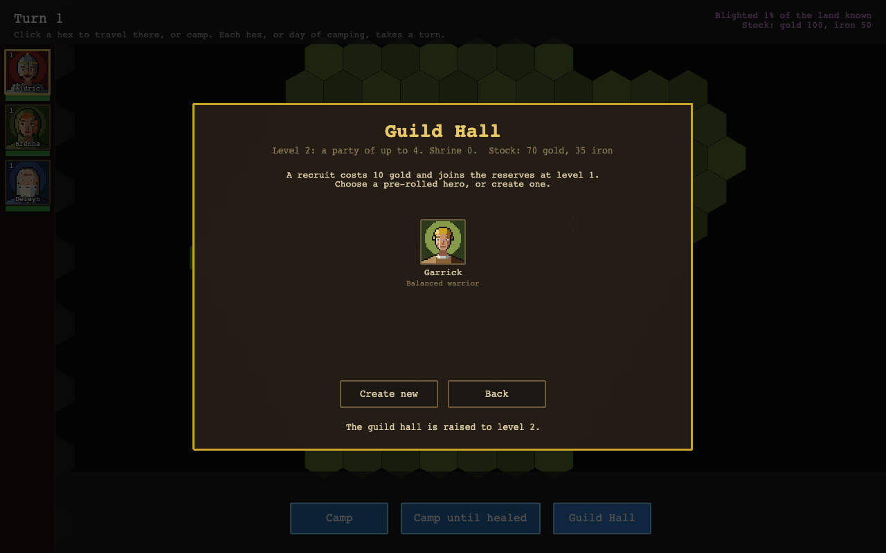

You can recruit one of the pre-rolled heroes not already in your company, or **Create new** to make one with character creation. A recruit joins at the hall's level or your party's lowest level, whichever is lower, with that level's points left for you to spend.

---

## 10. Winning, losing and saving

- **Victory**: beat the guardians of the **Source**, far in the east. They fight at threat 5 and are led by the **Blight Horror**, which claws through armour and casts Death Cloud and Bane. Plan to arrive with heroes around level 7. After the victory you can **End** the game or carry on in **endless** mode.
- **Defeat**: the game ends if your whole party falls in a battle, or if Oakvale falls to the blight.

**Saving is automatic.** Each playthrough lives in one of three slots, and there is no save button. The world map saves after each journey, camp and panel change. A battle saves at the start of each of your turns, so reloading during a battle rewinds to the start of that turn with the same dice. A defeat deletes its slot.

**Seeds**: add `?seed=42` (or any number) to the game's address to fight every battle in that session with fixed dice.

---

## 11. Reference

### Spells

| Spell | School | Mana | AP | Effect |
| --- | --- | --- | --- | --- |
| Magic Arrow | Offence | 3 | 4 | 1d10 to a foe within 5 hexes |
| Flame Arrow | Offence | 5 | 4 | 2d8 to a foe within 5 hexes |
| Sleep | Offence | 5 | 4 | A foe within 5 hexes sleeps for 2 turns, helpless until hurt |
| Frost Blast | Offence | 6 | 5 | 1d8 and −3 AP for a turn to everyone within 1 hex of a point within 4 |
| Fireball | Offence | 10 | 6 | 3d6 to everyone within 1 hex of a point within 6 |
| Acid Arrow | Offence | 7 | 4 | 1d8 to a foe within 5 hexes, then −5 AC and 1d4 a turn for 3 turns |
| Death Cloud | Offence | 10 | 6 | Poisons everyone within 1 hex of a point within 5: 1d6 a turn for 3 turns |
| Heal | Healing | 3 | 4 | Restores 1d8+2 to an ally within 4 hexes |
| Greater Heal | Healing | 6 | 4 | Restores 2d8+4 to an ally within 4 hexes |
| Heal All | Healing | 8 | 5 | Restores 1d8 to each ally within 2 hexes of the caster |
| Greater Heal All | Healing | 14 | 6 | Restores 2d8+2 to each ally within 2 hexes of the caster |
| Shield | Support | 3 | 2 | +15 AC to the caster for 3 turns |
| Protect | Support | 3 | 3 | +10 AC to an ally within 4 hexes for 3 turns |
| Bless | Support | 4 | 4 | +10 to hit for each ally within 2 hexes of the caster, for 3 turns |
| Mirror Image | Support | 6 | 3 | 3 images of the caster take the next 3 hits, for 3 turns |
| Haste | Support | 7 | 4 | +3 AP to an ally within 4 hexes for 2 turns |
| Bane | Support | 5 | 4 | −15 to hit for everyone within 1 hex of a point within 5, for 3 turns |

Spells further out in a school need the spell before them, and their tier asks more: level 1 and 40% Magic, then level 3 and 55%, then level 5 and 70%.

### Perks

| Branch | Perk | Effect |
| --- | --- | --- |
| Strength | Heavy Hand | +1 melee damage |
| | Weapon Training | +5% Melee Weapons |
| | Armour Breaker | Melee blows pierce 15% of armour |
| | Mighty Blow | +2 melee damage |
| | Weapon Mastery | +10% Melee Weapons |
| | Sunder | Melee blows pierce 20% more armour |
| Perception | Deadly Aim | +1 ranged damage |
| | Marksmanship | +5% Archery |
| | Far Shot | Ranged weapons reach 2 hexes further |
| | Eagle Eye | +10% Archery |
| Endurance | Toughness | +6 hit points |
| | Tireless | +1 AP every turn |
| Intelligence | Quick Study | +10% experience |
| | Spellcasting | Opens the spell tree: 2 spells now and 1 every level |
| | Arcane Study | +5% Magic |
| | Scholar | +2 skill points every level |
| | Deep Well | +6 mana |
| | Arcane Mastery | +10% Magic |
| Agility | Dodger | +5 armour class |
| | Evasion | +10 armour class |
| Luck | Keen Eye | +5% critical chance |
| | Fortune | +10% critical chance |

Each branch also has its trunk perk, which gives +1 to the attribute per rank. The perks in the right-hand column of the tree are the level 6 masteries, which need 8 in their attribute. Most of the other perks have two ranks.

### Magic items

Lairs hold loot. Among the items you may find:

| Item | Effect |
| --- | --- |
| Wand of Storms | 1d10+1, 5 AP, reach 5, uses Magic skill |
| Emberblade | 1d8+4, 5 AP, +10% to hit, pierces 15% |
| Hawkeye Bow | 1d6+2, 4 AP, reach 6, +10% to hit |
| Ring of Protection | +5 AC |
| Ring of Fortune | +5% critical chance |
| Amulet of Focus | +10% to spell chance |
| Sage's Circlet | +6 mana |
| Cloak of Shadows | +10 AC |

---

*The screenshots are taken from the running game by `npm run manual:screenshots`, which plays through `e2e/manual.shots.ts`. Run it again after changing how a screen looks.*
